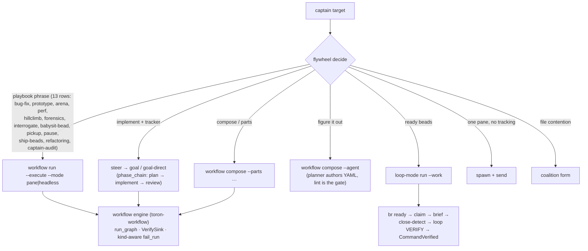

# flywheel

Multi-agent swarm orchestrator with **pluggable backends** (default: **herdr**
multiplexer + **toron** coordination) — an NTM-parity daily loop for
opencode / pi / grok. Spawn swarms, dispatch the daily-driver stages (P1→P8),
monitor states, checkpoint progress. Tracker: **br/bv**.

Three operating modes, one engine:

| Mode | Contract | Default path |
|------|----------|--------------|
| **open-mode** | Direct. Current pane. No crew, no loop, no graph. | Your harness tools. If the task needs durability or lanes, stop and name loop or swarm. |
| **loop-mode** | Durable solo execution. Crash-resume. | `--work`: beads from `br ready`. A bead may name a workflow (`## WORKFLOW <builtin>`), which the loop runs through the engine. |
| **swarm-mode** | Captain + crews + waves. | `flywheel workflow compose --parts wave-swarm --run --mode pane` — the playbook *is* the recipe (GATE→DISPATCH→OBSERVE→VERIFY→SIGNOFF). Manual `spawn` + `send` lanes are the escape. |

`flywheel decide "<target>"` classifies a target and prints the exact argv.
37 built-in workflows, 24 seed stages, and the compose grammar
(`--parts`, `--from-yaml`, `--agent`) are reachable from every door.

## Install

```bash
cargo install --path . --force
```

Config: `~/.config/flywheel/config.toml` (see `config.example.toml`).
Copy [`.env.example`](.env.example) → `.env` for local backend overrides
(`.env` is gitignored). Default stack needs a running herdr server
(herdr.sock) — `flywheel deps` checks everything.

> Re-install after pulling: workflow-surface features resolve from the
> installed binary, not your working tree.

## Control flow



Every execution path ends in the same place: the bead closes only after the
loop's VERIFY records `CommandVerified`. In-graph verify writes a **workflow
receipt** — evidence, never a close.

## The workflow engine

Workflows are YAML graphs (or `steps:` lists, which desugar to chain graphs at
parse time — one canonical shape, park-safe everywhere: `request_approval`
suspends the run on the graph path exactly as it did on the linear path).

```yaml
graph:
  nodes:
    repro:      { action: dispatch_job, spec: {...}, on_error: fail_run }
    fix:
      action: call_workflow
      workflow: repair-until-verified
      needs: [repro]
      inputs: { verify: "cargo test -p crate", max_iterations: 3 }
    prove:
      action: dispatch_job
      spec: { profile: "@reviewer", phase: review }
      needs: [fix]
      on_error: fail_run
```

Failure is classified, never guessed. A failing step returns
`{ok:false, error, kind, retryable, resumable, disposition, retry_after_ms}`:

| kind | meaning | fail_run behavior |
|------|---------|-------------------|
| `rate_limit`, `timeout` | transient provider pain | **retry the same node** with backoff (bounded by the enclosing `retry`, default 3), then escalate |
| `auth`, `billing` | account/config | abort — retry re-bills nothing |
| `blocked` | reservation/slot held | abort — repair cannot unblock a HARD hold |
| `cancelled`, `unknown` | operator / unclassified | abort |

Work-quality failure (a red test) is **not** a kind. It routes to the repair
recipe: `repair-N` (fresh-context worker) → `evaluate-N` (independent
evaluator returning `{done, remaining_work, failures, validation_evidence}`)
→ `verify-N` (the `VerifySink` runs your VERIFY command under the cargo slot
and writes a workflow receipt). Bounded by `max_iterations`; exhaustion emits
kind-14 + `remaining_work` and fails honestly.

The engine never shells out, never calls `br`, never writes
`command-verified`. Those belong to the loop.

## The durable loop (loop-mode)

```bash
flywheel loop-mode run <project> --work
```

Each poll: `br ready` → claim → brief → claim-watch → close-detect → loop
VERIFY. The planner is a total reducer — `tick(&LoopModel, &LoopMsg) →
(LoopModel, Vec<LoopAction>)` — pure, journal-backed, and replayable:

```bash
flywheel loop replay <project>   # re-drive recorded facts, assert identical actions
flywheel loop why <seq>          # inspect one decision: msg → state delta → actions
```

Facts that drive the reducer:

| Fact | Source | Consequence |
|------|--------|-------------|
| `LedgerFact` (claimed/closed/reopened/blocked) | close-detect | phase transitions; close-detect → VERIFY |
| `PaneStalled {reason, evidence_tail}` | herdr status + scrollback evidence | classified `rate_limit` / `network` / `model_truncated` / `silent_idle`; watching tier warns early, Diagnose tier acts |
| `LeaseLapsed {path}` | renewal leaf | reservation renewal before dispatch; lapse is loud, never silent |
| `Reclaim` | pane exited + budget exhausted | reservation released by reason, audit comment, bead reopened — never `br close` |
| `GitFact` | pre-commit guard | every attributed commit lands in the fact journal |
| mail-health counter | renew/lease failures | 3 consecutive failures stop dispatch + escalate (kind-14); first success resumes |

Illegal transitions are unrepresentable: `Verify` without a detected close,
`Complete` without `CommandVerified`, `Complete` while wave-held, dispatch to
a working agent without `--force`, reclaim of a bead another pin holds — each
is a compile-level `IllegalTransition`, table-tested.

## Reliability spine

- **FailureKind classifier** — spawn/send/headless failures are classified
  (`Auth | RateLimit | Timeout | Blocked | Provider | Cancelled | Unknown |
  Billing`) from a signature table that only extends by pattern; no-match is
  `Unknown` with raw evidence. Reroute is bounded: one hop per failure class
  per task, on pane and headless alike; second same-class failure goes
  terminal with the evidence attached.
- **Funded preflight** — providers with a balance endpoint are checked before
  dispatch; a $0 account fails the mode naming provider and profile. No
  endpoint → honest `skip` (classifier + fallback cover first dispatch).
- **Mail-health floor** — 3 consecutive lease/mail failures stop new dispatch,
  escalate to the captain, and hold until a success. The reservation
  invariant is present-or-loud, never silently absent.
- **Launch idempotency** — compose and spawn take deterministic keys
  (`run_id`/bead); a replay after a crash converges instead of minting a
  second crew. A dead pane under a live key is a miss that respawns, not a
  stuck handle.
- **Plane tripwires** — secrets sent toward a public plane, or job-assign
  bodies sent gift-wrapped, fail at send time with the named remedy.
  `--unsafe-plane` overrides and is audited. Publicity is the sender's
  explicit act; the default stays private.
- **Evidence over claims** — the VERIFY gate refuses closes whose filter
  matches zero tests; workers write receipts, the loop writes verdicts; a
  worker `br close` on a loop-owned bead is reopened.

## Doorbell (peer wake)

One workspace, one supervised `toron watch` dispatcher (crash-survivable,
lazily healed, `flywheel doorbell status` for liveness). Kind-9 `@pin`, jobs,
reservation conflicts, and channel join/leave ring the target pane as a single
`[doorbell]` line; the agent pulls the body. Plane-P mail stays sealed —
delivery emits a metadata-only ring (from-pin, thread, importance; never
content). Budget 5/30/3 with per-channel queues, rolling windows, and a
microsecond high-water; the filter is deliberately tight (reactions are not
wake-worthy).

## Command map

| Group | Commands |
|---|---|
| Swarm lifecycle | `init spawn add list status kill attach zoom` |
| Operator loop | `send interrupt view watch work loop-mode run/status/list/prune/doctor/replay/why` |
| Evidence | `artifacts <run_id> [--json]` · `artifacts stitch <run_id>` · `ledger check/receipt` |
| Assignment | `assign` (agent-mail bead dispatch) |
| Coordination | `mail inbox/send/locks/unlock/conflicts/agents` + `contact` + `product` |
| Patterns | `debate`, `plan-review`, `xproj` (cross-project fan-out) |
| Workflows | `workflow {list,lint,run,compose,new,crew,history}` — 37 builtins, compose grammar (`--parts`, `--from-yaml`, `--agent`, `--run` idempotent) |
| Cron | `cron {lint,run,list,show,pause,resume,status,history,start,remove}` (standalone YAMLs) |
| Coalitions | `coalition {form,status,intent,reserve,negotiate-*,detect,auto-coalesce,disband}` |
| Fleet | `squad` · `profile` · `model` · `stage` · `runs` · `doorbell {status,start,stop,re-inject}` |
| Durability | `checkpoint timeline audit history changes resume analytics` |
| Safety | `safety guards policy` |
| Ops | `deps config upgrade tutorial serve` |
| Automation | `--robot-snapshot --robot-status --robot-capabilities` (+ `--json` everywhere) |

## Scenarios

**Red verify does not kill the run.** `workflow run bug-fix --execute --mode
pane --inputs '{"symptom": "...", "repro": "..."}'`: repro fails loudly,
`tdd`/`fix` run through `repair-until-verified`; a red verify unrolls
`repair-2` with a fresh-context worker and an independent evaluator instead of
aborting; `prove` is a different-model reviewer.

**Provider dies mid-swarm.** A scout spawn returns `402`. The classifier marks
it `Billing` (never retried), marks the attempt FAILED with evidence, hops to
the profile's fallback chain once, and writes the audit row. The captain sees
why the crew shape changed.

**Pane freezes mid-bead.** The agent goes silent past the stall threshold. The
loop samples the pane tail, classifies `model_truncated`, emits `PaneStalled`
at the watching tier, then Diagnose → Respawn with the evidence attached. A
provider outage is distinguishable from a worker slacking.

**Lease lapses under a claimed bead.** The tick renews live leases before
dispatch; a lapse emits `LeaseLapsed`, and three consecutive mail/lease
failures stop new dispatch and escalate — the reservation floor is present or
loud.

## Design patterns

- **Fact fabric, not polling.** Producers append facts; `tick` is a pure
  reducer; leaves interpret actions. Replay is the purity witness.
- **Classified failure, not guessing.** One taxonomy spans engine and CLI;
  signature tables extend by pattern only; no-match fails terminal with
  evidence.
- **Evidence over claims.** VERIFY gates, receipts, hash-bound approvals
  (`evidence_hash` — a different hash is a different question). Worker
  self-rating is stored and never admitted.
- **Anti-forgery spine.** `CommandVerified` is loop-only; the engine cannot
  `br close`; the graph cannot mint a verdict.
- **At-most-once vehicles.** Idempotent launch keys and pre-spawn markers —
  convergence beats hopeful retries.
- **Fail in the safe direction.** Tripwires block the hazardous direction;
  publicity is explicit; the private default cannot be misrouted into.
- **Subtract before you add.** Dead built-ins are deleted, not documented.

## Durability (Resonate)

The loop runs as a **durable Resonate workflow** (requires a Resonate server,
default `http://localhost:8001` — installed as the launchd service
`com.flywheel.resonate`; sqlite state survives reboots). Every poll, send, and
sleep is a checkpoint: kill the loop process mid-run and `flywheel loop-mode
run <project>` with the same flags **resumes the same invocation**. State is
queryable via `flywheel loop-mode status <project>`; `flywheel loop-mode list`
shows the live-loop pid registry and `flywheel loop-mode prune` cleans dead
entries. `--local` runs the plain sync loop; `--once` does a single poll pass.

Poll cadence: `--interval N` (default 300) settled; `--interval-active N`
(default 30, floor 5) while anyone works or right after a dispatch. Blocked
alerts land within one active interval.

## Command map (legacy aliases)

`flywheel loop run` still works as an alias for `loop-mode run`. Stages
resolve semantic or p-code (`p1` = fresh-eyes-explore). `send --stage NAME
--param k=v` substitutes template slots; a missing required slot exits
naming it.

## Backend protocol (herdr default)

Socket protocol v19, one JSON-RPC request per connection (newline-delimited);
`events.subscribe` keeps a long-lived stream. See `src/herdr.rs` /
`src/backend/herdr.rs`.

## Collaboration patterns

| Pattern | Command | Contract |
|---------|---------|----------|
| Debate | `flywheel debate "<proposition>" --rounds 3` | A/B + judge, thread `debate-<ts>` |
| Plan→review→implement | `flywheel plan-review <project> "<feature>"` | APPROVE/CHANGES/VERIFIED/REJECT; paper-first |
| Cross-project | `flywheel xproj send …` | product + contact; `--to-project` handshake, then name-based delivery |
| Peer-triggered | spawn (doorbell ON) | kind-9 `@pin` / job / request-release → `[doorbell]`; agent pulls |
| Workflow run | `flywheel workflow run <name> --execute --mode headless\|pane` | declarative graph; role-conditioned dispatch; model-injected |
| Coalition | `flywheel coalition form <goal> --crews <squad>` | intent protocol: declare → soft-conflict → propose → negotiate |
| Cron | `flywheel cron start` | standalone scheduled primitive; body composes workflows; durable-sleep |

## Changelog / releases

Generated with [git-cliff](https://git-cliff.org) (Keep a Changelog +
Conventional Commits):

```sh
git cliff -o CHANGELOG.md          # regenerate
git cliff --unreleased             # preview pending entries
git cliff --bump                   # release: bump, tag, write
```

## Exit codes

0 ok · 1 herdr/server error · 2 usage error. stdout = data, stderr = messages,
`--json` for machine output (color auto-disabled when piped / `NO_COLOR`).

## Roadmap

**Open:**
- Loop `--engine` parity gate (`bd-3aen`) — six hardened-loop scenarios
  bar-for-bar on `--engine` vs legacy, then the full loop-as-durable-workflow
  migration.
- Loop reliability (`bd-bvwf.1–.5`) — orphan workspaces, first-poll detection,
  stray loop processes.
- On-demand `cron run` completion — the scheduled durable loop remains the
  real path.
- Deferred backlog (`bd-rwbn`, frozen) — pa harness, metered routing,
  governance, deep federation.

Feedback: open an issue at https://github.com/bangedorrunt/flywheel/issues
