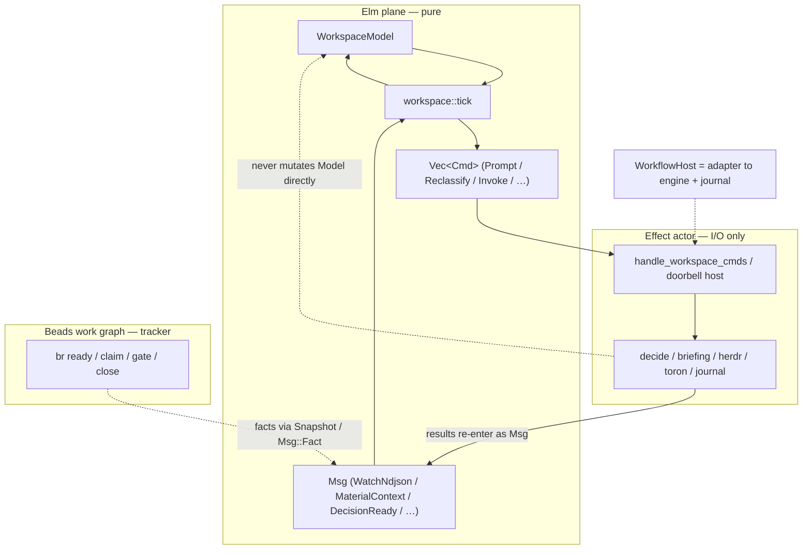

# Orchestration

ADR-0005 + 0010 + 0011 + 0012. Authoring: [docs/workflow-authoring.md](../workflow-authoring.md).

| Noun | Command |
|------|---------|
| profile | `flywheel profile {list,show,create,edit,run,remove}` — 6 built-ins (oracle/planner/reviewer/coder/scout/housekeeper) |
| squad | `flywheel squad {list,show,spawn,remove}` (`recipes list` alias) |
| workflow | `flywheel workflow {list,show,lint,run,new,history,crew,compose,remove}` — every catalog verb takes `--project` and resolves built-ins < user < project tiers |
| cron | `flywheel cron {lint,run,list,show,pause,resume,status,history,start,remove}` — distinct YAML type |
| model | `flywheel model {list,show,add,remove}` |
| runs | `flywheel runs {list,show,pending,digest}` |
| coalition | `flywheel coalition {form,status,disband}` — pane-crew-only |
| steer | `flywheel steer "<target>" [--direct] [--project p]` |
| open mode | `/open-mode`: direct work in the current pane; no crew, durable loop, or swarm lifecycle |
| loop mode | `/loop-mode` / `flywheel loop-mode run`: durable solo execution in one current harness; `--work` opts into tracked work |
| swarm mode | `/swarm-mode`: captain-led multi-crew execution with parallel lanes; loop supervision is optional |
| doorbell | workspace `__doorbell` (ADR-0005 Layer 0). Spawn starts it. `flywheel kill` stops it. `/peer-aware-mode` attaches. Shared by loop-mode and swarm-mode when enabled. |

## Functional effect-kernel discipline (ADR-0016)

All orchestration paths still obey one Elm boundary: external observations become `Msg`, `tick` returns `Cmd`, interpreters perform effects, and results re-enter as `Msg`. Do not add policy to a runtime brain, CLI helper, or persistence projection. Time and environment are sampled at effect boundaries and injected; `Unknown` never becomes success; queue acceptance never becomes provider delivery; Jev remains advisory. The full review checklist is [effect-kernel discipline](./effect-kernel.md).

## Session door (ADR-0011)

`flywheel arrive <project> --as <pin>` then `flywheel briefing "<target>" --project 
 --json`. `--commit` runs argv. `decide` is the classifier leaf (emits `topology`; `"2 crews"` becomes `--crew 2`). A live fleet proposes join, not a second compose.

## Classifier leaf

`flywheel decide "<target>" --json` is the classifier inside briefing (`src/decide.rs`). Run the returned `argv`. Do not skip arrive+briefing. Do not re-derive the table in prose.

| primitive | argv |
|-----------|------|
| captain-audit | `workflow run captain-audit --execute --mode headless` |
| loop-work | `loop-mode run <project> --work` |
| steer / steer-direct | `steer` / `steer --direct` |
| compose-parts / compose-agent | `workflow compose --parts` / `--agent` |
| coalition-form | `coalition form` |
| spawn-send | `spawn --profile` (never `add --oc`) |
| cron-start | `cron start` |

`workflow run` without `--execute` records control-flow only (no pane dispatch). Real work needs `--execute`. `--mode` default is **headless**. `steer` always `--execute --mode pane`. `/swarm-mode` pins `compose --parts wave-swarm --run` (do not casually re-run decide until a material event). `/loop-mode` pins `loop-mode run <project> --work`.

## Mid-session reclassify (GS-048)

Doorbell wakes ≠ classify. On **material** context (AUTHORITATIVE objective change, explicit topology ask, new work-unit class, classifier miss, stage-chain exhaustion then continued asks): re-run `decide --json` + `workflow list --brief` + `stage list`, announce `vehicle: …` or `none: raw`. Sticky-open airtight (GS-049): preserve open unless loop/swarm/join is explicit; catalog miss must not invent-flip open→none; hold loop against swarm without explicit; sticky-held open clears invent workflow/argv (no invent `wave-swarm` headless under open). Tick Law: `Msg::MaterialContext` → `Cmd::Reclassify` (effect runs decide; GS-050 stable journal `effect_key` — retries keep the same key, ADR-0032 I8a) → `Msg::DecisionReady` announce. CLI: `flywheel reclassify "<goal>"` ticks MaterialContext (sticky-open) then prints briefing. Non-material Channel/Job wakes stay Prompt pull-hints only. Elm deepen: `workflow evaluate` is evaluate-without-commit; ActionStage on phase-bearing failures; sensor→Msg vocabulary in the doorbell guide (docs only).

## Operating topologies

These are not interchangeable with workflow definitions:

- **open**: immediate work in the current harness; no orchestration lifecycle.
- **loop**: one current harness drives one objective durably. A queue or named
  workflow may be the work source. `--work` selects the bead-backed variant;
  beads are not required for loop mode generally.
- **swarm**: a captain coordinates multiple crews/panes and parallel lanes.
  It may use `loop-mode --work` for bead supervision, but peer wake does not
  depend on the loop.

A **workflow** is a reusable engine procedure. It can run inside open mode,
a loop, a swarm, headlessly, or directly; it is not itself an execution
topology.

Open mode is not workflow-blind: when the current pane is the intended
executor, use `workflow run <name> --execute --mode headless` for a bounded
one-shot, or pane mode with an existing workspace. Compose tokens remain
explicit and do not authorize spawning by themselves. On every follow-up or
material context change, re-read `workflow list --brief --json` and `stage
list`, select the smallest useful vehicle, or explicitly use `none: raw`;
do not reuse a first-prompt route after the task has changed.

Nested `call_workflow` runs are durable and now fail closed on recursive call
chains, maximum depth (`8` including the root), or exhausted child budget
(`32` child calls per lineage branch). The guard runs before `ctx.run` creates
the child and the lineage is carried in the serialized trigger for replay.

A **stage** is one prompt (`send --stage`). The verify-phase `ce-evaluate`
stage is advisory and structured; the following host `VerifySink` owns the
verdict. A **compose token** (`wave-swarm`, `repair-until-verified`) expands to a compiled-in
workflow when used as a bare `--parts` name. A **profile** is role →
harness/model; `crew: auto` counts `@roles`. `flywheel squad` /
`recipes list` is a group of profiles (spawn shape) — say "squad," not
"compose token."

**What a compose token is:** a bare name legal in
`workflow compose … --parts <token> --run` that expands to a compiled-in
workflow's steps, inline, at that position — one engine run, one artifact
trail. Preferred door: `workflow compose … --parts <token> --run`.
Legacy alias for compose tokens only: `workflow run <token> --execute`.
Ordinary builtins (e.g. captain-audit): `workflow run <name> --execute`,
NOT bare `--parts`. Other `--parts` forms: bare stage name, `role:stage`,
`phase:stage`, `workflow:name`, and the grammar forms (`each:`, `when:`,
`retry(n):`, `parallel:`). Stages referenced by spliced steps resolve
from the stage catalog (`stage list`).

## Execution modes (ADR-0010)

- **pane**: pre-spawn crew, `__send --confirm`, bus-auditable. `dispatch_job` live. `action: spawn` drains `SpawnSink` into `agent_start`.
- **headless**: `__run-headless` one-shot, logs `runs/<id>.jsonl`. Spawn must not fake 43001/43004.

## Run ledger + effect journal (ADR-0032 Spec 5/6/9)

`runs {list,show,pending,digest}` is the dashboard over the same state log `workflow history` and `cron history` read. ONE reader rule (`history_row_status`) decides a row's status at every door: a row that recorded none reads `unknown`, never a default `done`. Rows that **annotate** a run instead of recording one declare a `kind` — `phase-gate` (one ship-chain link), `loop-monitor` (the legacy loop monitor's start notice), `plan-warning` (the warn-first plan-artifact gate); they carry their real verdict, are skipped by `cron history`, and never count as run outcomes. Run rows carry terminal status + real project + failure artifact paths.

Effect journal: flywheel embeds the engine, so flywheel owns the journal. Every engine built for a run that really dispatches (`workflow run --execute`, `compose --run`, `cron run --live`, the cron daemon) gets a host-owned `EffectRunner` (`src/effect_journal.rs`): an effectful `job`/`mailbox` leaf commits prepared intent, claims the attempt, invokes its provider **exactly once**, then settles — or records `failed`/`unknown` through the engine's one ambiguity rule. Rows land in toron's `workflow_effects` tables, keyed by the engine boundary's own derivation (a retry reuses one key; two runs never collide on a byte-identical payload). A sink no provider performs is **not** journaled — the leaf keeps the engine's `bypassed-sink-uncovered` marker with a loud reason. Dry arms (`run` without `--execute`, `cron run` without `--live`) stay unjournaled on purpose: they perform no external effect. Mailbox leaves journal only on the in-process plane (a remote `[mail.toron] url` cannot carry `corr`).

The journal's honesty is carried by the engine's `EffectJournalMode` (`bd-engine-run-path-journaling-fwlx`, landed 2026-09-14): a constructor built for a run that really dispatches is `Enforced` — an effectful leaf with no injected runner **refuses** rather than dispatching unjournaled — while the dry arms stay `Recording`, where the marker means "recorded, not performed". `verify` journals through the same surface: the engine renders the command (so a templated `{{inputs.verify}}` reaches the sink resolved), runs the embedding's `VerifySink` first, and hands the already-executed result to the runner through `RunContext.provider_result` — the sink is the provider, so the row observes an effect that already happened and the command never runs twice. With no toron index open the engine keeps its loud marker, never a run that only looks journaled.

Run lifecycle: the journal is claimed in BOTH halves from one store (`effect_journal::journals`, `bd-mi9n`, ADR-0032 Spec 5/6 tail) — the effect runner AND a `RunJournal`. The engine reports its own run lifecycle (`Started` → `Running` → `Succeeded`/`Failed`) through the `RunJournal`, so a flywheel-driven run has a `workflow_runs` row with no embedding `create_run`/`cas_run_status` call, and the run row and its effect rows agree on `run_id` by construction (the engine supplies the same id to both seams). Idempotent by design, because a durable run replays: create-if-absent, CAS only when the status differs, a terminal row never moves — so a replayed tail cannot resurrect a finished run. Every journaled constructor passes it (`pane.rs` live arms, both `cron.rs` live engines); the dry arms pass `None`, since an engine that performs nothing must not mint a row claiming it ran. Best-effort by the effect path's rule: a journal failure is reported loud and never changes the run's outcome.
## Collaboration bootstrap (empty-fleet edge)

Any mode whose agent holds a registered mail identity but has no live
dispatcher (open mode especially, first agent on a task especially) must
bootstrap its own coordination, or the human becomes the mail relay:

1. **Arrive loudly** — check the roster (with recency; stale session
   identities are the same rot class as dead panes), then publish presence
   so the next agent discovers you.
2. **Captain ladder** — try the `captain` alias; unbound means the operator
   in the pane IS the captain channel (report in chat; mail is for peers).
   Never address a pin chosen by roster name-similarity.
3. **Arm an inbox watch** — `toron watch --live` or `mail inbox --since
   last` after each work unit; a write-only mailbox taxes the human.
4. **Mail discipline** — mint `corr` per thread, reply file-first, ack every
   `ack_required` message you acted on.

Canonical text lives in `integrations/prompts/open.md.tpl` (bootstrap
section) and `integrations/peer-aware.md.tpl` (boot-time arrival +
roster-recency invariants). Pending beads (2026-09-07 retrospective):
`bd-de9c` auto-bind `captain`; `bd-c29i` roster recency/prune;
`bd-fhf0` mail-surface honesty (read receipt, contact-request render,
corr re-use); `bd-jrlr` pin bootstrap templates; `bd-p0ed` verify-0005
drift.

## Profiles

All six built-ins default harness **omp**. Per-role models live in `profiles.toml` / `models.toml` — registry keys are composite `provider/model` (e.g. `[models."opencode-go/deepseek-v4-flash"]`); `Profile.provider` pins the composite key, bare ids fall back to the default provider (user file entries first, else alphabetically-first). Bare harness+model `spawn --model <id> [--provider 
]` (bd-j3so) is the lenient fallback for kind/count spawns without a named profile (registered ids route via composite, unknown ids pass through verbatim; `--provider` requires `--model`). `spawn --profile` writes the spawn-registry (behavior + skills). `profile run` / `squad spawn` use `profile_launch_args` (model/effort) and a **pane id**, never a workspace id.

## Captain briefing (bd-xe9r/bd-nmzk)

Interactive TTY `steer`, `workflow run --execute`, and managed mode commands prompt before dispatch — inferred crew counts (editable), per-role model menus w/ cost/caps from the registry, squad/bare-harness shape, stage-chain preview, go/no-go. Skipped by `--json`, `--yes`, or an explicit `--crew`; non-TTY dispatch is byte-identical. Shared prompt module `src/steer_brief.rs` (`source` fork only, `workflow_briefing_context` extracts `objective`/`goal`/`target` from `--inputs`); prompt logic is pure over injected IO.

## Hidden leaves

Never invoke `__*` except documented `__wait-output`.

## Which noun when (strategy surface, ADR-0028 E7)

| noun | is | choose it when | trail |
| --- | --- | --- | --- |
| **stage** | a payload unit (prompt + role/phase affinity) dispatched by `send --stage` | the INSTRUCTIONS are the value; one step, one crew member | `flywheel timeline` shows `stage=` per send |
| **workflow** | an execution procedure (steps/branches/verify) run by `workflow run/compose` | the CONTROL FLOW is the value: gates, retries, parallel arms, SIGNOFF | compose runs write artifacts |
| **compose token** | bare `--parts` name (`wave-swarm`, `repair-until-verified`); preferred `workflow compose … --parts <token> --run`; legacy `workflow run <token> --execute` | the CONTROL FLOW is the value and repeats across objectives | the composed run's artifacts |
| **profile** | role conditioning (harness/model/effort/behavior) referenced by stage/workflow/compose-token | always — model routing is strict; compose tokens/stages name profiles | model registry |

Announce the vehicle on every dispatch (stage / workflow / compose token / `none: raw`) — crews restate it in reports (2026-09-04 contract).

## Control planes (GS-048 diagram)

One Tick Law. WorkflowHost is an **adapter**, not an AgentServer/OTP actor.

- **Elm plane:** `(Model, Msg) → (Model, Vec<Cmd>)` — no I/O, no decide-inside-tick.
- **Effect actor:** applies Cmd; journals effects (ADR-0032); feeds DecisionReady / receipts back as Msg.
- **Beads:** work graph / close ceremony — not a second control plane.
- **REJECT:** Redis / AgentServer / OTP / dual peer-aware SoT as reclassify substrate.
