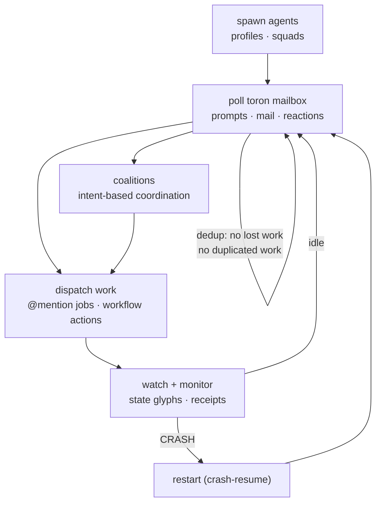
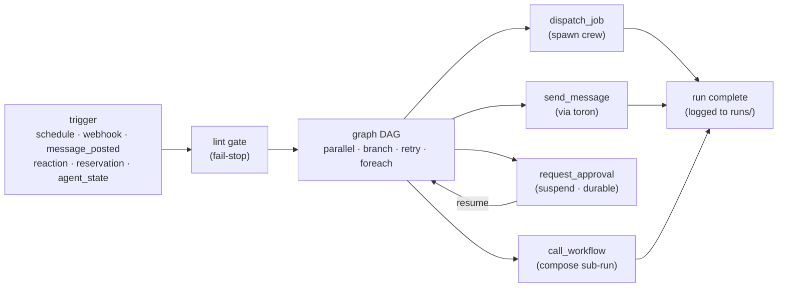
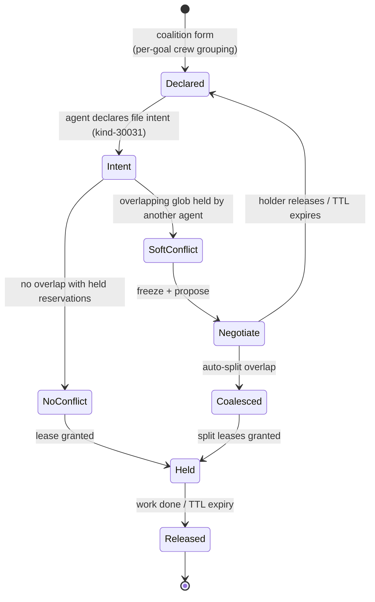

# ADR-0004 — flywheel Web Presence: Orchestration-Layer Presentation

| Field | Value |
|-------|-------|
| **Status** | Accepted (2026-08-13) |
| **Date** | 2026-08-13 |
| **Decision Maker** | Captain (bangedorrunt) |
| **Relates to** | toron ADR-0013 (website architecture — flywheel is a section of toron.dev), ADR-0005 (orchestration tier), ADR-0010 (execution wiring), ADR-0011 (coalitions) |
| **Governs** | `toron.dev/architecture` (flywheel section), `toron.dev/docs` (orchestration + recipes + workflow-authoring reference), `toron.dev/how-it-works` (flywheel diagrams D/E/F), `toron.dev/features` (Orchestration pillar) |
| **Companion** | toron ADR-0013 D5 (flywheel scope = section of toron.dev) |
| **Verification** | See §8 |

> **Relocation note (2026-08-14):** every "toron ADR-0013" reference below now
> lives in the **toron.dev repo** as
> [ADR-0001](https://github.com/bangedorrunt/toron.dev/blob/main/docs/decisions/0001-website-architecture-and-feature-presentation.md)
> (moved + renumbered). References are left in pre-move numbering as
> historical context.

---

## 1. TL;DR

flywheel is the **orchestration layer** that drives agent swarms on top of toron's mailbox + transport. It owns spawn/dispatch/monitor/loop, profiles/squads/workflows/cron, coalitions + intent-based coordination, the model registry, and headless/pane execution. flywheel's feature surface (ADR-0005/0010/0011) is as broad as toron's, but it occupies a different conceptual layer: **toron carries; flywheel drives.**

**Decision:** flywheel's web presence is a **section of toron.dev** (per toron ADR-0013 D5), not a standalone site. The site presents flywheel through: (a) a **layer-ownership table** on `/architecture` that cleanly separates toron's transport/trust/record responsibilities from flywheel's orchestration responsibilities; (b) a dedicated **Orchestration pillar** on `/features`; (c) three flywheel-specific diagrams on `/how-it-works` (the durable loop, coalition lifecycle, steer/compose flow); and (d) full orchestration docs in the Fumadocs reference (workflow-authoring, profiles, cron, recipes). This ADR also documents the **spin-out path** — the conditions under which flywheel graduates to flywheel.dev.

---

## 2. Background & Motivation

### 2.1 What flywheel is

flywheel is a Rust CLI (`~/.local/bin/flywheel`) — a herdr-backed swarm orchestrator with a durable monitoring loop built on Resonate. The loop (`flywheel loop run <project>`) polls the swarm, dispatches work to idle agents, sleeps durably, and exits when the queue drains. Crashes resume by re-running the same command — no lost work, no duplicated work (last-sent registry dedup).

flywheel's full feature surface (per ADR-0005/0010/0011 + skill):

1. **Durable monitoring loop** — Resonate-backed; spawn → poll → dispatch → watch → crash → resume → dedup. Confirmed sends, stall escalation, crew-execution claim watchdog, blocked-escalation protocol, context respawn, state-file contract.
2. **Profiles** (6 built-ins: oracle/planner/reviewer/coder/scout/housekeeper) — role templates with behavior preamble + model + harness.
3. **Squads** (recipes) — groups of profiles for a task.
4. **Workflows** — YAML DSL: triggers (schedule/webhook/message_posted/reaction/reservation/agent_state) × actions (spawn/dispatch_job/send_message/call_workflow/parallel/branch/retry/foreach/delay/request_approval). Graph DAG, lint gate.
5. **Smart cron** — self-reporting + failure→bead→fixer loop; durable-sleep scheduler.
6. **Coalitions** (ADR-0011) — ephemeral per-goal crew grouping; intent protocol (declare → soft-conflict → propose → negotiate); pane-crew-only.
7. **Model registry** (ADR-0010) — per-role model selection, effort tuning, retry-on-429.
8. **Execution modes** — pane (interactive/durable/bus-auditable) vs headless (autonomous/cron/local-only/logged).
9. **Steer** — `flywheel steer "<target>"` = one compose call; bead-tracked (`goal`) or direct (`goal-direct`).
10. **Compose** — `flywheel workflow compose "<target>" --parts "..."` — deterministic assembly from existing parts.
11. **Beads integration** — br/bv pass-through (`work triage/next/ready`); the loop feeds ready beads to idle agents.
12. **toron mail surface** — full MCP-parity mail (`flywheel mail inbox/reply/ack/search/summarize/...`); the loop wakes idle agents with urgent mail.
13. **Cross-project fan-out** — `xproj send/request` into another project's orchestrator.

### 2.2 Why a section, not a standalone site

The captain's grilling (toron ADR-0013 D5) locked: **flywheel is a section of toron.dev.** Rationale:

- flywheel is meaningless without toron — it has no transport layer of its own
  (ADR-0003 se2.3: `MailSurface` lives in toron-core; flywheel consumes it).
- The unified brand ("toron carries, flywheel drives") is stronger than two
  half-sites for a project at this stage.
- A layer-ownership table cleanly separates the two, and deep-links let visitors
  drill into either layer.

### 2.3 The spin-out trigger

flywheel graduates to flywheel.dev when **any** of:
- flywheel gains a user base that arrives for orchestration, not for toron's
  mailbox (different acquisition funnel).
- flywheel supports backends other than toron (e.g., a non-Nostr coordination
  surface) — at which point the "toron carries" coupling weakens.
- The orchestration docs + recipes + workflow-authoring guide grow large enough
  to warrant their own information architecture (projected: >50 workflow recipes
  + a full profiles marketplace).

Until then: one site, one brand, a section.

---

## 3. Decision

### V1 — Layer-ownership table on /architecture

The `/architecture` page (toron ADR-0013 D12) includes a **layer-ownership table**
that is the canonical "who owns what" reference:

| Concern | toron | flywheel | br/bv |
|---|---|---|---|
| Mailbox, transport, identity | **owns** | consumes | — |
| NIP-17 gift-wrap, NIP-49 keys | **owns** | — | — |
| Durable workflow engine (Resonate) | **owns** (toron-workflow crate) | drives via triggers/actions | — |
| @mention jobs (43001-43006) | **owns** | dispatches via `dispatch_job` | — |
| File reservations, build slots | **owns** | acquires/releases | — |
| Git archive (system of record) | **owns** | — | — |
| Federation (relays) | **owns** | — | — |
| Spawn, dispatch, monitor, kill | — | **owns** | — |
| Durable monitoring loop | — | **owns** | consumes (ready beads) |
| Profiles, squads, model registry | — | **owns** | — |
| Workflows, cron, coalitions | — | **owns** | — |
| Steer, compose | — | **owns** | — |
| Bead tracking (issues, deps) | — | pass-through | **owns** |

Each row links to the relevant doc page.

### V2 — Orchestration pillar on /features

The `/features` page (toron ADR-0013 D12) includes an **Orchestration pillar**
covering flywheel's surface:

| Feature | Visual pattern | Diagram |
|---|---|---|
| Durable monitoring loop | The loop state machine + crash/resume counter | **E** (flowchart) |
| Profiles + squads | 6-role card grid (oracle/planner/reviewer/coder/scout/housekeeper) with model badges | — (component) |
| Workflows | YAML snippet + trigger→action graph | **W** (flowchart, below) |
| Smart cron | Schedule → trigger → self-report → failure→bead→fixer loop | — (component) |
| Coalitions | Intent lifecycle: declare → soft-conflict → propose → coalesce | **CO** (state diagram, below) |
| Steer / compose | Captain → one compose call → crew inference → fleet spawn | **S** (flowchart, below) |
| Execution modes | Pane vs headless comparison card | — (component) |

### V3 — Three flywheel-specific diagrams on /how-it-works

In addition to toron's Diagrams A-D, F-H (toron ADR-0013 D10), `/how-it-works`
includes three flywheel-focused diagrams:

#### Diagram E — Durable monitoring loop (crash-resume + dedup)



*Caption: "flywheel drives the loop; toron carries every message and every job.
One dies, the other resumes. No lost work, no duplicated work."*

#### Diagram W — Workflow execution (trigger → actions → graph DAG)



*Caption: "A workflow is a graph of triggers and actions. Lint is the fail-stop
gate. Approval gates suspend durably — kill the process, the workflow waits."*

#### Diagram CO — Coalition intent lifecycle (declare → soft-conflict → coalesce)



*Caption: "Agents declare intent before they touch anything. Overlaps freeze and
negotiate — never silently corrupt. The coalition coalesces overlaps
automatically."*

### V4 — Orchestration docs in Fumadocs reference

The `/docs` Fumadocs sidebar (toron ADR-0013 D7) includes flywheel-specific
sections:

- **Concepts** → Orchestration layer overview, layer-ownership, execution modes
  (pane vs headless)
- **Profiles** → 6 built-in roles, model registry, effort tuning, custom profiles
- **Workflows** → YAML DSL reference (triggers, actions, graph DAG, lint),
  authoring guide (link to `flywheel/docs/workflow-authoring.md`), built-in
  workflows (brainstorm, plan, beads, debate, goal, triage, onboard,
  triage-deep, weekly-review)
- **Cron** → smart cron authoring (schedule, owner, policy, mode,
  failure→bead→fixer loop)
- **Coalitions** → intent protocol, soft-conflict, auto-coalesce (link to
  `flywheel/docs/collab/coalition-orchestration.md`)
- **Recipes** → debate, plan-review, captain-crew steering, cross-project fan-out
- **Steer / Compose** → `flywheel steer`, `flywheel workflow compose`, the
  captain-composes-machinery-executes model

### V5 — Brand voice alignment

flywheel's voice within toron.dev matches the **solo founder voice** (toron
ADR-0013 D9). flywheel-specific blog post concepts: "The captain composes; the
machinery executes." · "We killed the loop process at 3am. It resumed at 3:01.
That's the Resonate bet." · "Why coalitions beat queues for shared-file work."

### V6 — Visual treatment

flywheel sections use the **same visual language** as the rest of toron.dev
(toron ADR-0013 D2): dark `#0a0a0f` + Nostr violet. flywheel-specific visual
signals:

- flywheel content uses a **subtle violet-to-blue gradient accent** on section
  headers (distinguishing orchestration from mailbox content without breaking
  the unified palette).
- The durable-loop counter ("workflows resumed after crash") is shared with the
  hero — it's a toron+flywheel number (toron-workflow suspends; flywheel loop
  resumes).
- State glyphs on flywheel content use the same system (`↻ resumed`, `◉ blocked`)
  — they're the same underlying states.

### V7 — What flywheel's section will NOT do

- No separate domain (until the spin-out trigger fires, §2.3).
- No duplicate of toron's mail/identity/archive content — deep-link to the toron
  pages instead.
- No standalone install instructions — flywheel installs alongside toron
  (`toron daemon install` brings up the mailbox; `flywheel` is a separate binary
  documented under `/docs/getting-started#flywheel`).

---

## 4. Spin-out path (flywheel.dev)

When the spin-out trigger fires (§2.3), flywheel.dev is scaffolded from the same
Next.js + Fumadocs + Tailwind codebase. The migration is:

1. **Extract** the Orchestration pillar + workflow/cron/coalition docs into a
   separate Fumadocs instance at flywheel.dev.
2. **Cross-link**: toron.dev/architecture → "Orchestrated by flywheel →" badge
   linking to flywheel.dev. flywheel.dev → "Built on toron →" badge linking to
   toron.dev.
3. **Shared design tokens**: both sites use the same `--toron-*` / `--flywheel-*`
   token families (flywheel.dev adds `--flywheel-accent: #3b82f6` blue to
   distinguish from toron's violet).
4. **Shared landing**: a unified `toron.dev` landing that introduces both as a
   pair, then deep-links to each product's full site.

This is NOT the current path. It is documented so the decision to stay-unified
is explicit and the exit is pre-planned.

---

## 5. Comparison to reference sites

| Dimension | swarmtools.ai | herdr.dev | flywheel's section on toron.dev |
|---|---|---|---|
| What it shows | Coordinator→workers→hive (parallel decomposition) | Terminal panes + agent states (runtime) | Durable loop + coalitions + workflow graph (orchestration) |
| Diagram style | ASCII flow | Interactive terminal mock | Mermaid state/flow + ASCII topology (toron ADR-0013 D10) |
| Positioning | "coordination primitives" | "the runtime" | "the orchestrator that drives" (section of "the transport that carries") |
| Unique visual | — | — | **Coalition intent lifecycle** (Diagram CO) — no competitor has intent-based coordination |

flywheel's **coalition lifecycle** (declare → soft-conflict → coalesce) is a
visual no competitor has — it's the "how agents negotiate shared files without
corrupting each other" story. This is flywheel's equivalent of toron's
kill-the-daemon demo: a unique mechanism, made visceral.

---

## 6. Consequence / Blast Radius

- **Affected toron.dev pages:** `/architecture` (layer-ownership table),
  `/features` (Orchestration pillar), `/how-it-works` (Diagrams E, W, CO),
  `/docs` (Profiles, Workflows, Cron, Coalitions, Recipes, Steer/Compose
  sections in sidebar).
- **No code changes to flywheel binary.** This ADR is a presentation/content
  decision, not a code decision. The flywheel binary is unchanged.
- **Docs source-of-truth:** `flywheel/docs/workflow-authoring.md` and
  `flywheel/docs/collab/coalition-orchestration.md` are the canonical references;
  the toron.dev Fumadocs pages summarize + deep-link rather than duplicate.
- **Spin-out debt:** if flywheel.dev is later created, the Orchestration pillar +
  docs must be extracted. The layer-ownership table (V1) makes this extraction
  clean — flywheel content is already delineated.

---

## 7. Build tasks (within toron.dev build phases)

These integrate into toron ADR-0013 D11's build order:

| toron.dev phase | flywheel content |
|---|---|
| Phase 1 (landing) | Hero shares the "resumed after crash" counter (flywheel loop + toron-workflow) |
| Phase 2 (docs scaffold) | Fumadocs sidebar includes: Concepts (orchestration), Profiles, Workflows, Cron, Coalitions, Recipes, Steer/Compose |
| Phase 3 (/how-it-works) | Diagrams E (durable loop), W (workflow graph), CO (coalition lifecycle) |
| Phase 4 (/architecture + /features) | Layer-ownership table (V1), Orchestration pillar (V2) |

---

## 8. Verification

```bash
# /architecture layer-ownership table renders with all rows (toron/flywheel/br-bv columns)
# /features Orchestration pillar shows: durable loop, profiles grid, workflows, cron, coalitions, steer/compose, execution modes
# /how-it-works renders Diagrams E, W, CO as mermaid (with SVG fallback)
# /docs sidebar includes: Concepts → Orchestration, Profiles, Workflows, Cron, Coalitions, Recipes, Steer/Compose
# Each flywheel doc page deep-links to canonical source (flywheel/docs/workflow-authoring.md, flywheel/docs/collab/coalition-orchestration.md)
# No duplicate content — flywheel doc pages summarize + link, not copy
# Coalition lifecycle diagram (CO) renders: declare → soft-conflict → negotiate → coalesce → held → released
```

// governed-by: toron ADR-0013 (flywheel is a section of toron.dev)
// governed-by: ADR-0005 (orchestration tier — the feature surface this presents)
// governed-by: ADR-0010 (execution wiring + model registry + headless — presented in docs)
// governed-by: ADR-0011 (coalitions — presented as Diagram CO + docs section)
