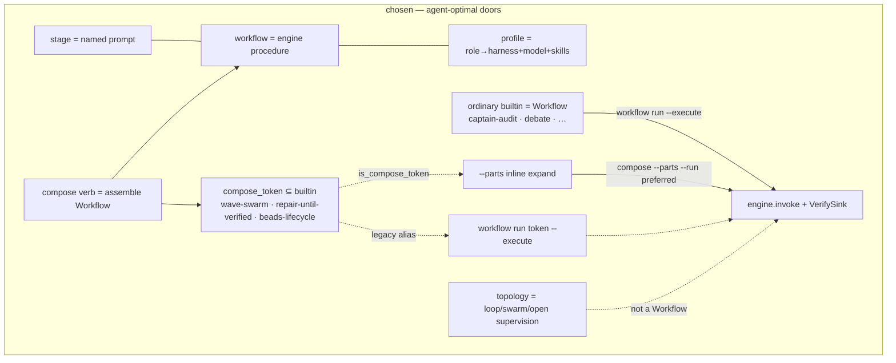
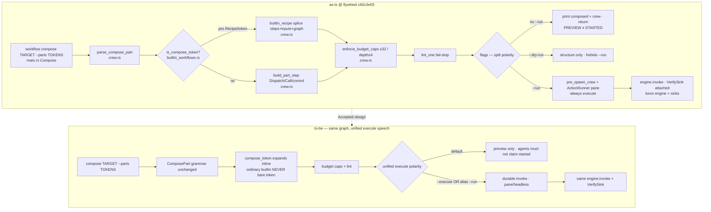
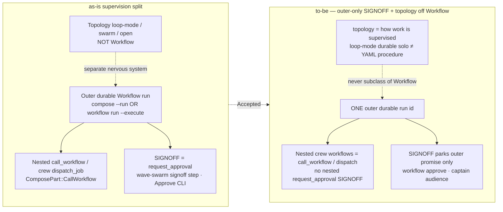
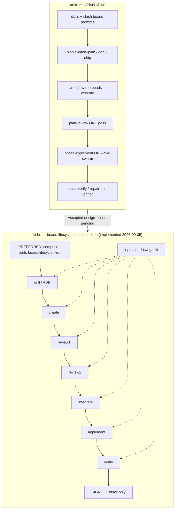
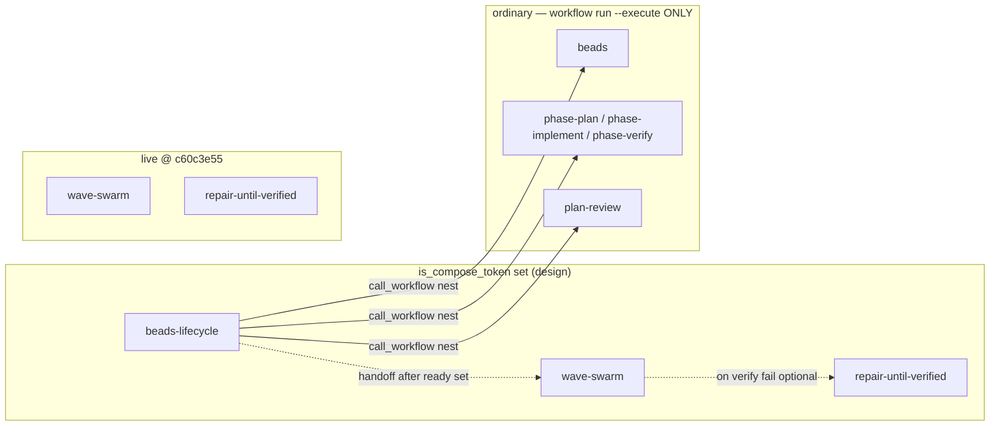

<!-- governed-by: ADR-0005, ADR-0006, ADR-0010, ADR-0015, ADR-0019, ADR-0022, ADR-0024, ADR-0025, ADR-0026 -->
---
status: accepted
date: 2026-09-05
decision-makers: Captain (bangedorrunt)
consulted: GS-020 as-is SHA256 7ea25cd998967b59d72dd1d72dbc0b2541e2369b112a5f39a18374ea46dd8c76; GS-022 beads-lifecycle SHA256 351c3f3afd56be1943d979fe078ad500dc8406cadf0bd98b723e6d5d3e6a9d75; GS-015 STEER mermaid; GS-012 / toron ADR-0027 house style; live HEADs flywheel c60c3e55 (merge gs-021/is-compose-token) / toron b6a6aabf4265 / beads 669875e68c62; GS-021/GS-023 Proposed counsel
informed: flywheel × toron × beads maintainers; Wheelhouse; captain AND crew harness agents
---

# ADR-0008: Workflow / Compose / Topology — Agent-Optimal Mental Model

| Field | Value |
|-------|-------|
| **Status** | **Accepted** (2026-09-05, GS-024) |
| **Date** | 2026-09-05 |
| **Decision-makers** | Captain (bangedorrunt) |
| **Extends** | [ADR-0005](0005-always-on-collab-baseline-and-command-surface.md) (workflow/squad/profile surfaces), [ADR-0006](0006-parameterized-stage-payloads-and-wave-scoped-dispatch.md) (wave-swarm compose token), [toron ADR-0010](../../toron/docs/decisions/0010-execution-wiring-model-registry-headless.md) (`--execute` / mode), [toron ADR-0015](../../toron/docs/decisions/0015-flywheel-toron-integration-contract.md) (one-way flywheel→toron), [toron ADR-0019](../../toron/docs/decisions/0019-bead-verified-execution-and-principle-playbooks.md) (playbook shapes), [toron ADR-0022](../../toron/docs/decisions/0022-phase-native-orchestration.md) (compose grammar), [toron ADR-0024](../../toron/docs/decisions/0024-graph-first-repair-loops-bead-workflow.md) (`VerifySink` / repair), [toron ADR-0025](../../toron/docs/decisions/0025-adopt-graph-dispatch-artifact-reduce-pin-supervision.md), [toron ADR-0026](../../toron/docs/decisions/0026-failure-taxonomy-funded-preflight-fallback-chains-mail-health-escalation.md) |
| **Does not amend / does not rewrite** | [toron ADR-0027](../../toron/docs/decisions/0027-one-workspace-tick-control-plane.md) — Tick Law, doorbell, kind 30013, factory.db, two captains untouched. ADR-0028 stays as landed. This record does not open GS-011. |
| **Governs (speech + doors now; code follow-ups)** | Compose-token mental model; preferred doors; SIGNOFF outer-only; topology ≠ Workflow; docs/skills speech. Live gate: `src/builtin_workflows.rs` `is_compose_token`. |
| **Honesty @ Accepted** | At Accept (`c60c3e55`) `is_compose_token` held **only** `wave-swarm` \| `repair-until-verified`; the third token was design Accepted with code pending. **IMPLEMENTED 2026-09-05** (match arm 84fbfb7, expand tests c751690, guard-fix 2010d78): live gate holds all three. Accept snapshot preserved in Dump & method. |
| **Tracker** | beads. Never pull requests as the log. |
| **Verification** | § Implementation Plan → Verification; optional `docs/decisions/_scripts/verify-0008.sh` |

> **Scope:** one agent-optimal mental model for **captain AND crew**: five nouns (drop recipe speech); **compose tokens** via **`is_compose_token`** vs ordinary builtins — design set = `wave-swarm` \| `repair-until-verified` \| **`beads-lifecycle`**; live code today gates the first two only; preferred door `workflow compose … --parts <token> --run` with `workflow run <token> --execute` as **legacy alias**; ordinary builtins `workflow run --execute` only; outer durable runs nest captain+crew with **SIGNOFF outer-only**; topology off Workflow. Encode grill locks + beads-lifecycle graph/`inputs.until` as Accepted design; land third-token code in follow-up.

Grounded at live `main` (2026-09-05 Melbourne / UTC): flywheel `c60c3e55` (GS-021 merge — `is_compose_token` rename + two-token gate), toron `b6a6aabf4265`, beads `669875e68c62`. Newer HEAD wins for line cites; re-walk if moved.

**Prior scout:** GS-020 Workflow AS-IS (assert SHA256 `7ea25cd998967b59d72dd1d72dbc0b2541e2369b112a5f39a18374ea46dd8c76`). GS-021/GS-023 Proposed counsel folded GS-022 `beads-lifecycle`. GS-024 Accepts this design into flywheel.

---

## 1. TL;DR

**Grill locks (Accepted speech + design):**

1. **Drop recipe speech.** Five load-bearing nouns only: **stage**, **workflow**, **profile**, **topology**, **compose** (verb).
2. **Compose token** = `wave-swarm` \| `repair-until-verified` \| **`beads-lifecycle`** (design set → **live set**), gated by **`is_compose_token`** (was `is_builtin_recipe`). **Live: all three match arms.**
3. **Preferred door** for compose tokens: `workflow compose … --parts <token> --run`.
4. **`workflow run <token> --execute`** = **legacy alias** for compose tokens (not the preferred door).
5. **Ordinary builtins** (e.g. `captain-audit`): `workflow run <name> --execute` — **NOT** bare `--parts`.
6. **Outer SIGNOFF outer-only**; nested captain+crew via `call_workflow` / `dispatch_job` — no nested `request_approval`.
7. **Docs/skills checklist** (speech migrate): `AGENTS.md`, `workflow-composition.md`, `skills/flywheel` (+toron if needed), slash swarm prompts, clap help.

A **compose token** is a builtin Workflow that is also legal as a bare `--parts` token (`is_compose_token`). An **ordinary builtin** (e.g. `captain-audit`) is the **same** `Workflow` type but is **not** a `--parts` token — run it with `workflow run <name> --execute`.

**Decision (chosen):** teach and enforce one door map:

| Intent | Door | Not |
| :--- | :--- | :--- |
| Assemble a NEW Workflow from parts | `workflow compose … --parts …` | spawn kind/count |
| Preview assembled graph + crew | compose **without** `--run` / execute | claiming "started" |
| Start a compose-token durable run | **`workflow compose … --parts <token> --run`** (**preferred**) | treating `workflow run <token> --execute` as primary |
| Legacy alias for compose token | `workflow run <token> --execute` (**legacy alias**, not preferred) | teaching it as the door |
| Run a named ordinary builtin | `workflow run <name> --execute` | bare `--parts captain-audit` |
| Inline a compose token inside parts | `--parts wave-swarm` / `repair-until-verified` / **`beads-lifecycle`** (when implemented) | calling it a "recipe" / squad |
| Beads authoring lifecycle | **`workflow compose … --parts beads-lifecycle --run`** (**design**; code pending) | promoting ordinary `beads`; merging into wave-swarm |
| Supervise a solo durable lane | topology `loop-mode` | "run the loop workflow" |
| Human gate on outer wave | SIGNOFF = `request_approval` on **outer** run only | nested crew inventing signoff |

---

## 2. Layer picture — as-is vs to-be

### 2.1 Compose path (CLI → ComposePart → expand → engine)

### 2.2 Supervision — outer durable vs nested crew / SIGNOFF

---

## 3. Context

### 3.1 Evidence ledger (live HEAD @ Accept)

| Claim | Evidence |
| :--- | :--- |
| Four-noun doc teaches compose token doors | `docs/agent-instructions/workflow-composition.md` (post GS-021 speech) |
| Compose token gate is **`is_compose_token`** | `builtin_workflows.rs` — live `wave-swarm` \| `repair-until-verified` \| **`beads-lifecycle`** (three arms since 84fbfb7) |
| Token check **before** stage-first | `crew.rs` `parse_compose_part` |
| `ComposePart::Recipe` expands inline | `crew.rs` expand + `builtin_recipe` |
| 37 builtins, same `Workflow` type | `BUILTIN_WORKFLOWS_YAML` — 37 unique names |
| `captain-audit` is ordinary builtin | **not** in `is_compose_token` |
| `wave-swarm` GATE→…→SIGNOFF | builtin YAML wave-swarm steps |
| Compose `--run` = real pane execute | `main.rs` Compose handler |
| `workflow run` needs `--execute` for side-effects | `main.rs` Run path |
| Preview path returns without invoke | compose without `--run` |
| Budget caps before lint | `crew.rs` enforce_budget_caps |
| Loop-mode is topology | `main.rs` topology / loop-mode — **not** Workflow |
| Toron `run_branch` ≠ flywheel tick | toron `control_flow.rs` — hygiene vs [toron ADR-0027](../../toron/docs/decisions/0027-one-workspace-tick-control-plane.md) |
| `VerifySink` embedding door | toron `engine/sinks.rs`; compose attaches on `--run` |
| Approve parked SIGNOFF | `WorkflowCmd::Approve` |

### 3.2 Problem statement

> How do captain **and** crew agents share one mental model for stage / workflow / profile / topology / compose, so that **compose tokens** are never confused with ordinary builtins, `--parts` never means "started", execute polarity stops splitting brains, SIGNOFF stays outer-only, and topology stays off the Workflow type — **without** rewriting toron ADR-0027, **without** claiming `beads-lifecycle` is in code before it is, and **without** recipe/squad/collab triple speech?

### 3.3 Why agents get lost (compressed from GS-020)

1. **"Recipe"** means compose token **and** squad `--recipe` **and** collab pattern docs.
2. **`--parts` without execute** looks like work started; binary only previews.
3. **Compose `--run` vs `workflow run --execute`** — opposite default polarity for the word "run".
4. **`captain-audit` vs `wave-swarm`** — same catalog, different doors; agents try `--parts captain-audit`.
5. **Debate / plan-review** dual doors (CLI purpose vs builtin Workflow).
6. **Topology** (loop-mode) spoken as if it were a workflow name.
7. **Nested SIGNOFF** temptation — crews invent human gates inside call_workflow children.
8. Legacy **Recipes/Pipeline/Template/Workflows** tops fight the unified `workflow` surface.

### 3.4 Grill locks (Accepted)

| Lock | Rule |
| :--- | :--- |
| **Nouns** | Prefer **stage, workflow, profile, topology, compose(verb)**. **Drop recipe speech** in new docs/ADR text. Legacy code identifiers (`ComposePart::Recipe`, `--recipe`, `builtin_recipe`) may remain until a later rename wave — **teach `is_compose_token`**. |
| **Compose token** | Builtin Workflow legal as bare `--parts` via **`is_compose_token`**. Design set: `wave-swarm`, `repair-until-verified`, **`beads-lifecycle`**. Live code gates two until follow-up lands the third arm + YAML. |
| **Preferred door** | Compose tokens: **`workflow compose … --parts <token> --run`**. |
| **Legacy alias** | `workflow run <token> --execute` for compose tokens = **legacy alias** (not preferred; keep working during migration). |
| **Ordinary builtin** | Same `Workflow` type; enter via `workflow run <name> --execute` (**not** bare `--parts`). Example: `captain-audit`. |
| **Docs/skills checklist** | Speech migrate: `AGENTS.md`, `workflow-composition.md`, `skills/flywheel` (+toron if needed), slash swarm prompts, clap help. |
| **Plan-review** | Purpose **(C)** — keep the purpose/pattern CLI door; do not collapse into compose-token status. Builtin `plan-review` remains ordinary until a deliberate catalog wave. |
| **Debate** | Stay **purpose** (CLI pattern + ordinary builtin) until there is **one** CLI alias strategy; do not promote to compose token. |
| **Outer + nested** | One outer durable run; nested captain+crew via `dispatch_job` / `call_workflow`. **SIGNOFF = outer-only**. |
| **Topology vs run supervision** | `loop-mode` / swarm / open supervise **how** work runs; they are **not** Workflow YAML. Do not teach "the loop workflow". |
| **Execute polarity** | Unify speech so preview ≠ started and one execute flag family covers compose + `workflow run`. As-is split (`--run` vs `--execute`) is the foot-gun to retire in speech first. |
| **ADR-0027** | Do **not** rewrite [toron ADR-0027](../../toron/docs/decisions/0027-one-workspace-tick-control-plane.md). |

---

## 4. Decision Drivers

1. **Agent-optimal for captain AND crew** — one argv teaching example beats two folklore paths.
2. **Same type, two entry modes** — compose token ⊆ builtin; ordinary builtin ⊄ `--parts`.
3. **Preview honesty** — lint+print must never be narrated as a started durable run.
4. **Human gate scarcity** — SIGNOFF is expensive; outer-only prevents nested parks.
5. **Topology hygiene** — supervision shape ≠ procedure graph (guards ADR-0027 category errors: `run_branch` is not tick).
6. **Subtract before add** — retire legacy tops and recipe speech before minting new nouns.
7. **Honest Accept** — design Accepted; do not claim third-token code until follow-up lands it; do not open GS-011; do not rewrite ADR-0027.

---

## 5. Considered Options / Alternatives

### Option A — Status quo (triple "recipe" + split execute polarity) — rejected

Keeps GS-020 traps. Captains say "run the recipe"; crews pass `--parts` and claim started; `captain-audit` wrongly attempted as compose token.

### Option B — Rename everything in one ship (Recipe→ComposeToken in Rust + clap) — deferred

Correct long-term, but a rename wave touches `ComposePart::Recipe`, leftover `is_builtin_recipe` speech, spawn `--recipe`, `recipes.toml`, docs, and integration prompts together — separate follow-up. Counsel/Accepted text already teaches `is_compose_token` (live rename landed in GS-021).

### Option C — Collapse Debate/Plan-review CLI into `workflow run` only — rejected for now

Deletes purpose doors agents already muscle-memory. Grill lock: plan-review stays purpose (C); debate stays purpose until **one** alias plan exists.

### Option D — Make every builtin a compose token — rejected

`is_compose_token` is deliberately small. Expanding `--parts` to 37 names destroys stage-first parsing and budget intuition.

### Option E — Chosen: speech + door map + catalog efficiency (this ADR)

Lock nouns and doors; publish compose-token vs ordinary-builtin throughout; Accept design for **`beads-lifecycle`** with implement-pending honesty; sketch execute-polarity unify and legacy retire without claiming finished code for the third token.

---

## 6. Decision Outcome

### 6.1 Noun model (to-be speech)

| Noun | Meaning | Agent cue |
| :--- | :--- | :--- |
| **stage** | One named prompt | `send --stage` / `stage list` |
| **workflow** | Engine procedure (YAML steps or graph) | `workflow list\|show\|run\|compose` |
| **profile** | Role → harness + model + skills | `profile` / `crew: auto` counts `@roles` |
| **topology** | How work is supervised (loop / swarm / open) | `loop-mode`, swarm spawn shape — **not** `workflow run` |
| **compose** (verb) | Assemble a **new** Workflow from parts / YAML / agent | `workflow compose` |
| **compose token** | Builtin legal as bare `--parts` via **`is_compose_token`** | `wave-swarm`, `repair-until-verified`, **`beads-lifecycle`** (design; code pending) |
| **ordinary builtin** | Builtin Workflow, `workflow run --execute` only | `captain-audit`, `weekly-review`, … |

**Forbidden in new speech:** recipe (all three old senses), playbook-as-CLI-verb, "loop workflow".

### 6.2 wave-swarm vs captain-audit

| | **wave-swarm** (compose token) | **captain-audit** (ordinary builtin) |
| :--- | :--- | :--- |
| Type | `Workflow` in `BUILTIN_WORKFLOWS_YAML` | same |
| **`is_compose_token`** | **yes** (live) | **no** |
| `--parts` bare token | **legal** — expands GATE/DISPATCH/EXECUTE/OBSERVE/VERIFY/SIGNOFF | **illegal** — stage-first / error |
| **Preferred door** | `workflow compose "<obj>" --parts wave-swarm --run --project 
` | n/a |
| **Legacy alias** | `workflow run wave-swarm --execute …` (**legacy alias**) | n/a |
| Canonical run | **Preferred:** compose `--parts` `--run` | `workflow run captain-audit --execute --mode pane --project 
` — **NOT** bare `--parts` |
| SIGNOFF | Outer `request_approval` — **outer-only** | None — analysis only |
| Teaching line | "compose token: preferred compose --parts --run; run --execute is legacy alias" | "ordinary builtin: workflow run --execute only; never bare --parts" |

### 6.3 `--parts` / `--run` / `--execute`

| Flag | As-is | Accepted speech |
| :--- | :--- | :--- |
| `--parts` | Assembly tokens only; no durable start | **Assemble** — never means started; legal bare tokens = compose tokens only |
| compose `--run` | Real pane execute after lint | **Preferred execute flag** on preferred door |
| `workflow run <token> --execute` | Dual door for compose tokens today | **Legacy alias** for compose tokens; still required for ordinary builtins |
| `workflow run <ordinary> --execute` | Real side-effects; default dry | **Only door** for ordinary builtins; never bare `--parts` |
| `--dry-run` | Structure preview; forbids `--run` | Stays preview; still ≠ started |

**Invariant:** **preview ≠ started.** Agents must not report a run_id or "working" from compose-without-`--run` or `workflow run` without `--execute`.

### 6.4 Builtin efficiency catalog

| Action | Names / rule |
| :--- | :--- |
| **keep (compose_token) — live** | `wave-swarm`, `repair-until-verified` — **`is_compose_token`** set @ `c60c3e55` |
| **promote compose_token — design Accepted → IMPLEMENTED 2026-09-05** | **`beads-lifecycle`** — third token; landed match arm (84fbfb7) + YAML stages + expand tests (c751690) + guard-fix (2010d78) + docs/skills checklist. |
| **keep (ordinary builtin)** | `captain-audit`, `weekly-review`, phase-* (`phase-resolve`…`phase-verify`), playbook shapes (`bug-fix`, `feature`, `refactoring`, `perf`, `hillclimb`, `prototype`, `arena`, `interrogate`, `forensics`), ops (`onboard`, `triage`, `triage-deep`, `pickup`, `pause`, `babysit-bead`, `ship-beads`, `autonomous-work`, `ship`, `reflect`, `awareness-digest`); thin `beads` / `plan` / `plan-review` / `goal*` stay ordinary — **nested by** `beads-lifecycle` when implemented, never bare `--parts` |
| **merge candidates** | `goal` / `goal-direct`; `plan` / `plan-direct` / `plan-review` (workflow side) — merge only after purpose-CLI story for plan-review is settled |
| **retire (speech first)** | Calling any ordinary builtin a "recipe"; dual docs that teach `--parts` for non-tokens |
| **collapse duplicate CLI** | Long-term: legacy `Recipes` / `Workflows` / `Pipeline` / `Template` / `Ensemble` tops → prefer `squad` + `workflow`. Debate/Plan-review: keep purpose doors until **one** alias plan. Spawn kind/count remains escape (`--escape`). |

### 6.5 Outer durable run, nested crew, SIGNOFF

- **Outer** run owns durability, run_id, Approve surface, wall-clock compose bound. **SIGNOFF = outer-only.**
- **Nested captain+crew** via `call_workflow` / `dispatch_job` spend crew attention under budget caps — they do **not** open a second captain SIGNOFF / nested `request_approval`.
- **Topology** (`loop-mode`) may host long-lived supervision beside or around runs; it does not become a Workflow subclass and does not absorb `request_approval` semantics.

### 6.6 Toron touchpoints (category hygiene)

- `WorkflowEngine::invoke` + `VerifySink` remain the graph verify door.
- `run_branch` stays workflow-engine control flow — **not** flywheel tick ([toron ADR-0027](../../toron/docs/decisions/0027-one-workspace-tick-control-plane.md) leftover hygiene).
- Dep direction unchanged: flywheel → toron-workflow.

### 6.7 Counsel → Accepted addendum — `beads-lifecycle` (GS-022 / GS-023 / GS-024)

Fold of GS-022. **Design Accepted → IMPLEMENTED 2026-09-05** (landed YAML + match arm + tests in the Accept ship's follow-ups; the Accept-ship restraint below is history).

#### Name + doors

| Field | Value |
| :--- | :--- |
| **Token** | **`beads-lifecycle`** |
| **`is_compose_token`** | **yes** (third token; sibling to `wave-swarm` \| `repair-until-verified`) — **after** follow-up implement |
| **Live @ Accept** | **NOT** in `is_compose_token` match arms |
| **Preferred door** | `workflow compose "<objective>" --parts beads-lifecycle --run --project 
 --inputs '…'` |
| **Legacy alias** | `workflow run beads-lifecycle --execute …` (not preferred) |
| **Nests (ordinary)** | `phase-plan`, thin `beads`, `plan-review`, `phase-implement`, `phase-verify` via `call_workflow` — **never** bare `--parts` |
| **Does not replace** | `wave-swarm`, `repair-until-verified`, ordinary `beads` noun |

#### Phase graph (stoppable)

| Ord | Phase | Who / nest | Notes |
| ---: | :--- | :--- | :--- |
| 0 | `grill` | `@planner` (+ optional `@oracle`) | Sharpen objective; emit ADR/goal JSON |
| 1 | `create` | `call_workflow: phase-plan` / `beads` / `decompose-beads` | Optimal beads + `## VERIFY` + deps; `br dep cycles` = 0 |
| 2 | `review1` | `@reviewer` stage `plan-review` | Bead-graph pass A (model family A) |
| 3 | `review2` | `@oracle` or second `@reviewer` (family B) | Pass B; findings JSON + verdict |
| 4 | `integrate` | `@planner` | Integrate AGREE-WITH-CHANGES; re-check cycles = 0 |
| 5 | `implement` | `@coder` / `phase-implement` **or** handoff to `wave-swarm` | Handoff, not merge |
| 6 | `verify` | `phase-verify` / `prove-verify` / `wave-verify` | Evidence > status |
| 7 | `signoff` | **`request_approval` outer-only** | Captain Approve CLI |

Arc speech: **grill/ADR → create → review1 → review2 → integrate → implement → verify → outer SIGNOFF**.

#### `inputs.until` early-exit

| Mechanism | Rule |
| :--- | :--- |
| **`inputs.until`** | ∈ `grill\|create\|review1\|review2\|integrate\|implement\|verify\|signoff` (default `signoff`) |
| **Per-node `guard:` on `trigger_until`** | Each phase node carries a `guard:` field comparing `trigger_until` against double-quoted literals (e.g. create runs unless `trigger_until == "grill"`); guards that fail (or error) skip the node, so the run set is grill..=until. Template `{{inputs.*}}` in guards is INERT (engine evaluates only `trigger_*`/`steps_*` vars — the kimg Branch design never fired; guard-fix 2010d78). Defaults bind at the flywheel invoke doors (`crew::apply_input_defaults` in `bounded_invoke` + `workflow run`); the engine honors node guards via the `run_graph_node` check (toron `engine/control_flow.rs`, UNCOMMITTED — pending review, not claimed landed). |
| **Preview** | Compose without `--run` lint-previews graph through `until` — preview ≠ started |
| **Optional** | `gate_before_implement: true` → one **outer** `request_approval` between integrate and implement |
| **Not** | Per-phase nested approvals; killing panes as "stop" |

#### Sibling / nest / handoff

| Asset | Relation |
| :--- | :--- |
| **`wave-swarm`** | **Sibling** — ready-wave execute. After `integrate`, captain may `until=integrate` then `compose --parts wave-swarm --run`. **Handoff, not merge.** |
| **`repair-until-verified`** | **Sibling** — bounded fix loop; optional nest on implement failure; do not unroll into lifecycle. |
| **`beads` / phase-* / `plan-review`** | **Nest** via `call_workflow`; stay ordinary builtins. Do **not** promote thin `beads` to compose token (noun collision). |
| **`goal` / `ship`** | Sibling ordinary meta/phase chains without dual bead review. |

#### Mermaid — lifecycle as-is vs to-be

#### Mermaid — door map + nesting

---

## 7. Consequences

### Positive

- Captain and crew share one door table; compose token (`is_compose_token`) vs ordinary builtin is explicit; preferred compose door vs legacy alias is explicit; **`beads-lifecycle`** closes the dual-review authoring gap as Accepted design.
- Preview honesty cuts false "started" claims.
- SIGNOFF outer-only keeps human gates scarce and Approve CLI meaningful.
- Topology stays out of Workflow speech — fewer ADR-0027 category errors.
- Catalog efficiency gives a retire/merge/promote map without a panic delete.
- Honest Accept: live two-token gate documented; third token not falsely claimed in code.

### Negative / costs

- Preferred compose door + **legacy alias** (`workflow run <token> --execute`) both remain during migration.
- Code may still say `Recipe` / `builtin_recipe` / spawn `--recipe` until a rename wave — **teach `is_compose_token`**; speech discipline required.
- Execute polarity unify needs a careful clap/help migration so scripts do not break.
- Purpose CLIs (Debate, Plan-review) continue to dual with builtins until alias strategy lands.
- **`beads-lifecycle` live since 2026-09-05** — the token is implemented (match arm + YAML + expand tests + guard-fix); agents may compose it.

### Neutral

- [toron ADR-0027](../../toron/docs/decisions/0027-one-workspace-tick-control-plane.md) unchanged by this Accept.
- 37 builtins still parse/lint as today (third token adds one when implemented).
- Beads remain the work graph; this ADR does not move work tracking.

---

## 8. Alternatives recap

| Option | Fate |
| :--- | :--- |
| A Status quo | Rejected — preserves GS-020 traps |
| B Big-bang Rust rename | Deferred — separate follow-up |
| C Delete purpose CLIs | Rejected — grill locks |
| D All builtins are compose tokens | Rejected — breaks stage-first + intent |
| E Speech + door map + catalog (this) | **Chosen / Accepted** |

---

## 9. Non-goals

- No rewrite of [toron ADR-0027](../../toron/docs/decisions/0027-one-workspace-tick-control-plane.md); no Tick Law ship; no doorbell/30013 changes.
- Do not touch factory.db; do not open GS-011.
- No **landing** of `beads-lifecycle` YAML / `is_compose_token` arm / expand tests in **this** Accept ship — follow-up only.
- No deletion of legacy CLI tops in this text (speech retire only).
- No forcing Debate/Plan-review into a single door without an alias plan.
- No claiming preview==started; no nested SIGNOFF design.
- No claiming live code already gates `beads-lifecycle`.
- No Grok Bot / Firstmate / Cloud Agents wiring required for this Accept.
- No land in **toron** `docs/decisions/` — this ADR lives in **flywheel**.

---

## 10. Implementation Plan

Agent-readiness: an implementer can start from this section without tribal knowledge. **This Accept ship** lands the ADR + README + optional `verify-0008.sh`. Code follow-ups are sequenced below.

### 10.A — This ship (GS-024 Accept land)

| Step | Action | Paths |
| :--- | :--- | :--- |
| 1 | Land Accepted ADR | `docs/decisions/0008-workflow-compose-topology-agent-optimal-mental-model.md` |
| 2 | Index row **Accepted** | `docs/decisions/README.md` |
| 3 | Optional thin verify | `docs/decisions/_scripts/verify-0008.sh` — assert ADR status + README + live two-token gate honesty |
| 4 | **Do not** add `beads-lifecycle` YAML or match arm in this ship | — |

### 10.B — Follow-up: speech / docs / skills (may partially already be on main post GS-021)

| Step | Action | Paths / notes |
| :--- | :--- | :--- |
| 1 | Keep five-noun speech; drop recipe in agent-facing text | `AGENTS.md`, `docs/agent-instructions/workflow-composition.md` |
| 2 | Skills + slash prompts | `skills/flywheel` (+toron skills if they still say recipe / `is_builtin_recipe`) |
| 3 | Clap help About strings | `src/main.rs` Compose / Run / Squad help |
| 4 | Teach preferred door + legacy alias + ordinary-builtin door | same docs |
| 5 | Preview ≠ started + SIGNOFF outer-only + topology ≠ Workflow | agent instructions + decide hints |

### 10.C — Follow-up: `beads-lifecycle` code (implemented 2026-09-05)

| Step | Action | Paths / patterns |
| :--- | :--- | :--- |
| 1 | Add match arm | `src/builtin_workflows.rs` — `is_compose_token`: add `"beads-lifecycle"` beside `wave-swarm` \| `repair-until-verified` |
| 2 | Add builtin YAML | `BUILTIN_WORKFLOWS_YAML` in `src/builtin_workflows.rs` — stages grill→…→signoff; `inputs.until`; outer `request_approval` only; nest ordinary builtins via `call_workflow` (mirror `wave-swarm` shape ~lines 1096–1171) |
| 3 | Expand path | `src/crew.rs` — `ComposePart::Recipe` / `parse_compose_part` already routes through `is_compose_token`; ensure expand + budget caps cover the new token (wave-swarm-style tests ~crew.rs `:1596+` pattern) |
| 4 | Tests | `builtin_workflows.rs` unit tests + crew compose expand tests: bare `--parts beads-lifecycle` expands; ordinary `beads` still **not** a compose token; `inputs.until` early-exit graph lints |
| 5 | Docs/skills after code | Update `workflow-composition.md` / `AGENTS.md` compose-token set to three **only after** match arm lands |
| 6 | **Patterns to follow** | Existing `wave-swarm` / `repair-until-verified` YAML + `is_compose_token` gate; toron `VerifySink` on compose `--run` |
| 7 | **Patterns to avoid** | Promoting thin `beads` to compose token; nested `request_approval`; merging lifecycle into `wave-swarm`; claiming preview==started; rewriting ADR-0027 |

### 10.D — Later rename wave (separate ADR/bead)

| Step | Action |
| :--- | :--- |
| 1 | `ComposePart::Recipe` → `ComposeToken` (or keep alias) |
| 2 | `builtin_recipe` → `compose_token_workflow` (optional) |
| 3 | Spawn `--recipe` → `--squad` only in help/docs |
| 4 | Execute-polarity unify (`--execute` / `--run` one family) behind compatibility window |

### Dependencies

- No new crates. Relies on existing `toron_workflow` lint/engine + flywheel compose path.
- Sibling checkout of `toron` for relative ADR links in docs (same as other flywheel ADRs).

### Configuration

- No new env vars for Accept. Future `inputs.until` / `gate_before_implement` are workflow inputs, not process env.

---

## 11. Verification

Checkboxes are testable. **At Accept land (GS-024):** speech/design criteria apply; third-token code criteria stay unchecked until follow-up.

### At Accept (this ship)

- [x] ADR file landed under `docs/decisions/` with `status: accepted` and date `2026-09-05`.
- [x] `docs/decisions/README.md` lists **0008** as **Accepted**.
- [x] Self-contained: mermaid as-is/to-be, noun model, compose_token design set, preferred doors, SIGNOFF, efficiency catalog, beads-lifecycle § (design at Accept, code landed in follow-ups).
- [x] Links: flywheel ADRs local; toron ADRs via `../../toron/docs/decisions/…` — **no** fake local flywheel `0027-…` path.
- [x] Does **not** rewrite [toron ADR-0027](../../toron/docs/decisions/0027-one-workspace-tick-control-plane.md) body.
- [x] Honesty: live `is_compose_token` names documented as `wave-swarm` \| `repair-until-verified` **only**.
- [x] `beads-lifecycle` **NOT** claimed present in code.

### Live code honesty (post-implement truth — updated 2026-09-05)

- [x] `rg 'is_compose_token' -n src/builtin_workflows.rs` — function exists.
- [x] `is_compose_token` match arms == `wave-swarm` \| `repair-until-verified` \| `beads-lifecycle` (third arm landed 84fbfb7).
- [x] `rg 'beads-lifecycle' src/` returns the compose-token match arm + builtin YAML name + expand tests (10.C landed).
- [x] Docs speech: `workflow-composition.md` / `AGENTS.md` teach preferred compose door + legacy alias; do not teach bare `--parts` for ordinary builtins.

### After speech follow-up (10.B)

- [x] Noun table taught without the word recipe (five nouns only) in AGENTS + workflow-composition.
- [x] Preferred door `workflow compose … --parts <token> --run` taught; `workflow run <token> --execute` marked **legacy alias**.
- [x] Ordinary builtin door == `workflow run --execute` only — **NOT** bare `--parts`.
- [x] Docs/skills checklist updated: AGENTS.md, workflow-composition.md, skills/flywheel (+toron if needed), slash swarm prompts, clap help.
- [x] Preview ≠ started enforced in agent instructions.
- [x] SIGNOFF outer-only + captain+crew nesting stated.
- [x] Topology ≠ Workflow in AGENTS.

### After `beads-lifecycle` implement (10.C)

- [x] `is_compose_token("beads-lifecycle") == true`.
- [x] Builtin YAML name `beads-lifecycle` present; phases grill→…→signoff in order; approvals outer-only (unconditional signoff + one conditional pre-implement gate; no nested `request_approval`).
- [x] `workflow compose … --parts beads-lifecycle` expands (preview) without claiming started.
- [ ] Compose `--run` / legacy `workflow run beads-lifecycle --execute` invoke path works in tests (preview + guard-eval + defaults covered; full durable `--run` e2e open).
- [x] Ordinary `beads` remains **not** a compose token.
- [x] `inputs.until` early-exit documented + lint-covered (per-node guards + truth-table test).
- [x] Docs/skills compose-token set lists three **after** code lands.
- [x] Optional: `docs/decisions/_scripts/verify-0008.sh` green for post-implement checks.

### Never (non-goals gates)

- [ ] No factory.db / GS-011 / Tick Law changes in the beads-lifecycle follow-up.
- [ ] No ADR-0027 body rewrite.

---

## 12. Open questions (non-blockers)

1. Prefer `--execute` as the single compose execute flag with `--run` alias, or the reverse?
2. How long should `workflow run <token> --execute` remain as a **legacy alias** before redirecting compose tokens to compose-only?
3. Landed 2026-09-05 via bd-adr0008-token-yaml-kimg (match arm + YAML) + bd-adr0008-expand-tests-7ui6 (expand tests) + bd-adr0008-guard-fix-16fl (working guards) + wave-1/wave-2 speech beads.
4. Plan-review purpose CLI: keep forever, or alias to `workflow run plan-review` after one release of warnings?

---

## Dump & method

- Baseline GS-020 assert SHA256 `7ea25cd998967b59d72dd1d72dbc0b2541e2369b112a5f39a18374ea46dd8c76`
- GS-022 source proposal SHA256 `351c3f3afd56be1943d979fe078ad500dc8406cadf0bd98b723e6d5d3e6a9d75`
- GS-021/GS-023 Proposed counsel → **GS-024 Accepted** into **flywheel** (not toron)
- Live main at Accept: flywheel `c60c3e55` (`is_compose_token` = two tokens only)
- Implemented 2026-09-05: match arm 84fbfb7 → expand tests c751690 → guard-fix 2010d78 (per-node `guard:` on `trigger_until`; kimg Branch design inert — see §6.7) → speech flip wwpd+q8mk
- ADR number: **0008** (flywheel decisions previously through **0007**; next free slot — this record is flywheel-owned)
- Cloud Agents: skipped (Pro-unavailable); clone path authorized
