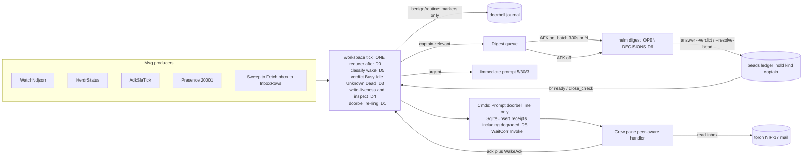
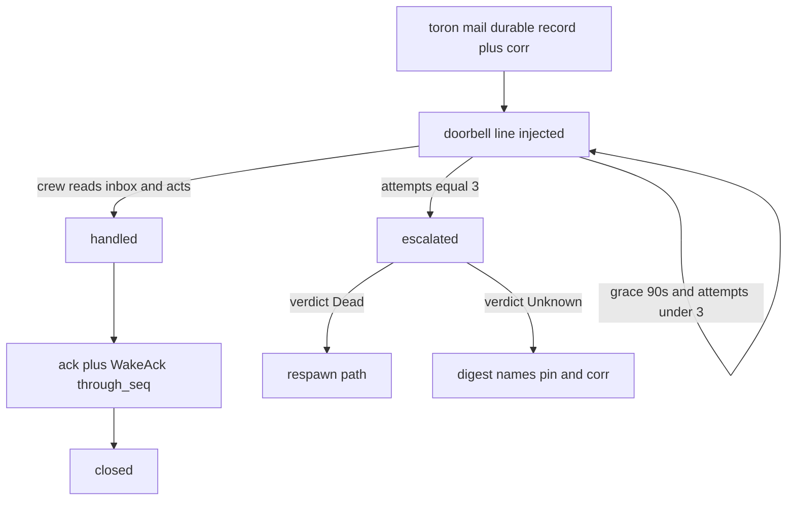
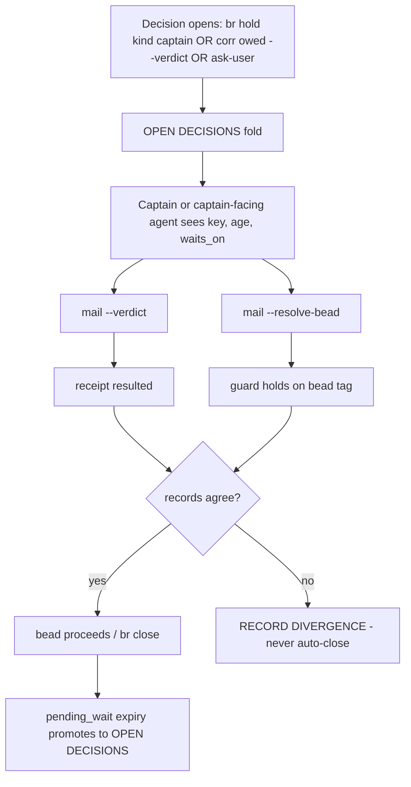

# ADR-0010 — Adopt delivery semantics, attention triage, and a keyed decision lifecycle

| Field | Value |
|-------|-------|
| **Status** | Accepted (2026-09-07; captain; HarborPilot + KeenAuditor agreed on thread `adr-0010-peer-review`) |
| **Date** | 2026-09-07 |
| **Decision Maker** | Captain (bangedorrunt) |
| **Authors** | HarborPilot (draft), KeenAuditor (peer review + fold) |
| **Relates to** | [ADR-0001](0001-event-driven-agent-collaboration-spine.md) (spine, escalation), [ADR-0005](0005-always-on-collab-baseline-and-command-surface.md) (always-on baseline), [ADR-0009](0009-compound-spine-ce-vocabulary-and-learnings-corpus.md) (learnings corpus — extended by D12), toron [ADR-0020](../../../toron/docs/decisions/0020-nostr-two-plane-cli-and-crew-steering.md) (crew steering), toron [ADR-0025](../../../toron/docs/decisions/0025-adopt-graph-dispatch-artifact-reduce-pin-supervision.md) (pin supervision — extended by D3), toron [ADR-0026](../../../toron/docs/decisions/0026-failure-taxonomy-funded-preflight-fallback-chains-mail-health-escalation.md) (failure taxonomy — extended by D5/D8), toron [ADR-0027](../../../toron/docs/decisions/0027-one-workspace-tick-control-plane.md) (one-workspace tick — **amended by D0**; D5 is gated on D0), toron [ADR-0028](../../../toron/docs/decisions/0028-jido-behavior-first-on-wheelhouse-nouns.md) (action schema — extended by D7), beads ADR-0001 (typed fields — **D11 requires a successor ADR in the beads repo**, this ADR does not ship beads schema), [kunchenguid/firstmate](https://github.com/kunchenguid/firstmate) (MIT — concepts adopted, no code; D13 class: commit `50cc24a`) |
| **Governs (on acceptance)** | `src/workspace.rs` (tick, Msg/Cmd, wake ack, worker state, one live Model), `src/doorbell*.rs` (re-ring ladder, digest), `src/durable.rs` (`poll_mail_digests` deleted as producer; drain + write-liveness), `src/main.rs` (`helm`, `doorbell afk`, `crew control`, `snapshot`, `--fire-and-forget`), `src/send.rs`, `src/snapshot.rs` (new), `src/write_liveness.rs` (new), toron `crates/toron-core/src/mailbox/{receipts,send_tags}.rs` (degraded state, `bead=` tag), `integrations/peer-aware.md.tpl`, captain/steer harness deny lists (D13), `docs/learnings/` (tiering), beads close-gate shape **via the beads successor ADR** |
| **Verification** | per-wave gates `verify-0010{a0,a,b,c,d}.sh` authored + all green 2026-09-11 (§13); behavioral fixtures pinned in cargo tests |

---

## 1. TL;DR

A fresh-eyes study of `firstmate` (an agent distro: one captain → one first mate →
crewmates in isolated worktrees, supervised by a zero-token bash watcher) against
flywheel × toron × beads found the inverse of the Every/CE study: **our bones are
stronger, their reflexes are.** We have cryptographic durable mail, a
dependency-graphed fail-closed ledger, a deterministic one-reducer tick with
replay/`why`. They have — and we lacked — **delivery-semantics discipline** (the
durable record IS the delivery; ack watermarks; re-ring ladders; semantic busy
where Unknown is never absorbed) and **attention triage** (wakes classified
without tokens; captain sees one batched digest of decisions; open decisions age
until answered).

**Decision — sixteen moves in four waves plus Wave A.0.** Wave A.0 (D0) folds
ADR-0027 Option A: one live `WorkspaceModel`, one wake, `poll_mail_digests`
deleted as a producer. Wave A hardens the delivery seam (doorbell-with-inbox D1,
wake ack watermark D2, semantic worker states D3, write-liveness + inspect
cadence D4, no-blind-stop D14). Wave B buys back captain attention
(reducer-side wake classification + AFK digest D5 — **gated on D0**,
open-decisions fold + typed captain-hold D6, ask-user-authority D15). Wave C
disciplines channels and authority (data/control plane D7, corr-preserving
resend + degraded receipts D8, structural `--resolve-bead` D9, subagent-guard
D13). Wave D unifies surfaces (fleet snapshot + `helm` D10, scout/ship
deliverable shapes D11 **via a beads successor ADR**, tiered learnings decay
D12). Standing discipline (§10): every wake-classification rule carries a pinned
regression test.

Nothing here replaces the tick, the mail, or the ledger. Everything here
sharpens what they already promise.

---

## 2. Context — the study (self-contained)

### 2.1 What firstmate is

A portable repo of `AGENTS.md` + ~170 bash scripts + internal skills that any
verified harness inhabits. The user ("captain") talks to exactly one agent (the
"first mate"); the mate spawns crewmates in isolated git worktrees, supervises
them, and hands back PRs or investigation reports. Two task shapes: **ship**
(authorized change) and **scout** (knowledge only — a report, never a PR;
evidence is not authorization). Restart is a non-event: obligations live in
durable records, "closed by records, not by recollection."

### 2.2 Patterns that matter (and the lesson each was earned by)

| # | Pattern | Mechanism | Lesson |
|---|---------|-----------|--------|
| P1 | Durable inbox + constant doorbell | Sequenced file record; terminal gets a short constant ring; worker acks by `mv` to `handled/`. 90s grace, 3 rings, escalate. Duplicate ring = no-op. | The durable record IS the delivery. |
| P2 | Generation-bound wake ack | Presented wakes stay durable until `--ack-through` after handling. Crash mid-handling → idempotent re-handle. | At-least-once with idempotent handling beats exactly-once delivery. |
| P3 | Semantic busy | Verdict `busy \| idle \| unknown \| dead` **plus the source**. Unknown is never promoted. Native `agent.get` idle is never trusted (it lies during a blocking tool call). | An unreadable worker surfaces for inspection. |
| P4 | Write-liveness + inspect cadence | Before escalating a stale pane: bounded walk of the task copy. File newer than quiet window = alive. Idle-not-working surfaces immediately; provably-working stale waits 240s; busy-turn max 3600s; 3 repeats → demand-deep-inspection. Never auto-interrupt. | A long compile looks dead to a renderer poll. |
| P5 | Zero-token triage | Bash watcher classifies; benign wakes advance markers with **no LLM turn**. | Intelligence is never spent on what a script can decide exactly. |
| P6 | AFK batched digest | Away-mode daemon self-handles routine wakes; captain-relevant events batch as one digest; wedge alarm if even that delivery sticks. | Batching is a presentation choice that must never hide a failure. |
| P7 | Open-decisions fold | Every drain prints OPEN DECISIONS (cursor-backed). A `needs-decision` buried under later lines keeps surfacing until explicitly resolved. RECORD DIVERGENCE flags status-vs-ledger contradictions. | Append-only logs bury decisions; a fold with an explicit closer is the antidote. |
| P8 | Keyed decision lifecycle | A decision is an ordinary backlog task **held** for the captain. The answerer closes it. Cleanup never closes a captain call. | Evidence is never authorization. |
| P9 | Data plane vs control plane | Text the worker *reads* ≠ lifecycle verbs (`interrupt\|exit\|relaunch` with verified postconditions). Marked `/quit` arrives as chat. | Never speak commands as conversation. |
| P10 | Corr-preserving resend + degraded delivery | After unconfirmed transport, only the printed corr-preserving resend is safe. Bookkeeping failure after enqueue never invites a resend. Duplicate over silence. | There is no "delivered-unconfirmed" that invites duplication. |
| P11 | Tiered memory with budget | Startup memory capped; `pinned` / `aging`(30d) / `perishable`(7d). Archive, don't delete. | Context is a budgeted projection of a corpus. |
| P12 | Turn-end guard + declared waits | "No turn ends blind while work is under way." `paused:` names which human; `blocked:` needs action. Bounded resurface. | Every waiting state names its owner and has a re-surface path. |
| P13 | One snapshot contract | All viewers consume one `fm-fleet-snapshot.v1`. | One structured contract per question, many renderings. |
| P14 | Coordination-layer tests | ~190 test files pin every classification rule and ladder. | The coordination layer is the product. |
| P15 | Subagent-guard | PreToolUse fence denies delegation-shaped tools on the primary. Firstmate 2026-07-22 / commit `50cc24a`: untracked Task-tool spawn made the fleet view empty; restart killed in-flight workers; supervision stayed down because in-flight count is derived from metadata those workers never wrote. | The fence sits on the tool surface, because the failure is the absence of metadata. |
| P16 | Ask-user-authority | Worker never answers its own finding. Unambiguous restorations of accepted intent are decided by the mate; expansions escalate with a five-element form. | Finding labels are evidence, never authority to broaden the contract. |

### 2.3 What we reject (and why)

- **Their filesystem+SSH inbox** — toron NIP-17 is already a stronger durable record.
  We adopt P1 *semantics* onto our store, not their store.
- **Their bash watcher** — classification belongs *inside* `workspace::tick` (D0/D5),
  not in a sibling script process.
- **Their flat backlog** — beads' typed fields and fail-closed close are strictly
  stronger; we adopt decision-hold *lifecycle* (P8), not their task store.
- **Worktrees as default isolation** — ADR-0019 forbids `flywheel worktree` on
  loop-owned beads. Isolation here is reservation + serialize. Reservations are
  **leases on a shared checkout, not copies.** Do not claim we already have
  isolation-by-copy.
- **Crews never mail the captain** — toron plane P to `captain` is the
  reporter-of-record path (`[{id}] done`). Killing it orphans the loop's close mail.
- **Escalation-etiquette translation table** — our captain reads `[bd-###]` fluently.
- **Ship/PR machinery, Relay, voice, secondmate homes** — out of scope.

---

## 3. Options

| Option | What it is | Why not / why |
|--------|------------|---------------|
| **A** | Adopt firstmate as distro (scripts, watcher, treehouse, markdown backlog) | Rejected. Replaces a compiled tick, signed mail, and fail-closed ledger with bash+locks. |
| **B** | Do nothing | Rejected. Delivery still lives in pane transcript; HITL lives in RAM `corr`; dual-wake debt stays; untracked harness spawn stays possible. |
| **C (chosen)** | Adopt firstmate *semantics* onto tick + toron + beads | Chosen. Bones stay ours. Reflexes land as Msg/Cmd, receipts, and typed holds. |

Drivers: `prove-it-works` (delivery and handling become journaled facts),
`boundary-discipline` (one Model, one wake, one closer for a captain call),
`encode-lessons-in-structure` (73-minute untracked-spawn class becomes a fence),
`guard-the-context-window` (benign wakes spend zero tokens),
`subtract-before-you-add` (delete subject-matching and four ad-hoc view assemblies).

---

## 4. Decision set

### Wave A.0 — One Model / one wake (prerequisite)

#### D0 — Option A is a gate, not a footnote

**What changes.** ADR-0027 Option A is already the documented mandate
(`src/workspace.rs` L70–88: doorbell is the live owner; `swarm_loop` must not
construct a second live `WorkspaceModel`; throwaway `Default` wrap is allowed
only in `tick_loop_owner`). As-is debt that this Dn **closes**:

1. `poll_mail_digests` (`src/durable.rs`) is deleted as a **wake producer**.
   Digest *rendering* may remain as a Cmd consumer of already-classified rows.
2. No second live `WorkspaceModel` construction site survives outside
   `tick_loop_owner` and tests.
3. D5's acceptance line is **structurally gated** on this Dn (A1): "D5 gate
   includes D0: one Model, one wake, `poll_mail_digests` deleted as producer."

**Why.** Classification-inside-tick is a lie while two RAM owners plus a second
producer remain. Skills already name this debt (FAQ Dual-wake / Option A). Do
not invent-green that GS-030 already folded it.

**Files.** `src/durable.rs` (delete producer), `src/main.rs` (doorbell is the
sole live constructor), `src/workspace.rs` tripwire at L1769 extended (A2).

**Acceptance.** Source scan: no live `WorkspaceModel::default()` in the loop
body; `poll_mail_digests` is not invoked as a Msg producer; existing
bd-3wzl-style assert at `workspace.rs` L1769 is extended to "no second
construction site survives."

---

### Wave A — Delivery semantics (the seam)

#### D1 — The durable record IS the delivery; the prompt is a doorbell

**What changes.** `flywheel send <pin> --stage <s> ...` keeps its payload, but
the delivery target is the toron message; `herdr agent.prompt` shrinks to:

```
[doorbell] inbox: <n> unacked for <pin>; latest corr=<c>; read + ack
```

The peer-aware handler, on doorbell: `fetch_inbox`, process in rumor order,
`acknowledge_message` / `mark_message_read` (the **ack**). The dispatcher's wake
budget is only the re-ring scheduler.

**Re-ring ladder (in `workspace::tick`).** An un-acked message older than
`FLYWHEEL_DOORBELL_GRACE_SECS` (default **90**) is due one ring per grace
window; after `FLYWHEEL_DOORBELL_RING_MAX` (default **3**) the wake escalates
from "ring" to "recover": `Dead` → respawn path; `Unknown` → digest naming
pin+corr+attempt count. This **replaces** the flat 120s deaf-pane digest.

**Fire-and-forget opt-out.** `--fire-and-forget <delivery-id>` (caller-supplied
id; re-enqueue is idempotent) and already-acked corrs **skip the ladder**.
`--raw` nudges that omit the id still ring once and do not escalate. Without
this, every "ok continue" becomes a stale escalation.

**Files.** `src/workspace.rs`, `src/send.rs`, `src/main.rs` (`--fire-and-forget`
already exists as an exit-policy flag — this Dn binds it to the ladder skip),
`integrations/peer-aware.md.tpl`.

**Acceptance.** Kill the pane between send and ring: message survives, respawned
crew acks on first doorbell. Duplicate ring produces zero duplicate work.
`--fire-and-forget <id>` never climbs the ladder. Escalation names
pin+corr+attempt count.

#### D2 — Generation-bound wake acknowledgement watermark

**What changes.** `Msg` gains `WakeAck { pin, through_seq }`, minted by the crew
handler after handling. Presented-but-unacked wakes re-present at the next
prompt. The journal records presentation seq and ack seq. `flywheel loop replay`
asserts: **no wake dropped, none handled twice**.

**Files.** `src/workspace.rs`, replay fold, handler template.

**Acceptance.** Kill a simulated handling turn between presentation and ack;
replay shows the wake re-presented exactly once more and then acked.

#### D3 — Semantic worker-state verdicts + kind-9 wake verbs

**What changes.** `WorkspaceModel.presence` upgrades to
`Busy { source } | Idle { source } | Unknown | Dead`.

1. `Unknown` is never promoted to `Busy` or `Idle` — it surfaces for inspection,
   never absorbs a wake, never prompts.
2. Native herdr `agent.get` busy is **evidence, not authority**; native idle is
   never trusted.
3. Endpoint death is the only process-level override → `Dead`.
4. Every consumer acts only on exact verdicts; `flywheel status` prints
   verdict+source per pin.

**Kind-9 is a wake log, not current state.** Peer-aware template posts sparse
verbs only: `blocked:`, `paused:` (names which human),
`needs-decision [key=…]`, `resolved [key=…]`. Never prose progress ("80% done").
Current state = presence verdict + `br show`. Presence 20001 stays the now-plane.

**Files.** `src/workspace.rs`, status render, `integrations/peer-aware.md.tpl`.

**Acceptance.** Property test: no consumer branch is reachable from `Unknown`.
Handler template contains the four verbs and does not coach progress posts.

#### D4 — Write-liveness before Respawn + inspect cadence

**What changes.** Drain path (3-poll grace → `Respawn+LoudMiss`) gains a bounded
walk (`FLYWHEEL_WRITE_WALK_{PRUNE,MAXDEPTH,TIMEOUT}`) over the bead's **toron
reservation globs** for any file newer than the pane's quiet window. Write
evidence defers respawn and emits a `write-evidence` digest; absence of evidence
leaves the schedule untouched; a failed/timed-out walk **does not defer** (fail
toward existing behavior). Walk runs only in the about-to-respawn branch.

**Inspect cadence (env, firstmate-verified numbers):**

| Knob | Default | Meaning |
|------|---------|---------|
| `FLYWHEEL_STALE_ESCALATE_SECS` | **240** | quiet + not-writing + not exact-Busy → inspect |
| `FLYWHEEL_BUSY_TURN_MAX_SECS` | **3600** | exact-Busy older than this → same inspect path |
| `FLYWHEEL_WEDGE_INSPECT_COUNT` | **3** | repeats add `demand-deep-inspection` |

Never auto-interrupt. Auto-kill stays `--force-working`. Declared `paused:`
uses the 3600s resurface (same number as `pending_wait` TTL).

**Files.** `src/durable.rs` / drain branch, `src/write_liveness.rs` (new).

**Acceptance.** Touch a reserved file during grace → no respawn, digest emitted;
nothing touched → respawn proceeds; failed walk → respawn proceeds.

#### D14 — No captain-facing turn ends blind

**What changes.** After D0: if beads are `in_progress` **or** a dispatcher is
required, and the wake-owner beacon is stale past
`FLYWHEEL_GUARD_GRACE_SECS` (default **300**), the captain-facing Stop/idle
path blocks or forces one recover turn. Crew panes are exempt. D5 AFK daemon
with a fresh identity-matched beacon may satisfy the predicate instead of the
watcher. This is a structural backstop, not permission to omit the live cycle.

**Files.** harness hook adapters for the captain/steer pane (pi/grok/opencode
as verified primaries), `src/main.rs` / doorbell liveness beacon (already
partially present for dispatcher supervision).

**Acceptance.** Fixture: in_progress bead + stale beacon → turn-end blocked or
one follow-up; crew pane with same conditions → no block; AFK daemon live →
predicate satisfied.

---

### Wave B — Attention triage

#### D5 — Classify wakes in the reducer; AFK digest mode

**D5 gate includes D0:** one Model, one wake, `poll_mail_digests` deleted as
producer. A D5 implementation that classifies inside `tick` while a second
producer still exists is unfinished work.

**What changes.** Wake classification is pure predicates over `Msg`s:

| Class | Examples | Action |
|-------|----------|--------|
| **benign** | no-change heartbeats, presence churn with exact `Busy`, re-delivered already-acked corr, `--fire-and-forget` rows | advance markers, zero prompts |
| **routine** | non-terminal status, pane renames, sweep rows with no decision content | journal + counter only |
| **captain-relevant** | blocked bead needing decision, VERIFY fence failure, `Dead`/escalated deaf pane, loop death, reservation conflict | queue for digest |
| **urgent** | destructive-adjacent, secrets tripwire | immediate prompt (unchanged) |

**AFK mode.** `flywheel doorbell afk on` switches captain-relevant delivery from
immediate prompts to **one batched digest** per `FLYWHEEL_DIGEST_SECS` (default
**300**) or threshold N, whichever first. Digest leads with outcomes, keeps
bead ids, ends with exact commands. A **wedge alarm** fires if the digest
itself cannot be delivered. Budget 5/30/3 remains the prompt cap; AFK changes
*what earns a prompt*, not the cap.

**Files.** `src/workspace.rs` (predicates + Digest cmd), `src/main.rs`
(`doorbell afk`).

**Acceptance.** Fixture journal replayed with AFK on: benign/routine rows
produce zero prompts; digest contains exactly the captain-relevant set with
ages; urgent bypasses batching. **Plus D0 gate.**

#### D6 — Open-decisions fold, typed captain-hold, record divergence

**What changes.** Two bounded sections computed from durable state, printed by
`flywheel status`, `flywheel helm` (D10), and the D5 digest:

1. **OPEN DECISIONS** — every bead held `--kind captain` (or an owed receipt
   with `--verdict` pending) with **age and who it waits on**; surfaced on
   *every* helm/status/digest until resolved (cursor-backed fold). Deferrals
   carry `--until` dates and age visibly.
2. **RECORD DIVERGENCE** — bead closed while its corr is still owed; corr
   answered while the held bead is still open; `[{id}] done` mail without a
   legal close. Divergence is a reconciliation signal, **never an auto-close**.

**Typed hold.** `br hold --kind captain` with `corr` bound is the store.
`WorkspaceModel.open_human` is a **cache** of held beads, not the source of
truth. Teardown, `kill`, and corr TTL **cannot close** the call.
`answer` / `mail send --verdict` is the only closer.

**pending_wait expiry promotes to OPEN DECISIONS — it must re-surface, never
close.** TTL 3600s / cap 512 stay; expiry is a fold event, not a drop.

**Files.** `src/status` / `src/main.rs`, receipts sqlite + `br` JSON; beads hold
surface (may be a thin CLI over existing typed fields — if beads lacks
`hold_kind`, that is part of the D11 successor, not a silent flywheel column).

**Acceptance.** Buried decision (opened, then 20 routine rows) still appears;
closed-bead/open-corr pair appears in divergence; pending_wait expiry appears
in OPEN DECISIONS, not as a silent drop; both clear only on `answer`/`--verdict`.

#### D15 — Ask-user-authority

**What changes.** Policy, not a new store. Worker never answers its own
ask-user finding. Reconstruct accepted intent from the brief (`## Captain's
intent` / stage contract). Auto-decide unambiguous restorations of accepted
behavior (including hard but in-scope corrections). Escalate expansions (new
guarantee, threat model, architecture, destructive, security) with five
elements:

1. original criterion
2. proposed expansion
3. smallest alternative that complies without the expansion
4. consequences of accept vs decline
5. recommendation

Stage stops, Publishes `corr`, parks on `WaitCorr`. Unambiguous-toward-brief
may be decided by the captain-facing agent; expansions stay human. Closes
through D6/D9.

**Files.** `integrations/peer-aware.md.tpl` + stage templates (`ce-execute`,
`ce-review`), captain-facing decision procedure (skill or compiled-in brief
section).

**Acceptance.** Fixture finding that restores accepted behavior is auto-decided
with a journaled corr; expansion finding parks and appears in OPEN DECISIONS;
worker-side auto-close of an ask-user finding is a LoudMiss.

---

### Wave C — Channel + authority discipline

#### D7 — Data plane vs control plane, structurally marked

**What changes.** Two surfaces:

1. **`flywheel crew control <pin> <verb>`** — allowlisted
   `interrupt | exit | relaunch` (existing kill/drain move under it as `drain`,
   `reap`). No arbitrary-text entry point.
   - `interrupt` ⇒ composer-empty **where the backend can prove it**; otherwise
     `cancel=unconfirmed`. Proof is backend-capability-gated (herdr native
     where exposed). Never rewrite busy state as proof of interrupt success.
   - `exit` ⇒ agent gone, reservation + dirty files preserved.
   - `relaunch` is a **journaled transaction**: checkpoint reservations + dirty
     files + brief, stop, launch same pin with a new incarnation token, roll
     the durable record back if launch fails. A launch that publishes the new
     record but cannot confirm a live agent keeps the new record (recovery
     reconciles).
2. **Operational-input marker** — dispatcher/loop-injected prompts prefixed
   with U+2063 + `FLYWHEEL_OP:`. Stage payloads a captain sends stay unmarked.

Teardown/discard stays off this plane (`kill` / `teardown` owners).

**Files.** `src/main.rs`, control lib, handler template, skill §5.

**Acceptance.** Each verb's postcondition asserted; marker round-trips through
herdr prompt injection (byte-checked); relaunch-fail-after-stop restores the
prior durable record.

#### D8 — Corr-preserving resend + degraded receipts

**What changes.** Receipts `owed → acked → resulted` gain:

1. **Printed resend command.** Transport-unknown prints
   `flywheel mail resend --corr <c>` — plain re-run mints a new corr and is
   called out as duplicating.
2. **Degraded, never resend-inviting.** Bookkeeping failure *after* durable
   enqueue records `degraded(acked-unknown)` and never invites a resend.
3. **Duplicate over silence.** Uncertain state prefers a rare duplicate wake
   over losing one (D2 makes duplicates safe).

**Files.** toron `receipts.rs`, flywheel sweep, CLI error paths.

**Acceptance.** Failure-injection: transport-unknown prints resend;
post-enqueue bookkeeping failure yields degraded + no resend invitation;
duplicate wake is a no-op through D2.

#### D9 — Structural close signals (`--resolve-bead`)

**What changes.** Dispatch-guard done-hold stops being a subject-ends-with
`] done` substring match. `toron mail send --resolve-bead bd-###` stamps
`bead=<id>` (corr-linked). Guard matches the tag. Subject anchoring demotes to
decoration. Durable close signal remains `br close`. Loop reporter-of-record
`[{id}] done` keeps its subject (humans) and gains the tag (machines).

**Files.** toron `send_tags.rs`, flywheel dispatch-guard, skill sync.

**Acceptance.** Tag present + arbitrary subject → hold fires; tag absent +
`] done` subject → hold does not fire.

#### D13 — Subagent-guard on captain/steer profiles

**What changes.** Captain/steer (and the firstmate-equivalent primary: the
pane that owns the dispatcher) deny **delegation-shaped** harness tools:
stems `agent`, `subagent`, `task`, `workflow`, `spawn`, `dispatch`,
`worktree`, `delegate` (MCP names `mcp__*` excluded; observe/stop names
`taskoutput`/`taskstop`/`tasklist` allowed; session-local todo
`taskcreate`/`taskupdate` allowed). Crew panes are exempt. The fence sits on
the **tool surface** (PreToolUse / equivalent), because the failure is the
absence of `WorkspaceModel` / spawn-registry metadata.

**Why.** Firstmate commit `50cc24a` (fleet-primary delegation fence). Untracked
harness spawn: fleet view empty, restart kills workers, in-flight count stays
zero so D14 never fires. Steer and open-mode can do this today.

**Files.** harness settings for captain/steer profiles (untracked per-home deny
where the vendor cannot ship a harness-agnostic matcher; tracked matcher
script where we own classification), `integrations/prompts/{swarm,loop,open}.tpl`
standing order as defense-in-depth (the hook is the fence; the prompt is not).

**Acceptance.** Delegation-shaped tool name on a captain profile is denied;
observe/stop still works; a crew pane can still be `flywheel spawn`'d;
untracked spawn writes no `state`/registry row and D14's in-flight count
ignores it (the fence exists so that path is unreachable).

---

### Wave D — Surfaces

#### D10 — One fleet snapshot contract + `flywheel helm`

**What changes.** Versioned schema `flywheel-snapshot.v1` assembled once per
invocation from the workspace model, beads JSON, receipts sqlite, and
reservations:

```
{ schema, generated_at, workspace, freshness_epoch,
  pins:      [ { pin, verdict, source, since, bead, reservations[] } ],
  lanes:     [ { bead, status, wave, blocked_on, age } ],
  decisions: [ { key, kind: bead|corr, opened_at, waits_on, age, hold_kind } ],
  mail:      { owed, acked, resulted, degraded },
  journal:   { last_seq, last_presented, last_acked, unacked_wakes },
  drain_pending, afk }
```

`status` / `view` / `watch` / `steer_brief` consume the snapshot.

**`flywheel helm`** is the one session-start drain over that snapshot. Always
prints OPEN DECISIONS, UNREAD STATUS, RECORD DIVERGENCE even when the wake
queue is empty. `loop why` stays the mechanic's tool. Skill-sync for the new
noun.

**Files.** `src/snapshot.rs` (new), consumers refactored, `src/main.rs` (`helm`),
`--robot-capabilities`.

**Acceptance.** All four surfaces render from one snapshot call; robot JSON
validates against the schema; `helm` on an empty queue still prints the three
sections (empty-state sentences allowed).

#### D11 — Scout/ship deliverable shapes + promotion (beads successor required)

**What this ADR decides.** Beads gain a typed `deliverable` field: `diff`
(default) or `report`. Close-gate **shape** follows the declaration:

- `report` beads close on artifact existence (`result_path`); they **refuse**
  `unit-test-verified` as the close gate.
- `diff` beads close on the existing VERIFY fence — unchanged.
- Promotion is explicit: `br create --promotes bd-X` links the new bead; the
  dispatch brief carries the report path. A report may recommend
  implementation; it never authorizes it.

**What this ADR does not ship.** The typed field and `--promotes` are a
**beads ADR-0001 successor**. Flywheel may consume the field once it exists.
A flywheel-only column is forbidden.

**Acceptance (after the beads successor lands).** Report bead without artifact
fails close loudly; report bead with only `unit-test-verified` fails close;
promotion link shows in `br show`; diff beads unaffected.

#### D12 — Tiered learnings decay + bounded grounding projection

**What changes.** `docs/learnings/` frontmatter gains `tier: pinned | aging |
perishable` and `reinforced: YYYY-MM-DD`. `ce-compound`/`ce-sweep` maintain
them: reinforce on re-verification, archive (don't delete) on staleness —
`aging` 30d, `perishable` 7d and must name a checkable expiry. GATE grounding
read becomes a bounded projection: top-N by reinforcement recency within
`FLYWHEEL_GATE_BUDGET` (default ~4k tokens), computed by frontmatter, `rg`-able,
no vector store (ADR-0009 non-goal preserved).

**Files.** `docs/learnings/` (ce-sweep migration), GATE projection, ce-sweep rules.

**Acceptance.** GATE output size bounded under budget with 50 seeded learnings;
un-reinforced 40d-old aging entry absent from projection, present in corpus.

---

## 5. Data flow (target)



**Wake lifecycle (D1+D2):**



**Decision lifecycle (D6+D9+D15):**



---

## 6. Vocabulary crosswalk (firstmate → ours)

| firstmate concept | Our primitive after this ADR |
| :--- | :--- |
| Durable steering inbox + constant doorbell | toron mail record + `[doorbell] inbox:` line + ack ladder (D1) |
| `--ack-through` generation bound | `Msg::WakeAck{through_seq}` journal watermark (D2) |
| Semantic busy + source | `Busy/Idle/Unknown/Dead{source}` (D3) |
| Worktree-write liveness + 240/3600/3 inspect | reservation-glob write guard + inspect cadence (D4) |
| Zero-token watcher triage | wake predicates inside `tick` **after D0** (D5) |
| AFK sub-supervisor batched digest | `doorbell afk` + wedge alarm (D5) |
| OPEN DECISIONS / UNREAD / DIVERGENCE | helm/status/digest fold sections (D6, D10) |
| `captain-hold` + `--resolve-key` | `br hold --kind captain` + `--resolve-bead` (D6/D9) |
| fm-send vs fm-control | `send --stage` vs `crew control` + `FLYWHEEL_OP:` (D7) |
| Pending-reply corr resend | receipts `degraded` + printed corr resend (D8) |
| Memory tiers + startup budget | learnings `tier/reinforced` + GATE projection (D12) |
| `fm-fleet-snapshot.v1` + `/bearings` | `flywheel-snapshot.v1` + `flywheel helm` (D10) |
| ship/scout + promotion | beads `deliverable: diff\|report` + `--promotes` **via beads successor** (D11) |
| Turn-end guard | captain-facing beacon predicate (D14) |
| Subagent PreToolUse fence | captain/steer delegation-shaped deny (D13) |
| ask-user-authority skill | D15 policy; closes through D6/D9 |
| Treehouse worktrees | **rejected** — reservations are leases, not copies |
| no-mistakes / yolo merge | **rejected as redundant** — VERIFY fences + gates |

---

## 7. Non-goals

* No replacement of the one-reducer tick law — classification enters `tick` as
  pure predicates; no sibling watcher process.
* No filesystem inbox, no SSH transport, no new mail store — toron stays the record.
* No beads schema rewrite **in this repo**. D11 requires a beads successor ADR.
* No natural-language dispatch-profile engine — catalog slots + registry stay strict.
* No Relay, voice, or cross-human collaboration features.
* No change to prompt caps (5/30/3).
* No vector store (ADR-0009 non-goal preserved).
* No default worktrees, no "crews never mail captain."
* No invented principle names.

---

## 8. Consequences

* **Good:** delivery survives pane death; captain attention gets a batched
  aging-aware interface; decisions cannot be silently buried or silently
  expired; close/hold signals become structural; long compiles stop looking
  like dead crews; untracked harness spawn is unreachable on the captain pane.
* **Bad:** crews must run the updated peer-aware handler (`doorbell re-inject`)
  — old handlers ignore doorbells and fall to the ladder, safe but noisy for
  one generation. Wave A adds an ack round-trip per message. D13 deny lists are
  harness-specific and will drift unless the matcher is stem-based (we own
  classification in a script, not a frozen vendor name list).
* **Neutral:** subject-line conventions become decoration. D3 makes Unknown
  visible in status where today it often renders as absence — more honest,
  occasionally louder. D0 makes the dual-wake FAQ obsolete.

---

## 9. Principles mapping

Cite only names from `flywheel principles list`.

| Principle | Decision it changes |
| :--- | :--- |
| `prove-it-works` | D1/D2/D8: delivery and handling become journaled, replayable facts |
| `guard-the-context-window` | D5 benign/routine zero-prompt triage; D12 budgeted GATE projection |
| `boundary-discipline` | D0 one Model / one wake; D3 Unknown never promoted; D6 only `answer` closes a captain call |
| `fix-root-causes` | D0 deletes the second producer instead of absorbing its symptoms; D13 fences the tool that created untracked work |
| `type-system-discipline` | D3 verdict enum; D6 hold_kind; D9 `bead=` tag |
| `encode-lessons-in-structure` | D13 fence (firstmate `50cc24a`); D4 inspect cadence; D15 five-element form |
| `subtract-before-you-add` | D9 deletes subject-matching; D10 deletes four ad-hoc view assemblies |
| `never-block-on-the-human` | D6 ages decisions without gating the fleet; AFK digest is opt-in |
| `make-operations-idempotent` | D1 duplicate doorbell no-op; D2 crash-replay; D7 relaunch journal |

---

## 10. Standing discipline

**Every wake-classification rule, ladder boundary, and delivery guarantee gets
a pinned regression test in the same change that introduces it.** A
classification rule without a fixture is unfinished work. Each Dn's Acceptance
line is its test obligation.

---

## 11. Topology wiring

* **swarm-mode:** all waves apply at the dispatcher. Crews are
  consumer-agnostic beyond the handler template. D13/D14 apply to the
  captain-facing pane, not crew panes.
* **loop-mode:** same dispatcher; solo lanes gain D1/D2 delivery and D6 aging
  for their own blocked beads.
* **open-mode:** D6/D8/D9/D10 usable with no crew; D1/D5 need
  `flywheel doorbell start`. Until a dispatcher exists, the agent arms
  `toron watch --live` or pulls `mail inbox --since last` per work unit
  (empty-fleet bootstrap, §12). If the `captain` alias is unbound, the
  pane operator IS the captain channel — never guess a roster pin. D13
  applies (this is the pane that can spawn untracked work).

---

## 12. Implementation Plan

This is the agent-facing contract. Follow it; do not invent a second shape.

### Patterns to follow

* Elm: `workspace::tick(Model, Msg) -> (Model, Vec<Cmd>)`. Classification,
  ladder, inspect cadence, and digest queue are **pure** in `tick`.
* Receipts sqlite is the assignment store (`owed → acked → resulted` +
  `degraded`). `open_human` caches held beads; beads hold is truth for D6.
* Peer-aware handler (`integrations/peer-aware.md.tpl`) is the ack duty +
  kind-9 verb protocol. Re-inject is `flywheel doorbell re-inject`.
* Doorbell line is constant; payload is toron mail. Never type the brief into
  the pane as the delivery mechanism.
* Incarnation tokens on busy records (D3/D7) so a respawn cannot inherit the
  previous run's idle/busy.

### Patterns to avoid

* Filesystem inbox, SSH inbox, second watcher process.
* Subject-as-close-signal (`] done` substring).
* Auto-close on RECORD DIVERGENCE.
* Equating reservations with worktrees.
* Promoting `Unknown` to Busy or Idle.
* `poll_mail_digests` as a Msg producer.
* Invented principle names.
* Flywheel-only beads columns (D11).
* Prompt-only "don't use Task tool" as the D13 fence.
* Guessing a `captain` pin from `list_agents` when the alias is unbound.

### Collaboration bootstrap (empty-fleet edge)

Live-use 2026-09-07 (HarborPilot, first agent, no crew, `captain` unbound):
the mail fabric delivered; the human became the relay. D1's thesis, proven:
a durable record without a wake consumer taxes the operator. **No new Dns.**
Contract lives in `integrations/prompts/open.md.tpl` and
`integrations/peer-aware.md.tpl`. Code beads (F1/F2/F5/F6) are labeled
`adr-0010` + `live-use`.

Until F1 lands, the captain-fallback contract is standing:

1. **Arrive loudly.** Roster first (treat no-recent-activity identities as
   absent), then publish presence so the next agent discovers you.
2. **Captain ladder.** Try `mail send --to captain`. If the alias is unbound,
   the operator in THIS pane is the captain channel (report in chat; mail
   is for peers). Never pick a captain-looking pin from the roster.
3. **Arm an inbox watch.** No dispatcher will ring an open-mode pane. Run
   `toron watch --live`, or pull `toron mail inbox --since last` after each
   work unit.
4. **Mail discipline.** One `corr` per assignment, stable `thread_id` across
   rounds, file-first over ~20 lines, `acknowledge_message` on every
   `ack_required` you acted on. Do not re-use a `corr` for a different body
   (toron currently may return the first event id and skip indexing).

F1 (toron): auto-bind `captain` to the operator key at `ensure_project` (or
first agent registration). F2 (toron): `list_agents` surfaces `last_active`;
prune stale session identities on the pane-cleanup cadence. F5 (toron-mcp):
`mark_message_read` must not share the ack shape (`acknowledged: false` on a
successful read). F6 (toron): pending contact requests render as typed
("contact request: \<pin\>"), not subjectless empty bodies.

### Affected paths (flywheel)

| Path | Dns |
|------|-----|
| `src/workspace.rs` | D0 tripwire, D1 ladder, D2 WakeAck, D3 verdict, D5 predicates, D6 cache |
| `src/doorbell.rs`, `src/doorbell_tick.rs` | D1, D5 digest, D14 beacon |
| `src/durable.rs` | D0 delete producer; D4 drain guard |
| `src/write_liveness.rs` | D4 (new) |
| `src/snapshot.rs` | D10 (new) |
| `src/send.rs`, `src/main.rs` `cmd_send` | D1 fire-and-forget ladder skip |
| `src/main.rs` CLI | `helm` (D10), `doorbell afk` (D5), `crew control` (D7), `snapshot` (D10) |
| `integrations/peer-aware.md.tpl` | D1 ack duty, D3 verbs, D15 stop-and-publish |
| `integrations/prompts/{swarm,loop,open,peer-aware}.md.tpl` | D13 standing order (not the fence) |
| captain/steer harness hook/deny | D13, D14 |
| `AGENTS.md`, skill §5, `robot_capabilities` | every CLI-adjacent Dn (Skill Sync Contract) |

### Affected paths (toron, via addenda)

| Path | Dns |
|------|-----|
| `crates/toron-core/src/mailbox/receipts.rs` | D8 `degraded` |
| `crates/toron-core/src/mailbox/send_tags.rs` | D9 `--resolve-bead` / `bead=` |
| toron catalog / `catalog_freshness` | if any MCP surface moves (prefer CLI-only flags) |
| project ensure / contact captain bind | F1 auto-bind `captain` at birth |
| agent roster / session identity cleanup | F2 `last_active` + stale prune |
| MCP `mark_message_read`; inbox projection; send corr-dedupe | F5/F6 + silent same-corr re-use |

### Affected paths (beads, via successor ADR — not this change)

`deliverable`, `--promotes`, `hold --kind captain` if not already representable.

### Configuration (env)

| Var | Default | Owner |
|-----|---------|-------|
| `FLYWHEEL_DOORBELL_GRACE_SECS` | 90 | D1 |
| `FLYWHEEL_DOORBELL_RING_MAX` | 3 | D1 |
| `FLYWHEEL_STALE_ESCALATE_SECS` | 240 | D4 |
| `FLYWHEEL_BUSY_TURN_MAX_SECS` | 3600 | D4 |
| `FLYWHEEL_WEDGE_INSPECT_COUNT` | 3 | D4 |
| `FLYWHEEL_WRITE_WALK_PRUNE` | (header-owned) | D4 |
| `FLYWHEEL_WRITE_WALK_MAXDEPTH` | (header-owned) | D4 |
| `FLYWHEEL_WRITE_WALK_TIMEOUT` | (header-owned) | D4 |
| `FLYWHEEL_DIGEST_SECS` | 300 | D5 |
| `FLYWHEEL_GUARD_GRACE_SECS` | 300 | D14 |
| `FLYWHEEL_GATE_BUDGET` | ~4000 tokens | D12 |

### Migration

1. Land D0 first. Old dual-wake FAQ becomes a pointer to this ADR.
2. Re-inject all live peer-aware panes (`flywheel doorbell re-inject <project>`).
   Old handlers: ladder escalates (noisy, safe).
3. Subject `] done` keeps working as **decoration** only after D9; one release
   of dual-match is forbidden — D9 is a clean cutover (project policy: no shims).
4. Learnings frontmatter: ce-sweep backfills `tier: aging` + `reinforced: today`
   for existing files so GATE does not empty on day one.

### Skill Sync Contract (CLI-adjacent Dns)

D5 `doorbell afk`, D7 `crew control`, D9 `--resolve-bead` (toron skill), D10
`helm`/`snapshot`, D1 `--fire-and-forget` ladder semantics: update **all** of
Commands enum, `robot_capabilities`, this repo `AGENTS.md`, flywheel skill §5,
toron skill where the flag lives.

---

## 13. Verification plan (gates per wave; checkboxes open until landed)

- [x] **Wave A.0 (D0):** `verify-0010a0.sh` — source scan: no live second
      `WorkspaceModel::default()` outside `tick_loop_owner` + tests; extend
      `workspace.rs` L1769-style assert to "no second construction site
      survives"; `poll_mail_digests` is not a Msg producer (rg tripwire)
- [x] **Wave A:** `verify-0010a.sh` — D1 kill-pane survival + duplicate-ring
      no-op + `--fire-and-forget <id>` never escalates; D2 crash-between-handle-
      and-ack replay asserts once-more re-presentation; D3 no-consumer-from-
      Unknown property + kind-9 verb template; D4 write-evidence defers,
      failed walk does not; D14 in_progress + stale beacon blocks captain
      turn-end, crew pane exempt
- [x] **Wave B:** `verify-0010b.sh` — D5 fixture replay **and** D0 gate;
      zero prompts for benign/routine; digest contents exact; urgent bypass;
      D6 buried-decision + divergence + pending_wait-expiry-promotes;
      D15 auto-decide vs park fixtures
- [x] **Wave C:** `verify-0010c.sh` — D7 verb postconditions + marker
      round-trip + relaunch rollback; D8 failure-injection triad; D9 tag-hold
      fires / subject-only never fires; D13 delegation-shaped deny on captain
      profile, observe/stop allowed
- [x] **Wave D:** `verify-0010d.sh` — D10 schema validation + helm empty-queue
      still prints three sections; D11 skipped until beads successor lands
      (checkbox names the successor id); D12 projection bounded at 50 seeded
      learnings
- [x] Skill Sync Contract honored on every CLI-adjacent Dn
- [ ] toron-side changes (D8, D9) carry toron ADR addenda + `catalog_freshness`
      if any MCP surface moves

---

## 14. Implementation order + collaboration

Wave A.0 first (D0). Wave A next (the seam everything else observes, including
D14). Wave B consumes A's verdicts and **cannot accept D5 without D0**. C and D
parallelizable after A. D11 waits on the beads successor.

**Peer review (completed 2026-09-07).** Thread `adr-0010-peer-review`.
KeenAuditor review: `docs/decisions/_reviews/0010-keen-auditor.md`.
HarborPilot reply: accept all folds + D0/D13/D14/D15 + corrections, with
structural amendments A1 (D0 named inside D5's acceptance line) and A2
(Wave A.0 verification checkbox). Both pins recorded in the header.

Study clone retained at `/tmp/firstmate` for reference.

## 15. More Information

**Accepted 2026-09-07** by the captain. Implementation is wave-gated beads
labeled `adr-0010` (see `docs/decisions/_reviews/0010-bead-graph.md`).
Wave A.0 scaffolding starts at D0. Status of per-wave verify scripts stays
unchecked in §13 until each wave lands.

**Live-use retrospective 2026-09-07** (HarborPilot, thread
`adr-0010-peer-review`, file
`docs/decisions/_reviews/0010-harborpilot-retrospective.md`): no new Dns.
F1/F3/F4 folded into §12 Collaboration bootstrap; F5/F6 one line each there.
Empty-fleet code beads labeled `live-use`.
