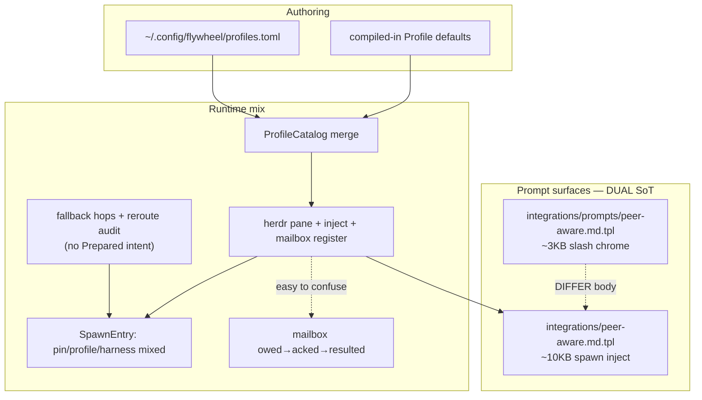
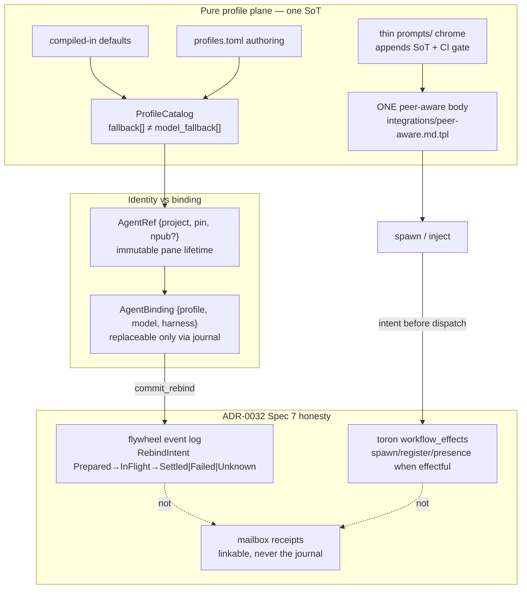

<!-- governed-by: ADR-0005 Spec 1/1b, ADR-0007, ADR-0011, ADR-0018, ADR-0026, toron ADR-0032 Spec 7 (I4–I5/I6), GS-042, GS-043 -->
---
status: accepted
date: 2026-09-12
decision-makers: Captain (bangedorrunt)
consulted: |
  GS-042 agent-profile overhaul (bible db07a4cb…); GS-043 PR#8 tip 9677e9b
  (merged to main as 772abd8 during GS-044 — single peer-aware SoT + AgentRef + journaled rebind);
  toron ADR-0032 tip 0131edd (Status: Proposed); Jido v3 Ref/Turn lessons
  (steal FP contracts, reject AgentServer/OTP); GS-038/039/040 CoS scars
  (wake theater, open AUTHORITATIVE, name-bind).
informed: flywheel × toron × beads maintainers; harness agents
---

# ADR-0013: Agent-profile lifecycle and journaled fallback rebind

| Field | Value |
|-------|-------|
| **Status** | **Accepted** — captain word on this file, 2026-09-12. Wave A (GS-043 shape) landed on `origin/main` (`772abd8…`); Wave B (D9, spawn/register/presence as effects) implemented in the acceptance change set on the flywheel effect journal; Wave C remains open and is sequenced under its own beads. |
| **Decision-makers** | Captain (bangedorrunt) |
| **Extends** | [ADR-0005](0005-always-on-collab-baseline-and-command-surface.md) Spec 1/1b (profile catalog), [ADR-0007](0007-catalog-slots-and-agent-native-cli.md) (slots + `profile set`), [ADR-0011](0011-session-conductor-crew-budget-captain-fcfs-join-loud.md) (crew pack), [toron ADR-0018](../../toron/docs/decisions/0018-agent-identity-naming-grammar.md) (pin≠slug / identity grammar), [toron ADR-0026](../../toron/docs/decisions/0026-failure-taxonomy-funded-preflight-fallback-chains-mail-health-escalation.md) (fallback/reroute), [toron ADR-0032](../../toron/docs/decisions/0032-workflow-engine-honesty-jido-contracts.md) Spec 7 / I4–I6 (intent before dispatch; unknown visible; journal ≠ mailbox) |
| **Does not amend** | Tick Law; frozen MCP tool count; toron kind registry; one-way `flywheel → toron-workflow → toron-core`; beads legal-close ownership; open-mode AUTHORITATIVE text (GS-039); doorbell plane ownership (ADR-0012) |
| **Does not wire** | Jido AgentServer / OTP supervision / Pods / Flow topology; mailbox `owed→acked→resulted` as a workflow or rebind journal; a second peer-aware template body; inventing `Settled` from timeout/mail-ack/process exit |
| **Governs** (on acceptance) | `AgentRef` / `AgentBinding` / `RebindIntent` lifecycle; peer-aware single SoT + CI gate; `profile set --fallback` vs `--model-fallback`; `binding-rebind` captain path; fail-loud `--model` until a live consumer exists; C1 evidence redaction on journal + reroute audit |
| **Tracker** | beads re-cut against this record + ADR-0032 waves; GS-043 PR#8 subset now on tip (`772abd8…`); this ADR remains **Proposed** — HOLD merge of *this* ADR PR until captain word |
| **Verification** | Acceptance checklist §10; GS-043 prove steps remain the code gate for the subset |

**Decision in one sentence:** Treat every live employee as an immutable `AgentRef` plus a replaceable `AgentBinding`, and allow profile/model/harness changes only through a journaled rebind that obeys ADR-0032 Spec 7 honesty — intent before dispatch, visible unknown, and never inventing settlement from timeout, mail ack, or process exit — while keeping a single peer-aware prompt SoT and distinct `fallback[]` (profile names) vs `model_fallback[]` (model ids) taxonomy.

---

## 1. Why this ADR exists

GS-042 scored tip inventory against Jido v3 FP lessons and **toron ADR-0032 (Proposed)**. The profile catalog already exists (six builtins + TOML overlay + Squad/CrewPlan), but the **agent-profile lifecycle is not yet an honest FP composition**:

1. **Dual peer-aware SoT** — spawn inject (`integrations/peer-aware.md.tpl`, ~10KB) and slash chrome (`integrations/prompts/peer-aware.md.tpl`, ~3KB) **DIFFER** on tip main. Automation that patches one path leaves the other stale (GS-038 chatter-ignore class).
2. **Identity vs role leak** — `SpawnEntry` mixes pin / mail identity / profile / harness without a typed freeze line. Pin≠slug (ADR-0018) is documented; pane-lifetime immutability is not enforced as a type.
3. **Fallback hops without Spec 7 safety** — `Profile.fallback` and `model_fallback` are distinct fields, and tip already hops/audits some billing paths, but tip main does not journal intent-before-dispatch for live rebinds, and timeout/empty evidence can be mistaken for a license to change model.
4. **ADR-0032 is the honesty gate, not a profile ADR** — profiles must **obey** I4/I5/I6 when spawn, stage send, park, wake, and reroute scale. Mailbox receipts stay mailbox receipts.

GS-043 PR#8 (`9677e9b…`) implements a **subset** of this contract (single SoT + `AgentRef` + journaled rebind + fail-loud `--model` + C1 redact) and was **merged to tip** as `772abd8…` during the GS-044 window (mission asked HOLD; tip moved under captain/other merge — this scout did not merge it). This ADR is the **self-contained captain contract** for that subset and for the remaining GS-042 P0/P1 profile lifecycle work. Captain accepts the ADR when finished; do **not** invent-green ADR status from the code merge alone.

---

## 2. Tip baselines (re-confirmed 2026-09-12 ~19:56 AEST / Melbourne UTC+10)

| Repo | Live HEAD | Notes |
|------|-----------|-------|
| **flywheel** | `772abd829b9886e727d92e4db99842d31f100eea` | Mac + `origin/main` — merge of GS-043 PR#8 @ 19:55 AEST |
| **toron** | `0131edd3f8ac3dc46f133b735a5e27ffbce25420` | ADR-0032 **Proposed** at `docs/decisions/0032-workflow-engine-honesty-jido-contracts.md` |
| **beads** | `faf1dc4453ec3f69d8dd7851febb93d041c0e9ff` | Mac tip (local ahead of GitHub `origin/main` `7ee5d03…`) |
| **GS-043 PR#8** | tip was `9677e9b24698e1b2f136b44ff4e1a5f46b7fa0ec` | **MERGED** as `772abd8…`. Pre-merge main `193d57e…` had dual peer-aware DIFFER (~9894 vs ~2890 B) and **no** `agent_ref.rs`. Post-merge: SoT ~10810 B + chrome ~1459 B; `src/agent_ref.rs` present. |

**ADR-0032 status:** `status: proposed` in front matter; body states **Proposed. Acceptance = captain word on this file.** Tip toron already carries a `workflow_effects` store (Wave-3-shaped infrastructure) while the ADR remains Proposed — that is **infra ahead of acceptance**, not invent-green that ADR-0032 is Accepted.

**GS-044 honesty:** Mission asked HOLD on PR#8. Tip moved during authorship. Rescore uses **post-merge tip** as live truth; pre-merge column kept for audit.

---

## 3. As-is vs to-be

### 3.1 Architecture — as-is (pre-GS-043 / pre-merge tip `193d57e…`)



### 3.2 Architecture — to-be (Wave A landed on tip `772abd8…`; Wave B/C still open)



### 3.3 Profile lifecycle — as-is

```mermaid
sequenceDiagram
  participant Op as Operator/Captain
  participant FW as flywheel
  participant H as herdr pane
  participant M as mailbox
  Op->>FW: compose/spawn @profile
  FW->>H: pane start + inject peer-aware tpl (root ~10KB)
  FW->>M: register / presence (receipts)
  Note over FW: exit 0 easy to read as "ready"
  Op->>FW: profile set / ad-hoc reroute
  Note over FW: SpawnEntry fields rewrite;<br/>timeout/ack can be mistaken for hop license
```

### 3.4 Profile lifecycle — to-be (FP)

```mermaid
sequenceDiagram
  participant Op as Operator/Captain
  participant FW as flywheel
  participant J as rebind journal
  participant H as herdr pane
  participant FX as effect journal
  Op->>FW: spawn @profile
  FW->>FW: AgentRef settle (pin; npub freeze once Some)
  FW->>FX: prepare spawn/register intent (I4)
  FW->>H: dispatch only after intent committed
  FW->>FX: settle or mark unknown (I5)
  Note over FW,FX: wake observation = separate evidence
  Op->>FW: binding-rebind --pin … --profile scout
  FW->>J: RebindIntent Prepared
  FW->>J: InFlight
  FW->>H: apply binding
  FW->>J: Settled | Failed | Unknown
  Note over J: never edit profiles.toml for live pane
  Note over FW: timeout / mail-ack alone → no hop
```

---

## 4. Normative decisions

### D1 — Single peer-aware SoT + CI gate

- **Canonical body:** `integrations/peer-aware.md.tpl` (spawn inject).
- **Chrome:** `integrations/prompts/peer-aware.md.tpl` MUST stay thin, MUST name the SoT path, MUST NOT embed a second `OPERATING CONTRACT` body.
- **Required SoT markers** (ADR-0010 D7 / bd-kfy2 contracts survive thinning): `CONTROL-PLANE MARKER`, `FLYWHEEL_OP`, `RED-SURFACE PING`.
- **CI:** `scripts/check-peer-aware-sot.sh` (chrome byte budget, marker presence, `main.rs` references SoT path). Wire into `.github/workflows/ci.yml`.

Pre-merge tip: **PROVED DIFFER** (~9894 B vs ~2890 B). Post-merge tip (`772abd8…`): single SoT + CI gate **FOLDED** (SoT ~10810 B, chrome ~1459 B).

### D2 — `AgentRef` freeze once `npub` is `Some` (A1)

```text
AgentRef { project, pin, npub: Option<String> }
```

- Immutable for a pane lifetime: `project` + `pin` never rewrite; `npub` may transition `None → Some` exactly once.
- `AgentRef::with_npub` is a **no-op** when already `Some` (A1). A second bind does not silently replace identity.
- Fail-closed if pin unbound after settle where tip already claims name-bind (GS-038).

`AgentBinding { profile_name, model, harness }` is the **only** replaceable surface for live panes, and only via D3.

### D3 — Journaled rebind (I4 / I5); journal ≠ mailbox (I6)

```text
RebindIntent {
  agent: AgentRef,
  from: AgentBinding,
  to: AgentBinding,
  reason: RebindReason,   # Captain | ProfileFallback | ModelFallback | …
  state: Prepared | InFlight | Settled | Failed | Unknown,
  effect_key: derived(agent, from, to),
  evidence: redacted bounded snippet
}
```

- **I4 — Intent precedes dispatch:** commit `Prepared` before any in-flight hop. No silent `profiles.toml` edit for a live pane rebind.
- **I5 — Unknown is visible:** timeout, crash, empty evidence, or mail ack alone MUST NOT invent a model/harness/profile change. Empty evidence → refuse hop and journal `Unknown` (or no hop), never invent `Settled`.
- **I6 — Journal ≠ mailbox:** rows live in the **flywheel event log** (`state::log_event` / equivalent). Mailbox `owed→acked→resulted` may be **linked** by `corr` projection; it MUST NOT be the rebind journal.
- Apply helpers: `commit_rebind` (Settled|Failed) and `commit_rebind_opt` (Settled|Unknown|Failed) for pane-gone / unresolved hops.

### D4 — `fallback[]` vs `model_fallback[]` rebind taxonomy

| Field | Values | Failure classes that may consume | Journal reason |
|-------|--------|----------------------------------|----------------|
| `Profile.fallback` | **other profile names** | `billing` / `auth` / `provider` (ADR-0026 Spec 3) | `ProfileFallback` |
| `Profile.model_fallback` | **model ids** | `rate_limit` (then registry `ModelEntry.fallback` as last rung) | `ModelFallback` |
| *(neither)* | — | `timeout` / empty evidence / mail-ack alone | **no hop** |

- Headless + pane registry last rung MUST journal via `commit_rebind` before a second harness invoke (I4).
- CLI authoring: `flywheel profile set --fallback a,b --model-fallback id1,id2` — **distinct flags** (D5).

### D5 — CLI surface

| Command | Mutates | Notes |
|---------|---------|-------|
| `flywheel profile set --fallback … --model-fallback …` | `profiles.toml` catalog SoT | Authoring only; not a live-pane hop |
| `flywheel binding-rebind <project> --pin <pin> [--profile\|--model\|--harness] [--note …]` | spawn registry binding via journal | Does **not** edit `profiles.toml` |
| `flywheel spawn …` | pane + registry under AgentRef settle | Effectful paths obey I4 when wired to effect journal |
| `flywheel rebind` (legacy name-bind) | name binding restore | **Not** profile/model rebind; keep distinct |

### D6 — `--model` fail-loud until live consumer

On tip / GS-043: `SpawnEntry.model` is **write-only** — no spawn/pane/headless consumer reads it today.

- `binding-rebind --model …` MUST **fail-loud before Settled** with an explicit refusal naming the write-only fact.
- NEVER invent `Settled` for a write that nothing reads.
- Catalog authoring remains `flywheel profile set --model …`.
- When a live consumer lands, this ADR is amended (or a follow-on bead) before `--model` on `binding-rebind` may Settled.

### D7 — C1 redact evidence

Before persist or `eprintln` of harness stderr / provider blobs:

- `redact_evidence` strips `Authorization:`, `Bearer`, `sk-`, `xai-`, `nsec1`, `ncryptsec`, `eyJ…`, `api_key=` / `OPENCODE_*` / `TORON_KEY_PASSPHRASE=` forms at token boundaries.
- Truncate to a bounded non-secret snippet (e.g. 256 chars) with an explicit truncated marker.
- Apply on **both** `journal_rebind` and `record_reroute_audit`.

### D8 — ADR-0032 Spec 7 honesty for profiles (normative cite)

From toron ADR-0032 (Proposed) — profiles **obey**, they do not restate a second retry policy:

- **I4 — Intent precedes dispatch:** an effectful dispatch cannot begin until its workflow-effect (or rebind) intent is durably committed.
- **I5 — Unknown is visible:** a crash, timeout, or ambiguous provider response cannot be represented as a successful or absent effect without reconciliation evidence.
- **I6 — Mailbox receipts stay mailbox receipts.**
- Spec 7: one retry coordinator; `rate_limit`/`timeout` are retry candidates only when effect state is known safe or the provider honors the stable `effect_key`; otherwise `unknown/reconcile_pending`, not a blind retry. `auth`/`billing`/`provider`/`blocked`/`cancelled` are not blindly retried — ADR-0026 fallback/reroute remains authoritative **under** this effect-safety qualification.

**Profile mapping:** a live profile/model hop is an effectful rebind. Timeout string alone is never a hop license. Mail ack is never settlement of a rebind.

### D9 — Spawn / register / presence as effects (target; may trail PR#8)

Full GS-042 P0-3 remains the north star: spawn/register/presence publish follow `intent → in_flight → settled|unknown`, never “exit 0 = employee ready.” Wake observation is **separate evidence**. GS-043’s rebind journal is necessary but **not sufficient** for this D9 — do not invent-green P0-3 as folded when only rebind lands.

---

## 5. Rejects (explicit)

| Reject | Why |
|--------|-----|
| **Jido AgentServer / OTP / Pods / Flow topology** | Second runtime/control plane; ADR-0028 + ADR-0032 already refuse. Steal Ref/Turn/fail-closed FP; do not port the runtime. |
| **Mailbox-as-journal** | `owed→acked→resulted` lacks workflow/rebind identity, attempt fencing, and unknown. Violates I6. |
| **Dual peer-aware tpl bodies** | Dual SoT is the GS-038 stale-path class. Chrome may exist; a second full body may not. |
| **Invent `Settled`** | From timeout, mail-ack, process exit, or write-only `--model`. Settled requires apply evidence or an honest Failed/Unknown. |
| **Silent `profiles.toml` edit for live pane hop** | Catalog authoring ≠ in-flight rebind. Captain path is `binding-rebind`. |
| **Conflating `fallback` and `model_fallback`** | Different value domains and failure classes (D4). |
| **First-match-wins / silent steer in catalog** | ADR-0032 Spec 9; unknown `@profile` / no-match stays fail-closed / explicit `none`. |

---

## 6. Relationship to GS-042 scores and GS-043 PR#8

Honest rescore vs **post-merge tip** `772abd8…` (2026-09-12 ~19:55 AEST). Audit column = pre-merge `193d57e…` (mission baseline before PR#8 landed).

| ID | Item | vs tip main `772abd8…` | vs pre-merge `193d57e…` |
|----|------|------------------------|-------------------------|
| **P0-1** | Single peer-aware SoT + CI | **FOLDED** — SoT ~10810 B, chrome ~1459 B, CI SoT script | was **STILL** DIFFER ~9894 vs ~2890 |
| **P0-2** | Immutable `AgentRef` vs role | **FOLDED** — `src/agent_ref.rs` (A1) | was **STILL** |
| **P0-3** | Profile spawn as ADR-0032 effect | **FOLDED (flywheel journal)** — spawn / register / presence + the wake observation each journal intent→in_flight→settled\|failed\|unknown; toron `workflow_effects` wiring still trailed under Proposed 0032 | same |
| **P0-4** | Open-mode AUTHORITATIVE invariant | **FOLDED** | was already **FOLDED** |
| **P0-5** | One catalog compiler (0032 Spec 9) | **CHANGED** / remainder **STILL** | unchanged by PR#8 |
| **P1-6** | Compose-as-data | **CHANGED** | unchanged |
| **P1-7** | Muse/slot pin in profile digest | **FOLDED (flywheel ledger)** — `SpawnEntry.model_pin` | was **STILL** |
| **P1-8** | Skills attach bounded digest | **FOLDED (flywheel ledger)** — `SpawnEntry.skills_digest` | was **STILL** |
| **P1-9** | Fallback chains + Spec 7 effect-safety | **FOLDED** — journaled taxonomy I4/I5 | was **CHANGED**/incomplete |
| **P1-10** | Wake + presence as profile attach | **CHANGED** / full contract **STILL** | unchanged |
| **P2-11** | Versioned portable profile codec | **STILL** | **STILL** |
| **P2-12** | Capability plugins without OTP | **STILL** | **STILL** |
| **P2-13** | Fleet CoS control surface | **STILL** | **STILL** |
| **P2-14** | Clean `dead_code` / profile CLI | **STILL** | **STILL** |

**No invent-green:** FOLDED = tip proves contract; CHANGED = partial; STILL = gap remains; PARTIAL = rebind only (not full spawn-as-effect).

> **Rev 3 (2026-09-12):** P1-7/P1-8 re-scored on the Wave C digest landing — `model_pin` (the resolved route, never the `@slot` alias) and `skills_digest` (bounded, order-sensitive) ride the spawn ledger row, written from the same `profile_launch_plan` call that builds the argv, all gated in `verify-0013.sh`. The rescore *baseline* column above stays the PR#8-tip audit; the catalog-compiler remainder (P0-5) and the portable codec (P2-11) remain open.

---

## 7. Implementation blueprint (post-acceptance)

### Gate 0 — Contract characterization

- Keep this ADR Proposed until captain word.
- Re-cut beads so none say “reuse mailbox receipts for profile exactly-once” or “port Jido AgentServer.”
- GS-043 PR#8 already on tip; captain still accepts **this ADR** before Status → Accepted.

### Wave A — Honesty subset (GS-043 shape) — **landed on tip** `772abd8…`

1. Single peer-aware SoT + CI gate (D1) — landed.
2. `src/agent_ref.rs` + wiring (D2–D4, D6–D7) — landed.
3. CLI: `profile set --fallback` + `binding-rebind` (D5–D6) — landed.
4. Prove suite on tip — keep green; do not regress.

### Wave B — Spawn as effect (D9 / GS-042 P0-3) — **landed on the flywheel journal**

- `AgentEffect` / `AgentEffectGuard` in `src/agent_ref.rs` journal `Prepared → InFlight → Settled | Failed | Unknown` on the flywheel event log (I4/I5/I6 — the same journal primitive D3 chooses, so no second retry coordinator and no mailbox-as-journal).
- `cmd_spawn` opens the spawn effect before `workspace_create` and settles it only on the verified workspace + live panes; `--no-verify` journals `Unknown` instead of inventing `Settled`. Register (`pinned_mail_identity`) and presence publish are their own per-pin effects; an unobservable upsert/publish journals `Unknown`, never a silent absence.
- The wake-subscription read is a **separate `Wake` observation row** carrying the subscriber count — it never settles spawn / register / presence.
- **Still trailed:** wiring these effects to toron `workflow_effects` storage (that store is infra ahead of ADR-0032's Proposed status), and the robot-mode hard-fail for a missing wake observation (P1-10) — no live contract requires it yet, so the existing loud `subscribers=0` warning stands rather than being invented into a gate.

### Wave C — Catalog / digest / portable (P0-5 remainder, P1-7/8, P2)

- One compiled catalog table for profiles ⊕ workflow matchers ⊕ topology metadata (Spec 9 remainder).
- ~~Muse/slot + skills digests on spawn ledger~~ **landed (Rev 3)**: `SpawnEntry.model_pin` + `SpawnEntry.skills_digest`, recorded from the resolved launch plan. Still open: one compiled catalog table; portable ProfileDef codec; drop `dead_code` allow when CLI is sole TOML mutation path.

---

## 8. File / ownership map

| Path | Owner | Role |
|------|-------|------|
| `src/agent_ref.rs` | flywheel | `AgentRef` / `AgentBinding` / `RebindIntent` / `AgentEffect` + `AgentEffectGuard` (D9) / redact / commit helpers |
| `src/profile.rs` | flywheel | catalog SoT; `fallback` vs `model_fallback` docs |
| `src/main.rs` | flywheel | `profile set`, `binding-rebind`, spawn / register / presence effect wiring |
| `src/pane.rs` | flywheel | pane 429 / billing hops through `commit_rebind(_opt)` |
| `integrations/peer-aware.md.tpl` | flywheel | **only** full peer-aware body |
| `integrations/prompts/peer-aware.md.tpl` | flywheel | thin chrome |
| `scripts/check-peer-aware-sot.sh` | flywheel | CI gate |
| `docs/learnings/gs-043-profile-fallback-rebind.md` | flywheel | as-is→to-be learning (PR#8) |
| toron `workflow_effects` | toron-core | spawn/effect journal when Wave B lands |
| mailbox receipts | toron-core | message lifecycle only |

---

## 9. Risks and mitigations

| Risk | Mitigation |
|------|------------|
| Treat code merge as ADR Accepted | Status flipped on captain word only (2026-09-12); code merges alone never flipped it |
| Treat toron `workflow_effects` as “ADR-0032 Accepted” | Status stays Proposed until captain word; infra ≠ acceptance |
| Chrome regrows into a second SoT | CI byte budget + marker grep |
| Operators use `profile set` for live hops | Help text + learning doc: live = `binding-rebind` |
| Secrets in journal | C1 redact on all persist/eprintln paths |
| Invent-green CoS from exit codes | I5 + fail-loud `--model` + no Settled without apply evidence |

---

## 10. Acceptance checklist (captain)

Accepted by captain word on this file (2026-09-12). The checklist records the evidence for each item; the code gates below are re-runnable in one pass with `bash docs/decisions/_scripts/verify-0013.sh`.

- [x] **Status flip:** front matter + body Status → Accepted (captain, 2026-09-12).
- [x] **D1:** one peer-aware SoT + green `check-peer-aware-sot.sh` in CI (10808 B body / 1459 B chrome on `772abd8…`; gate re-run green).
- [x] **D2/A1:** `AgentRef` on tip; `with_npub` freezes once `Some`; pin unbound after settle fails closed where claimed (`agent_ref::tests::npub_freezes_once_some`, `::unbound_pin_fails_closed`).
- [x] **D3/I4–I6:** live rebinds journal Prepared→InFlight→terminal; timeout/empty/mail-ack alone never hop; journal is the flywheel event log, not mailbox receipts (`agent_ref::tests::timeout_alone_never_allows_rebind`).
- [x] **D4:** `fallback[]` vs `model_fallback[]` taxonomy enforced in code + CLI flags (`profile::tests::fallback_empty_by_default`).
- [x] **D5:** `profile set --fallback/--model-fallback` and `binding-rebind` documented and distinct from legacy `rebind`.
- [x] **D6:** `binding-rebind --model` fail-loud until a live consumer exists; no invent Settled (`gs043_residual_honesty_tests`).
- [x] **D7/C1:** redact covers journal + reroute audit (`effect_journal_redacts_evidence`, `record_reroute_audit_redacts_evidence`).
- [x] **D9 (Wave B):** spawn / register / presence journal intent→in_flight→terminal on the flywheel event log; the wake observation is a separate row; `--no-verify` journals Unknown (`adr0013_spawn_effect_tests`).
- [x] **P1-7/P1-8 (Wave C digests):** the spawn ledger row carries the resolved Muse/slot pin + a bounded skills digest, both from ONE `profile_launch_plan` call (`adr0013_spawn_effect_tests::spawn_ledger_records_model_pin_and_skills_digest`, `spawn_profile_plan_tests::launch_plan_pin_is_the_resolved_route_not_the_slot_alias`, `state::loops_sidecar_tests::spawn_registry_pin_and_skills_digest_columns_roundtrip`, `profile::skills_digest_tests`).
- [x] **Rejects:** no AgentServer, no mailbox-as-journal, no dual tpl, no invent Settled — still explicit in this file.
- [ ] **Beads:** re-cut against this ADR + ADR-0032; no bead claims mailbox receipts give profile exactly-once. *(No open bead makes that claim; the Wave C re-cut is still owed.)*
- [x] **HOLD discipline:** the HOLD was on *this* ADR PR only — captain word given 2026-09-12; spawn-as-effect (D9) landed on the flywheel journal; toron `workflow_effects` wiring and the P1-10 robot-mode hard-fail stay sequenced under ADR-0032.

**Non-goals for acceptance of this ADR alone:** full Fleet CoS surface (P2-13), portable codec (P2-11), or ADR-0032 Wave 3 completion — those remain sequenced under their own records.

---

## 11. Evidence index

| Evidence | Path / ref |
|----------|------------|
| GS-042 bible | `/home/box/agent-data/grok-ship/reports/GS-042.md` (sha256 `db07a4cb355e66fd20bdc1ce919f79ee1ad4e72fc71fceae6dd960682e671b67`) |
| GS-043 learning | `docs/learnings/gs-043-profile-fallback-rebind.md` on PR#8 |
| ADR-0032 | toron `docs/decisions/0032-workflow-engine-honesty-jido-contracts.md` @ `0131edd…` (**Proposed**) |
| Dual tpl pre-merge | ~9894 B vs ~2890 B on `193d57e…` |
| Post-merge SoT | ~10810 B SoT + ~1459 B chrome on `772abd8…` |
| PR#8 | `9677e9b…` merged as `772abd8…` (2026-09-12 19:55 AEST) |
| Wave B effect journal | `src/agent_ref.rs` (`AgentEffect`, `AgentEffectGuard`) + `adr0013_spawn_effect_tests` in `src/main.rs` |
| Wave C ledger digests | `state::SpawnEntry::{model_pin, skills_digest}` + `profile::skills_digest` (P1-7/P1-8) |
| ADR compliance gate | `docs/decisions/_scripts/verify-0013.sh` |
| This ship | GS-044 report `GS-044.md` / `GS-044-profile-adr.md` |

---

## 12. Changelog

| Rev | Date (AEST) | What |
|-----|-------------|------|
| 1 | 2026-09-12 | Proposed — GS-044 self-contained profile lifecycle / journaled fallback ADR; HOLD merge of ADR PR; rescore updated after PR#8 landed on tip `772abd8…` during authorship |
| 2 | 2026-09-12 | **Accepted** (captain word) — Wave B (D9) implemented: spawn / register / presence effects + a separate wake observation on the flywheel event journal; `binding-rebind` pin aligned to the D5 flag form; acceptance checklist evidence recorded; `verify-0013.sh` added. Wave C (catalog/digest/portable) still open. |
| 3 | 2026-09-12 | Wave C digests landed: `SpawnEntry.model_pin` (resolved route, never the `@slot` alias) + `SpawnEntry.skills_digest` (bounded, order-sensitive), both taken from the single `profile_launch_plan` call that builds the argv; P1-7/P1-8 re-scored FOLDED; `verify-0013.sh` covers them. Still open: one compiled catalog table, portable codec. |
