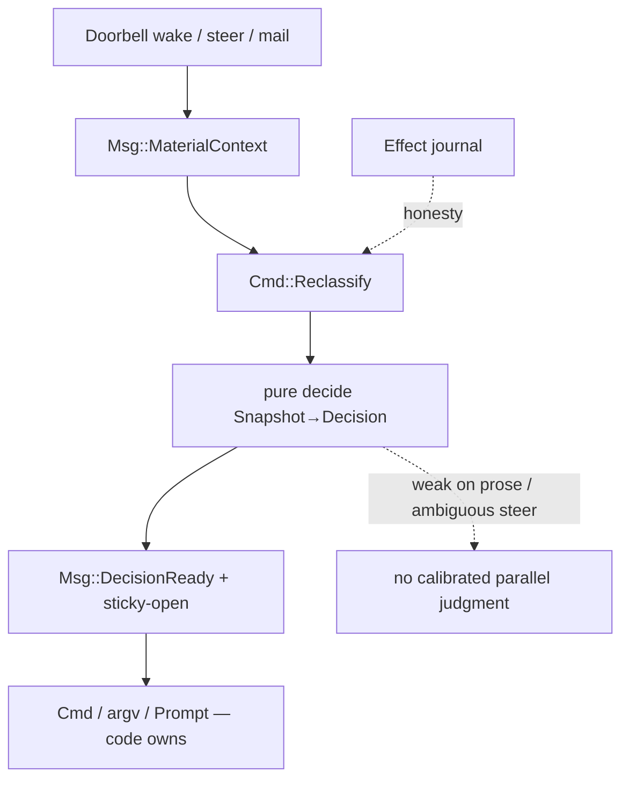
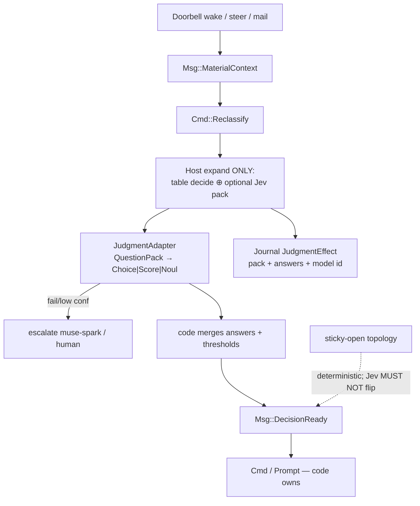

<!-- governed-by: ADR-0010, ADR-0012, ADR-0013, toron ADR-0032, toron ADR-0033 (Proposed), beads ADR-0001, GS-054, GS-055 -->
---
status: proposed
date: 2026-09-19
decision-makers: Captain (bangedorrunt) — Proposed only; HOLD merge until captain ship word
consulted: |
  GS-054 System One / Jev scout (CONFIRM theses 1–3; REJECT agent-runtime / dual SoT /
  Funnel / Redis-OTP-AgentServer / auto-close); TypeSafe docs (llms.txt, how-to-build-
  with-system-one, jev-1.13 jaggedness, cookbooks: rerank, classifying_rag_passages,
  citation_check, skill_suggestion, llm_guardrails, parallel_questions, entity_alignment,
  hierarchical_classification); Firstmate lock GS-055 (flywheel+toron+beads ADRs only;
  chiebukuro ADR is Shipwright's); GS-048/049 Reclassify path; GS-052 hybrid brief tip
informed: flywheel × toron × beads maintainers; Shipwright (chiebukuro compile-vs-gate)
---

# ADR-0014: Jev / System One as host-side judgment adapter (Proposed)

| Field | Value |
|-------|-------|
| **Status** | **Proposed** — 2026-09-19. **HOLD merge** of this ADR PR until captain ship word. **No W1/W2/W3 implementation** in this change set. |
| **Decision-makers** | Captain (bangedorrunt) |
| **Extends** | [ADR-0010](0010-delivery-semantics-attention-triage-decision-lifecycle.md) (decision lifecycle), [ADR-0012](0012-doorbell-plane-independent-runtime.md) (wake ≠ classify), [ADR-0013](0013-agent-profile-lifecycle-journaled-rebind.md) (journaled honesty), [toron ADR-0032](../../toron/docs/decisions/0032-workflow-engine-honesty-jido-contracts.md) Spec 7 (intent before dispatch; journal ≠ mailbox), [toron ADR-0033](../../toron/docs/decisions/0033-jev-system-one-relative-to-honesty-plane.md) (Proposed — System One in host/effects plane) |
| **Does not amend** | Tick Law; pure `decide` table leaf; sticky-open topology; doorbell plane ownership; MCP freeze; beads sole close; disk wiki SoT; GS-053 HOLD; GS-054 W1–W3 HOLD implement |
| **Does not wire** | Judgment adapter crate; `FLYWHEEL_JEV` flag; live `POST /v1/systemone`; agent while-loop; dual SoT; Redis/OTP/AgentServer; invent-`Settled`; Jev flip of sticky-open |
| **Governs** (on acceptance) | Where System One / Jev may sit relative to MaterialContext → Reclassify → DecisionReady; confidence escalate; effect-journal requirements for judgments; REJECT list for fashion imports |
| **Tracker** | GS-055; GS-054 W1–W3 remain HOLD until captain ship word; chiebukuro ADR owned by Shipwright |
| **Verification** | Acceptance = captain word on this file. Code wedges (W1–W3) require a separate ship word after acceptance. |

**Decision in one sentence:** Treat TypeSafe Jev (`jev-latest` / pinable `jev-1.13.x`) as an optional **host-side enricher** that answers typed Choice / Score / Noul packs over ephemeral state slices during MaterialContext / Reclassify / DecisionReady and workflow-family selection — while **code always owns Cmd**, sticky-open stays deterministic, low confidence escalates to muse-spark/human, and every production judgment is effect-journaled — never as an agent runtime, second source of truth, or silent topology author.

---

## 1. Why this ADR exists

GS-054 confirmed four theses for the stack:

| # | Thesis | Verdict |
|---|--------|---------|
| 1 | Jev behind DecisionReady / workflow family / honesty gates; code owns Cmd; low conf → muse-spark/human; **do not** replace Elm Tick with a System One agent loop | **CONFIRM** |
| 2 | Chiebukuro: ingest triage, compile quality/noul, qmd rerank, session eligibility; wiki stays disk SoT; Jev never knowledge store | **CONFIRM** (chie ADR = Shipwright) |
| 3 | One judgment adapter (state slice + question pack → typed answers → code compose) for toron host **and** chie pipelines; journal as effects where honesty requires | **CONFIRM** |
| 4 | REJECT Typesafe-as-agent-runtime; Funnel/public; dual SoT; fashion MCP without Tick feed; Redis/OTP/AgentServer "for Jev" | **CONFIRM REJECT** |

Flywheel already ships the seam: `Msg::MaterialContext` → `Cmd::Reclassify` → host expands via pure `decide` → `Msg::DecisionReady`, with sticky-open topology and effect-journal honesty (GS-048+). What is missing is a **captain-locked contract** for inserting calibrated judgments without fashion-importing an agent loop.

This ADR is **Proposed only**. GS-054 wedges W1 (adapter spike), W2 (`FLYWHEEL_JEV` reclassify enricher), W3 (chie qmd rerank) remain **HOLD implement** until a separate captain ship word.

---

## 2. Tip baselines (GS-055 authorship)

| Repo | Live HEAD | Notes |
|------|-----------|-------|
| **flywheel** `origin/main` | `8914910e45afb5c4c392db90dfd601d68348b42b` | Merge PR#13 gs-052/hybrid-brief |
| **toron** `main` | `a1359edcb8b4152fbffd8ccb235a1e4873c3a2b1` | Companion ADR-0033 Proposed |
| **beads** `main` | `3fb001bbf07896d239078a22cce204d1da70b2c2` | Companion ADR-0006 Proposed |

---

## 3. What System One / Jev is (fixed vocabulary)

Sources: [TypeSafe llms.txt](https://docs.typesafe.ai/llms.txt), [how-to-build-with-system-one](https://docs.typesafe.ai/concepts/how-to-build-with-system-one.md), [jev-1.13 jaggedness](https://docs.typesafe.ai/model-jaggedness/jev-1.13.md).

| Claim | Contract |
|-------|----------|
| **Jev** | TypeSafe flagship; first System One model; alias `jev-latest` → currently `jev-1.13.x` |
| **Not an LLM** | Understands NL **state**; returns typed decisions + probabilities — **no generation**, no chain-of-thought as control flow |
| **API** | `POST https://api.typesafe.ai/v1/systemone` with `state` + parallel `questions` |
| **Primitives** | **Choice** (closed-set + probs + confidence); **Score** (ordered levels); **Noul** (P(yes) ∈ [0,1]) |
| **Philosophy** | AI-powered software: **code owns control flow**; model only where common-sense judgment over unstructured data is needed |
| **Jaggedness (jev-1.13)** | No generation; **math/count/date-compare in code**; filter state before send; literal instructions; do not rely on Noul↔Choice arithmetic identities |

---

## 4. As-is vs to-be

### 4.1 As-is (tip `8914910e…`)



### 4.2 To-be (Proposed — after captain acceptance + separate W1–W2 ship word)



**Invariant:** HTTP / API keys / Jev calls never enter `workspace::tick`. Adapter lives in the host expand path (doorbell_host / live_decide_snapshot expand), same honesty plane as other effects.

**Expand boundary (I7, normative):** `Cmd::Reclassify` prepares pack intent (insert-or-load under the `ReclassifyIntent` effect key) → the effect layer awaits the System One POST off-tick → answers re-enter as a `DecisionReady` extended field. The diagram's `HOST → AD` edge is never an inline blocking call inside expand; tick never performs I/O.

**Merge authority (I3, normative):** the table `decide` wins on primitive and topology. Jev may only annotate (urgency / confidence) and resolve explicit-`none` ambiguity as advisory text attached to the escalate Prompt — never auto-adopt. After merge, code asserts `out.topology == sticky(in)` unless `explicit_topology` was set on the incoming `MaterialContext`; violation escalates to muse-spark / human and journals a `LoudMiss`. Forbidden zone: never call the adapter from `decide.rs` `classify` / `pick` / `build_decision` — those stay pure.

---

## 5. Decision details

### 5.1 Judgment adapter (conceptual contract — not implemented here)

```text
JudgmentAdapter.ask(state_slice, pack_id) -> Answers
  1. Load versioned QuestionPack (pure data — ADR-0013 / toron ADR-0032 profile rhyme)
  2. POST systemone OR offline refuse (honesty path) / table fallback (announce-only, `fallback_flag=true`) — always loud in journal
  3. Return Choice|Score|Noul map + model id + usage
  4. If honesty_required: EffectJournal.append(JudgmentEffect{pack, answers, conf, model})
Caller code: weights, thresholds, Cmd construction — NEVER the model.
```

**Pack contract (I5, normative):** packs are versioned YAML pure data in-repo at `.flywheel/judgment-packs/<id>.vN.yaml` (schema: pack id, version, model pin, questions with typed Choice/Score/Noul definitions). Model pin is `jev-1.13.0` — never `jev-latest` — until pack re-validation CI exists, so static packs cannot drift silently under a moving alias.

**State-slice builder (I5, normative):** the slice is built in code with a byte cap (8 KiB default) and a PII denylist (credentials, tokens, private keys, full mail bodies); truncation is head-cut with a `truncated=true` marker. This is the code-side filter the jev-1.13 jaggedness row mandates.

**Offline / deny policy (I4, normative):** on the honesty path the default is hard escalate (refuse, never silent table fallback). Table-decide fallback is allowed only on announce-only surfaces, and then only with `fallback_flag=true` journaled. This closes §7.2.

### 5.2 Allowed enrichment surfaces (flywheel)

| Surface | Shape | Notes |
|---------|-------|-------|
| **Reclassify enricher** | On MaterialContext: intent Choice, urgency Score, honesty Nouls → merge with table `decide` | Highest leverage; default off behind future `FLYWHEEL_JEV` |
| **Workflow family / selection** | Choice over families when brief catalog ambiguous (skill_suggestion shape) | After adapter exists; does not replace hybrid `--brief` |
| **Inbound mail guardrails** | Noul/Score battery on doorbell material (injection / credentials) | Compose in host; still Tick Msg; later wave |
| **Honesty gates** | Confidence thresholds escalate; never invent Settled from Jev alone | Aligns ADR-0032 Spec 7 |

### 5.3 Hard rules

1. **Code owns Cmd** — Jev never selects next Tick action or invents topology.
2. **sticky-open stays deterministic** — open stays open unless explicit loop/swarm/join/none; Jev cannot silently rewrite topology.
3. **`decide` remains pure** — table leaf stays; Jev is host enricher beside it, not a replacement inside pure tick.
4. **Effect journal** — every production Jev call on honesty path is journaled as a judgment effect (or loud UNJOURNALED).
   **JudgmentEffect shape (I2, normative):** a *child* of the `ReclassifyIntent` effect key (never a peer intent — one logical reclassify, one parent intent): `{parent_effect_key, pack_id, pack_version, model_id, answers, conf, usage, fallback_flag}`. Honesty path runs `Enforced` (no runner → refuse, never dispatch unjournaled); off-honesty surfaces keep the `bypassed-no-effect-runner` marker. This closes §7.7.
5. **Confidence escalate** — low confidence → muse-spark / human Prompt path; confidence is peakedness, not permission to act.
   **Confidence definition (I1, normative):** Choice confidence = top1−top2 probability margin. Score/Noul map to margin-from-midpoint in code (never model-side Noul↔Choice arithmetic, per jev-1.13 jaggedness). **Provisional thresholds** (initial defaults, captain-tunable, re-validation duty): topology-adjacent < 0.85 escalate; honesty-gate < 0.80 escalate; announce-only < 0.60 fallback-allowed. This closes §7.3.
6. **Profiles stay pure data** — QuestionPacks may live as data; do not store profiles or bindings in TypeSafe.
7. **Beads sole close** — no Noul → `br close` (see beads ADR-0006).
8. **Offline / deny** — 429/outage.
   **Locked (I4):** honesty path = hard escalate (refuse); announce-only = table fallback with `fallback_flag=true`. Thresholds locked as provisional per rule 5 above (I1).

### 5.4 Folded GS-054 REJECT list (flywheel-facing)

1. System One as **agent runtime** / tool while-loop / "Jev chooses next Cmd".
2. Putting Jev **inside** pure `workspace::tick` IO.
3. **Dual SoT** — TypeSafe-hosted session/wiki as authority beside Nostr+SQLite / disk wiki.
4. **Redis / OTP / AgentServer** "because classifier needs a cluster".
5. **New MCP** `jev_*` tools without Tick Msg feed / effect journal.
   Catalog reads for workflow-family selection enter as `state_slice` via the host (I7) — never via a new tool.
6. **Casual new Nostr kinds** for judgment events without ADR + Tick Msg mapping.
7. **Invent-Settled** from timeout, mail ack, process exit, or Jev confidence alone.
8. **Invent-green** offline emulator claiming calibration without measurement.
9. Auto **topology flip** from Jev alone.
10. Replacing Syncthing / Funnel-public chie MCP (GS-053 HOLD; Shipwright owns chie ADR).

---

## 6. Relationship to Tick Law / effect journal / beads / profiles

| Plane | Role of Jev |
|-------|-------------|
| **Tick Law** | Leaf judgment only; Msg/Cmd shape unchanged; host expand may call adapter via prepared-intent → await → re-entry (I7); `decide.rs` classify/pick/build_decision is a forbidden zone (I3/L6) |
| **Effect journal** | JudgmentEffect child of `ReclassifyIntent` effect key: `{parent_effect_key, pack_id, pack_version, model_id, answers, conf, usage, fallback_flag}` (I2) |
| **beads close** | Never; advisory readiness only (beads ADR-0006) |
| **Profiles (ADR-0013)** | Remain pure data; Score "profile fit" optional later — never move SoT into model weights |
| **toron ADR-0032 / 0033** | Honesty Spec 7 applies; System One is optional judgment in host/effects plane, not a peer path |

---

## 7. Open questions → locked defaults (debate agreement 2026-09-19, PearlTern + BrightCoast)

1. API key custody (`TYPESAFE_API_KEY`) — **locked (I6):** mikasa-only; no eren/box egress until Serve MCP; monthly spend ceiling still TBD captain (sole remaining open item).
2. Offline / deny policy — **locked (I4):** hard-fail escalate on honesty path; loud table-decide fallback announce-only with `fallback_flag=true`.
3. Confidence thresholds per action class — **locked provisional (I1):** 0.85 / 0.80 / 0.60 with re-validation duty; captain-tunable.
4. Data egress — **locked (I5/I6):** code-side filter with byte cap + PII denylist before any POST; mikasa-only until Serve MCP.
5. Model pin — **locked (I5):** pin `jev-1.13.0`; never `jev-latest` until pack re-validation CI exists.
6. Pack ownership — **locked (I5):** packs in-repo at `.flywheel/judgment-packs/<id>.vN.yaml` (pure data); shared vs chie split deferred to Shipwright's chie ADR.
7. Honesty schema — **locked (I2):** new `JudgmentEffect` kind as child of `ReclassifyIntent` effect key (not an extension of the intent row).
8. Interaction with GS-053 — **locked (I6):** builder-only until Serve MCP; any eren consumer Jev only after.

---

## 8. Consequences

### Positive

- Calibrated uncertainty on DecisionReady without agent-loop fashion.
- Shared vocabulary with toron ADR-0033 and Shipwright's chiebukuro ADR (compile vs gate).
- Cost/latency friendly: parallel question packs (~100 ms class path; batch >> serial).
  Measurement duty (L8): the ~100 ms figure is vendor-claimed, not measured in-repo; W2 ships with a latency/cost budget (timeout + batch policy) and observes real distributions before any per-message surface (e.g. mail guardrails) is enabled.

### Negative / costs

- New dependency on external API + key custody + egress policy.
- Threshold tuning debt; jev-1.13 jaggedness requires domain validation.
- Journal schema growth.

### Neutral

- W1–W3 remain design-authorized only after this ADR is Accepted **and** a separate ship word lands.

---

## 9. Acceptance

This ADR takes effect when the Captain marks it **Accepted**. Until then:

- Status remains **Proposed**.
- This PR is **HOLD merge**.
- No judgment adapter / `FLYWHEEL_JEV` / rerank flags land in this change set.
- GS-054 W1–W3 stay HOLD implement.

---

## 10. Sources

- GS-054: `/home/box/agent-data/grok-ship/reports/GS-054.md` (box-local path; canonical content folded into §§1–5 above)
- GS-055: `/home/box/agent-data/grok-ship/reports/GS-055.md` (box-local path; tip baselines in §2 — rebase policy: refresh SHAs on rebase, never treat pinned SHAs as live)
- https://docs.typesafe.ai/llms.txt
- https://docs.typesafe.ai/concepts/how-to-build-with-system-one.md
- https://docs.typesafe.ai/model-jaggedness/jev-1.13.md
- Cookbooks: rerank, classifying_rag_passages, citation_check, skill_suggestion, llm_guardrails, parallel_questions, entity_alignment, hierarchical_classification

---

## 11. Debate agreement + implementation record (2026-09-19)

- **Debate:** 1-pi crew (PearlTern) adversarial review, 13-part critique (G1–G7 gaps, L1–L8 logic, I1–I7 improvements), Round 2 reply, **AGREE stated by both**. Full thread: toron channel `test-channel`, project `flywheel`.
- **Outcome:** I1–I7 landed as normative text above (§§4.2, 5.1, 5.3–5.4, 6, 7); sole remaining open item is the monthly spend ceiling (captain).
- **Implementation:** W1 (`src/judgment.rs` adapter + `.flywheel/judgment-packs/`) and W2 (reclassify enricher behind `FLYWHEEL_JEV`, default off) built under bead `bd-h3nj` per operator override (see bead comment `BYPASS gate=ADR-0014-HOLD-merge`). Status stays **Proposed** until the captain's explicit accept word.
