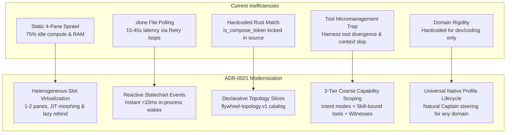
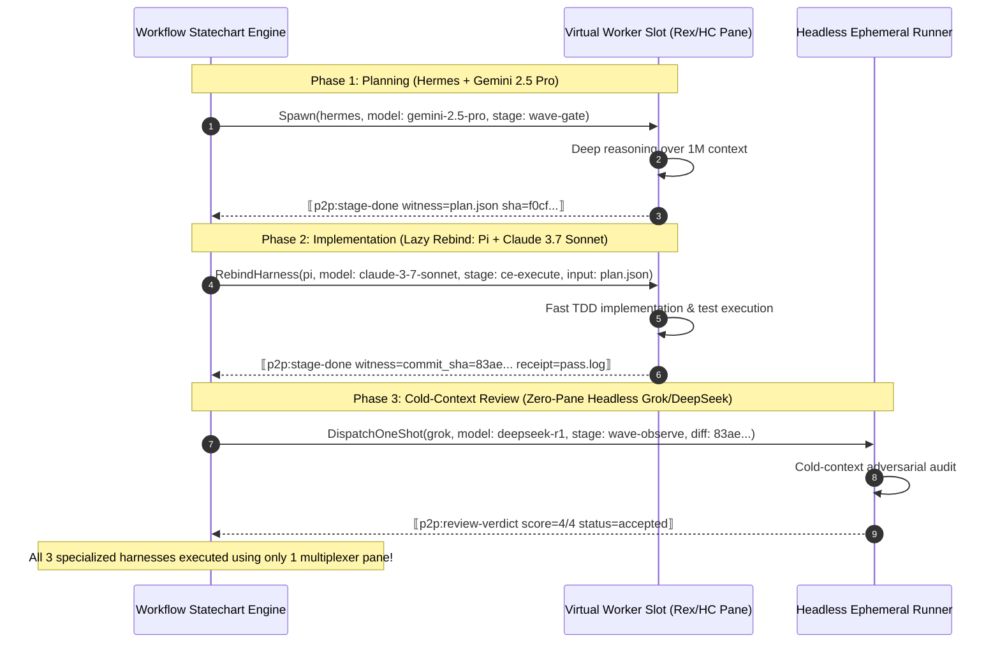
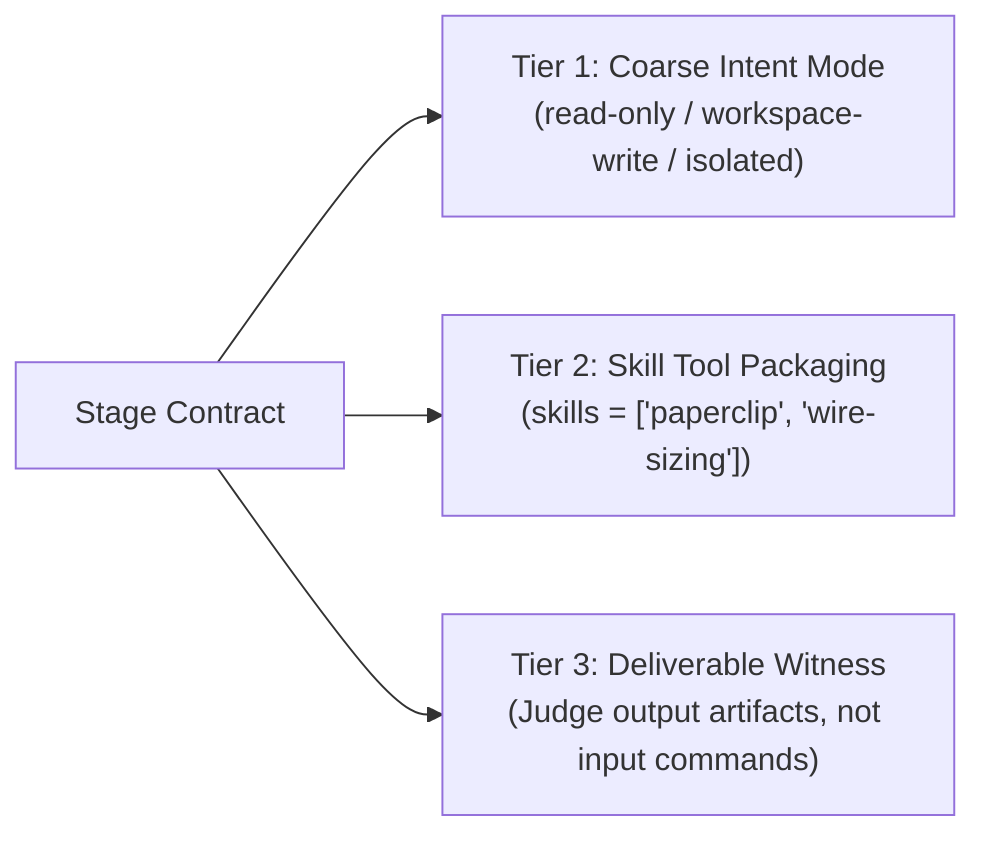
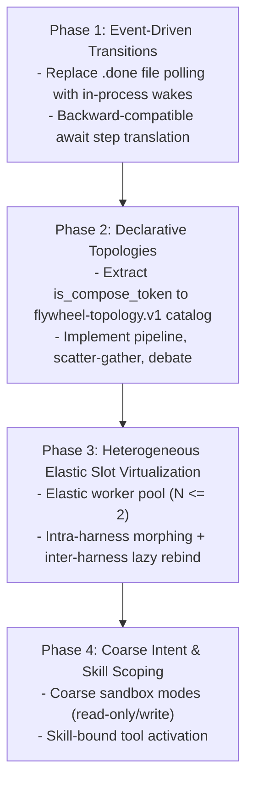

<!-- governed-by: ADR-0005, ADR-0006, ADR-0007, ADR-0008, ADR-0010, ADR-0013, ADR-0016, ADR-0018, ADR-0020, toron ADR-0007, toron ADR-0020, toron ADR-0027 -->
---
status: proposed
date: 2026-11-12
decision-makers: Captain (bangedorrunt)
consulted: |
  AmberHarbor (captain stack analysis & UltraThink orchestration proposal 2026-11-12);
  BlackGorge & FoggyDesert (P2P multiplayer mesh & formal verification proofs);
  toron-core / toron-plane / toron-workflow maintainers;
  elm-effect-rs maintainers.
informed: flywheel × toron × beads maintainers; universal harness agents (opencode/pi/antigravity/gemini/claude/codex/grok)
supersedes: |
  Amends and modernizes ADR-0006, ADR-0007, ADR-0008, and ADR-0013:
  - Retires hardcoded `is_compose_token` match gate in `src/builtin_workflows.rs`.
  - Replaces filesystem `.done` marker polling with reactive statechart events.
  - Replaces static 4-pane swarm sprawl with Heterogeneous Elastic Slot Virtualization.
  - Replaces triplicate role indirection and tool permission micromanagement with 3-tier coarse capability and skill scoping.
extends: |
  ADR-0005 (always-on collab baseline, peer-aware mode),
  ADR-0006 (parameterized stages and wave-scoped dispatch),
  ADR-0007 (catalog slots and agent-native catalog CLI),
  ADR-0008 (workflow/compose/topology agent-optimal mental model),
  ADR-0010 (delivery semantics, attention triage, keyed decision lifecycle),
  ADR-0016 (functional effect kernel, pure tick, journal honesty),
  ADR-0018 (elm-effect-rs is the core),
  ADR-0020 (consolidated doorbell plane D, P2P mesh, atomic bead convergence)
---

# ADR-0021: Elastic Slot Virtualization, Declarative Topology Slices, and Coarse Capability Contracts

| Field | Value |
|---|---|
| **Status** | **Proposed** (2026-11-12) |
| **Decision-makers** | Captain (`bangedorrunt`) |
| **Supersedes** | Amends and modernizes [ADR-0006](0006-parameterized-stage-payloads-and-wave-scoped-dispatch.md), [ADR-0007](0007-catalog-slots-and-agent-native-cli.md), [ADR-0008](0008-workflow-compose-topology-agent-optimal-mental-model.md), [ADR-0013](0013-agent-profile-lifecycle-journaled-rebind.md) |
| **Extends** | [ADR-0005](0005-always-on-collab-baseline-and-command-surface.md), [ADR-0010](0010-delivery-semantics-attention-triage-decision-lifecycle.md), [ADR-0016](0016-functional-effect-kernel-redesign.md), [ADR-0018](0018-elm-effect-is-the-core.md), [ADR-0020](0020-unify-doorbell-toron-multiplayer-engine.md) |
| **Does not amend** | One-way dependency invariant (`flywheel → toron-workflow → toron-core`); Tick Law (`(Model, Msg) -> (Model, Vec<Cmd>)`); Nostr cryptographic envelope signatures; Fail-closed bead close ceremony |
| **Governs** | Retirement of hardcoded `is_compose_token`; Declarative `flywheel-topology.v1` catalog; Heterogeneous Elastic Slot Virtualization (1–2 active panes max); Zero-polling reactive statechart transitions (<10ms); Coarse capability intent modes & skill-based tool packaging; Universal multi-domain profile lifecycle (finance, electrical, health, legal, dev); Formal Statechart Verification Phase |
| **Tracker** | `bd-adr0021-elastic-topologies-capability-contracts` |
| **Verification** | `bash scripts/verify-clippy.sh`, `flywheel workflow verify`, `bash scripts/clean-proof.sh --head`, `mbx test --workspace` |

---

## 1. TL;DR & Executive Summary

Flywheel's low-level execution engine is now mathematically verified and consolidated (ADR-0020 consolidated Plane D wakes into `:18080`, and ADR-0021 introduced zero-divergence hierarchical statecharts with TLC model checking). However, the orchestration and authoring layer remains encumbered by five significant bottlenecks:
1. **75% Static Pane Idle Waste**: Workflows like `wave-swarm` pre-allocate 4 dedicated panes (`planner`, `coder`, `reviewer`, `verifier`), but only one pane works at any time while the other three idle.
2. **Filesystem Polling Latency**: Stages coordinate by having LLMs write `.flywheel/wave/<label>-<stage>.done` markers, while `Action::Retry` loops poll the filesystem with 5s–15s backoff delays (**15–45s lag per stage transition**).
3. **Hardcoded Compose Tokens in Rust**: `is_compose_token` is an immutable Rust match on 3 tokens (`wave-swarm`, `repair-until-verified`, `beads-lifecycle`). Users and agents cannot define new orchestration patterns without recompiling the Rust binary.
4. **Context Bloat & The Tool Permission Tax**: Roles, profiles, and stages maintain overlapping text definitions, blindly injecting 1,000–3,000 tokens of static preamble slop. Meanwhile, attempting to micromanage fine-grained tool whitelists across multiple harnesses (`pi`, `opencode`, `hermes`, `grok`, `claude`) creates an unmaintainable configuration trap.
5. **Coder-Centric Monoculture**: The profile system is architecturally locked to software engineering, lacking a native, conversational lifecycle for arbitrary domains (financial advisory, electrical contracting, clinical research, legal).

### The Decision:
1. **Heterogeneous Elastic Slot Virtualization**: Panes become virtual compute slots (cap $N \le 2$). Adjacent stages sharing a harness morph in-place (<10ms preamble switch). Stages requiring different harnesses perform lazy slot rebinding via durable Git SHA and JSON witness handovers. Headless auditors (Grok, DeepSeek, linters) run zero-pane one-shot tasks.
2. **Declarative Topology Slices (`flywheel-topology.v1`)**: Extract compose tokens from Rust into a declarative catalog (`~/.config/flywheel/topologies/` and `.flywheel/topologies/`). Ship four canonical geometric patterns: `pipeline`, `scatter-gather`, `adversarial-debate`, and `repair-loop`.
3. **Reactive Statechart Transitions**: Retire filesystem `.done` polling completely. Transitions fire immediately upon receipt of typed in-process wakes (`⟦p2p:stage-done⟧`), slashing stage latency from ~30s to <10ms.
4. **3-Tier Coarse Capability & Skill Scoping**: Reject fine-grained per-tool micromanagement. Adopt:
   - **Coarse Intent Modes**: `read-only`, `workspace-write`, and `isolated-sandbox`.
   - **Skill-Based Tool Packaging**: Bring-your-own-tools via skill declarations (`skills = ["paperclip"]`).
   - **Deliverable Witness Verification**: Validate structured outputs (Git SHA, test logs, calculations), not low-level input commands.
5. **Universal Native Profile Lifecycle & Captain Steering**: Enable natural conversational management of domain profiles (`flywheel profile {list, show, create, set, remove}`) across any industry.

---

## 2. Context & Problem Statement



### 2.1 The 75% Static Pane Idle Tax
In the canonical `wave-swarm`, four terminal panes are created at session start:
- Pane 1: `@planner` (`wave-gate`, `wave-dispatch`)
- Pane 2: `@coder` (`ce-execute`)
- Pane 3: `@reviewer` (`wave-observe`, `ce-evaluate`)
- Pane 4: `@verifier` (`wave-verify`, `wave-signoff`)

Because the lifecycle is sequential (Gate $\to$ Dispatch $\to$ Execute $\to$ Observe $\to$ Review $\to$ Verify $\to$ Signoff), **only one agent is active at any time**. The other three panes sit completely idle, holding open terminal buffers, model memory, and system processes. In a 20-minute wave, 60 CPU/pane minutes are wasted.

### 2.2 The Filesystem Polling Bottleneck (`.done` markers)
As documented in `src/crew.rs:2613-2665`, stage sequencing in `wave-swarm` does not use event queues or reactive wakes. Instead, the runner injects synthetic `await_<stage>` steps:
```yaml
- name: gate
  action: dispatch_job
  spec: { task: "... write .flywheel/wave/{{inputs.wave_label}}-gate.done" }
- name: await_gate
  action: retry
  max_attempts: 12
  backoff_secs: 5
  step:
    action: verify
    command: test -f .flywheel/wave/{{inputs.wave_label}}-gate.done
```
This introduces 15–45 seconds of cumulative artificial delay per run, risks false-negative wedging if an LLM forgets the exact marker filename, and litters the disk with stale markers.

### 2.3 The Hardcoded Rust Compose Gate
In `src/builtin_workflows.rs:1586`:
```rust
pub fn is_compose_token(name: &str) -> bool {
    matches!(
        name,
        "wave-swarm" | "repair-until-verified" | "beads-lifecycle"
    )
}
```
Expanding a token into `--parts` triggers compiler-baked special cases inside `crew::compose_workflow_with_resolvers`. User workflows and project-tier `.flywheel/workflows/` cannot define custom compose tokens. Novel collaboration geometries like `scatter-gather`, `pipeline-relay`, and `adversarial-debate` are impossible without compiling a new Rust binary.

### 2.4 The Context Bloat & Tool Permission Tax
When an agent is dispatched, the runner injects the profile's full prose `behavior` preamble, bloating token context (1,000–3,000 tokens of boilerplate per turn). More critically, attempts to enforce security or sandboxing by maintaining fine-grained tool whitelists across diverse harnesses (`edit_file` in Claude vs `sed` in bash vs `write_file` in Hermes vs OpenCode tools) create an unmaintainable configuration tax.

### 2.5 Cross-Domain Expansion Barriers
Modern agentic workflows extend far beyond software code: financial modeling, electrical code audits, medical research analysis, and legal document review all require structured multi-agent coordination. Flywheel currently lacks a clean, domain-agnostic profile catalog and natural language steering mechanism for non-engineering domains.

---

## 3. Decision Drivers

1. **Sub-10ms Inter-Stage Transitions**: Replace filesystem polling with reactive statechart event handshakes.
2. **Resource Efficiency Without Sacrificing Specialization**: Maximize compute utilization (50–75% reduction in open panes) while preserving the freedom to run different models/harnesses where they excel.
3. **Zero Tool Permission Burden**: Avoid low-level tool function whitelists. Enforce boundaries via coarse intent modes, skill declarations, and output deliverable witnesses.
4. **Declarative Extensibility**: Enable users and autonomous agents to create, inspect, and compose new topologies without touching Rust code.
5. **Universal Domain Portability**: Provide a first-class profile lifecycle for any domain (finance, electrical, health, legal) with natural Captain steering.
6. **Formal Verification Compliance**: All topology slices must compile to `elm-effect-xstate` machines verifiable for reachability, quiescence, and deadlock freedom.

---

## 4. Considered Options

### Option 1: Maintain the Status Quo
- *Pros*: Zero migration cost; existing scripts run as-is.
- *Cons*: Retains 75% idle pane waste, 15–45s polling latency, hardcoded Rust tokens, and rigid coding-only assumptions.

### Option 2: Naive Single-Harness Homogeneous Morphing
- Force all stages into a single harness/model running in a single terminal pane.
- *Pros*: Solves idle pane waste; simplest implementation.
- *Cons*: **Destroys model and harness specialization.** Forces planning, coding, security auditing, and domain tasks into one harness, sacrificing Gemini's 1M planning context, Claude's coding speed, and Grok/DeepSeek's adversarial cold-context auditing.

### Option 3 (Selected): Heterogeneous Elastic Slot Virtualization + Declarative Topologies + Coarse Capability Contracts
- Decouple physical multiplexer slots from specialized harnesses.
- Use intra-harness in-place morphing when harnesses match, elastic slot rebinding when harnesses differ, and headless zero-pane execution for specialized auditors.
- Define topologies declaratively in YAML/TOML catalogs.
- Use 3-tier coarse capability scoping (intent modes + skill-bound tools + witness deliverables).

---

## 5. Detailed Architecture & Design

### 5.1 Heterogeneous Elastic Slot Virtualization

Flywheel separates **The Slot** (the physical multiplexer terminal window) from **The Harness** (the specialized engine: Pi, OpenCode, Hermes, Claude, Grok, etc.).



#### The Three Complementary Execution Modes:
1. **Intra-Harness Fast Morphing (Same Harness Family)**:
   - When adjacent stages use the same harness (e.g. `@coder` and `@reviewer` both on `pi`), the pane process stays active.
   - The engine sends an in-pane role switch directive (`⟦morph:role=reviewer⟧`), instantly swapping the system prompt preamble (<10ms) without rebooting the process or dropping terminal state.
2. **Inter-Harness Elastic Rebinding (Different Harnesses, Shared Slot Pool)**:
   - When a stage requires a completely different harness (e.g. `@planner` on `hermes` handing off to `@coder` on `pi`), Flywheel avoids running both simultaneously.
   - The planning harness writes a clean, structured witness (`plan.json`) and yields its slot.
   - Flywheel launches the coding harness inside that same physical slot, passing the witness artifact path as its kickoff input.
   - **Result**: You run an 8-harness heterogeneous pipeline using only **1 or 2 multiplexer panes** at any time.
3. **Headless / Ephemeral Execution (Zero-Pane Specialization)**:
   - Specialized review passes, formal verifiers, or linters do not require interactive terminal scrollback.
   - Flywheel dispatches them via `--mode headless` as one-shot API/CLI tasks. They run for 2–5 seconds, record their evaluation witness into the SQLite ledger, advance the statechart, and terminate. Zero multiplexer clutter.

---

### 5.2 Declarative Topology Slices (`flywheel-topology.v1`)

Compose tokens are removed from Rust code and placed into declarative topology definition files.

#### Topology Slice Schema:
```yaml
# Example: ~/.config/flywheel/topologies/adversarial-debate.yaml
schema: flywheel-topology.v1
name: adversarial-debate
description: "Iterative challenge-response between proposer and challenger, judged by an impartial arbiter"

slots:
  - name: proposer
    role: author
  - name: challenger
    role: auditor
  - name: arbiter
    role: judge
    backend: headless # Runs one-shot; zero pane overhead

parameters:
  max_rounds: 3
  consensus_threshold: 0.85

statechart:
  initial: Propose
  states:
    Propose:
      dispatch: proposer
      on:
        PROPOSAL_SUBMITTED: Challenge
    Challenge:
      dispatch: challenger
      on:
        OBJECTION_RAISED: CounterPropose
        NO_OBJECTION: Arbitrate
    CounterPropose:
      dispatch: proposer
      on:
        REVISED: Arbitrate
    Arbitrate:
      dispatch: arbiter
      on:
        CONSENSUS_REACHED: Complete
        DEADLOCK:
          guard: "rounds < max_rounds ? Challenge : EscalateToHuman"
    Complete:
      type: final
```

#### The Four Canonical Topologies:
1. **`pipeline`**: Sequential linear execution ($A \to B \to C$) with JIT role morphing or elastic slot handoff.
2. **`scatter-gather`**: Parallel fan-out over items (beads, files, financial instruments, electrical circuits), gathered into an aggregator/synthesizer.
3. **`adversarial-debate`**: Structured multi-round challenge and defense judged by an impartial arbiter.
4. **`repair-loop`**: Hillclimbing iteration that mutates state until an authoritative verification fence passes.

---

### 5.3 3-Tier Coarse Capability Scoping & Skill-Bound Tool Packaging

Attempting to whitelist exact tool function names across 10 diverse harnesses is explicitly rejected. Flywheel adopts a 3-tier scoping model:



1. **Tier 1: Coarse Intent Modes (Zero per-tool config)**
   Every stage specifies only its broad execution posture:
   - `mode = "read-only"`: The harness disables state-mutating actions (reviewers, auditors, and advisors cannot alter files).
   - `mode = "workspace-write"`: Normal execution (implementers can touch files in the project root).
   - `mode = "isolated-sandbox"`: Offline, scratchpad, or temporary container.
2. **Tier 2: Skill-Based Tool Injection (Bring-Your-Own-Tools)**
   Instead of Flywheel registering individual tool APIs, **Skills package their own tools and MCP servers**:
   - `@health-advisor` profile declares `skills = ["paperclip"]`. The skill automatically provides PubMed and clinical trial tools.
   - `@financial-advisor` profile declares `skills = ["agent-reach", "xueqiu-stocks"]`. The skill wires market fetch tools.
   - `@home-electrician` profile declares `skills = ["nec-code-lookup", "wire-sizing-calc"]`.
3. **Tier 3: Deliverable Witness Verification**
   Instead of gating which shell commands an agent ran, the stage contract specifies **the required deliverable**:
   - Electrician stage: Requires `load_calculation.json` + `exit_code: 0`.
   - Coder stage: Requires `git_sha` + `test_receipt` proving passing tests.
   - Reviewer stage: Requires `EvaluationEvidence` record with numerical advisory score $\ge 3/4$.

---

### 5.4 Universal Native Profile Lifecycle & Captain Steering

Flywheel supports arbitrary professional domains in `~/.config/flywheel/profiles.toml`:

```toml
[profiles.financial-advisor]
role = "financial-advisor"
harness = "pi"
model = "claude-3-7-sonnet"
task_hint = "Portfolio risk analysis, macro indicators, and asset allocation modeling"
behavior = """
You are a conservative, numbers-first Financial Risk Advisor.
Never speculate without citing audited financial reports.
Always compute risk-adjusted return (Sharpe/Sortino) and state variance assumptions.
"""
skills = ["agent-reach", "accounting-math"]

[profiles.home-electrician]
role = "home-electrician"
harness = "pi"
model = "claude-3-7-sonnet"
task_hint = "NEC code compliance, wire gauge calculation, panel load balancing"
behavior = """
You are a licensed Master Electrician and NEC Code Auditor.
Prioritize safety, continuous load de-rating (80% rule), and voltage drop (<3%).
Always cite relevant NEC article sections (e.g. NEC 210, 220, 310).
"""
skills = ["nec-code-lookup", "wire-sizing-calc"]
```

#### Conversational Management via Captain:
Operators and agents manage profiles natively using existing CLI/MCP verbs:
```bash
# List all native and custom profiles
flywheel profile list

# Inspect profile behavior and skill bindings
flywheel profile show home-electrician

# Create or update a profile on the fly
flywheel profile create legal-counsel \
  --role "legal-counsel" \
  --model "claude-3-7-sonnet" \
  --task-hint "Contract clause auditing & indemnity risk analysis"

# Update routing or fallback dynamically
flywheel profile set home-electrician --model "claude-opus-4"

# Remove an obsolete profile
flywheel profile remove legal-counsel
```

When steering the fleet, the Captain dispatches directly:
```bash
flywheel steer "Audit garage subpanel for 50A EV charger installation" \
  --profile home-electrician \
  --direct
```

---

### 5.5 Formal Statechart Verification Phase Integration

Every declarative topology compiles directly into an `elm-effect-xstate` machine. Before execution or in CI gates (`scripts/clean-proof.sh`), topologies are mathematically verified via:

```bash
flywheel workflow verify [NAME] [--export-tla] [--json]
```

#### Mathematical Properties Enforced:
1. **Reachability**: The initial state can reach every declared active leaf; no orphaned states exist.
2. **Quiescence**: The statechart settles deterministically upon completion or failure without infinite internal loops.
3. **Deadlock Freedom**: Every non-final state has at least one valid outbound transition on allowable events.
4. **Zero-Divergence TLA+ Specifications**: Derives TLC-compatible specifications directly from the Rust AST for formal model checking.

---

## 6. Migration Plan & Implementation Phases



### Phase 1: Event-Driven Transitions (Immediate)
- Deprecate `await_<stage>` steps that poll `.flywheel/wave/*.done`.
- Wire stage progression to in-process Toron mail events (`Msg::StageDone`).
- Retain writing `.done` marker files as non-blocking sidecars for backward compatibility with external scripts.

### Phase 2: Declarative Topologies Catalog
- Create `crates/flywheel-topology` or `src/topology/` module.
- Move `wave-swarm`, `repair-until-verified`, and `beads-lifecycle` into `topologies/` YAML files.
- Replace `is_compose_token(name)` with `topology_catalog.get(name)`.
- Support `--topology <name>` on `flywheel workflow compose`.

### Phase 3: Heterogeneous Elastic Slot Virtualization
- Update `flywheel spawn` and `workflow compose` to accept `--slot-cap <N>` (default 2).
- Implement in-place role morphing for same-harness steps (`⟦morph:role=<name>⟧`).
- Implement lazy slot rebinding for different-harness steps using structured Git/JSON witnesses.
- Enable headless one-shot dispatch for `ce-evaluate` and audit passes.

### Phase 4: Coarse Capability & Skill Scoping
- Add `mode = "read-only" | "workspace-write"` to Stage contracts.
- Bind skills directly to profile declarations in `profiles.toml`.

---

## 7. Backward Compatibility Guarantees

1. **Existing CLI Compose Commands**:
   `flywheel workflow compose "<target>" --parts wave-swarm --run` will resolve seamlessly to the `pipeline` topology with 8 phases, running with zero syntax changes.
2. **Legacy File Observers**:
   The engine will continue to write legacy `.done` marker files asynchronously so existing disk monitors or dashboard tools continue to function.
3. **Existing Profiles Unchanged**:
   All 6 built-in profiles (`coder`, `planner`, `reviewer`, `oracle`, `scout`, `housekeeper`) remain fully backward-compatible. Custom profiles in `~/.config/flywheel/profiles.toml` require zero schema migration.
4. **Architectural Dependency Invariant**:
   Maintains the strict one-way dependency: `flywheel → toron-workflow → toron-core`.

---

## 8. Verification & Acceptance Criteria

1. **Clean-Proof Compliance**:
   `bash scripts/clean-proof.sh --head` must exit 0, verifying full build, lint, and statechart checks in an isolated clean scratch directory.
2. **Clippy & Formatting Compliance**:
   `bash scripts/verify-clippy.sh` must pass with zero warnings (`-D warnings`).
3. **Formal Verification Pass**:
   `flywheel workflow verify` must report `ok: true` across all registered topologies.
4. **Stack Health**:
   `flywheel stack status --check` must report `stack: ok`.
5. **Zero-Polling Proof**:
   Integration tests in `tests/` must demonstrate stage transitions occurring in $< 50\text{ms}$ without filesystem polling loops.
