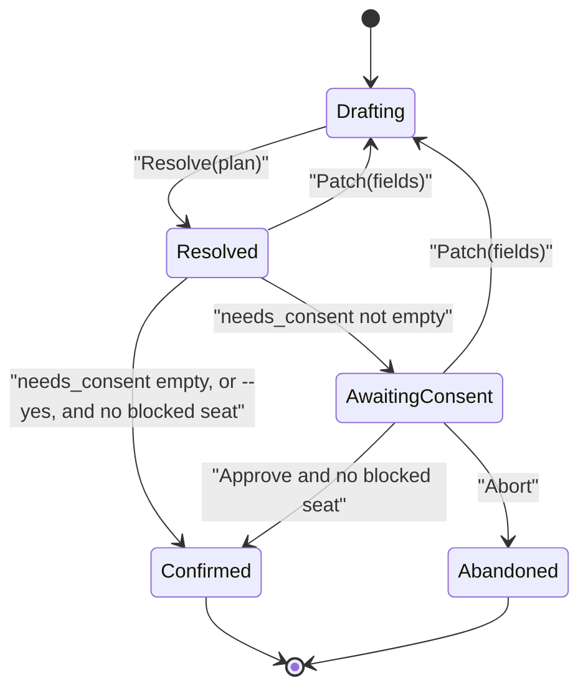
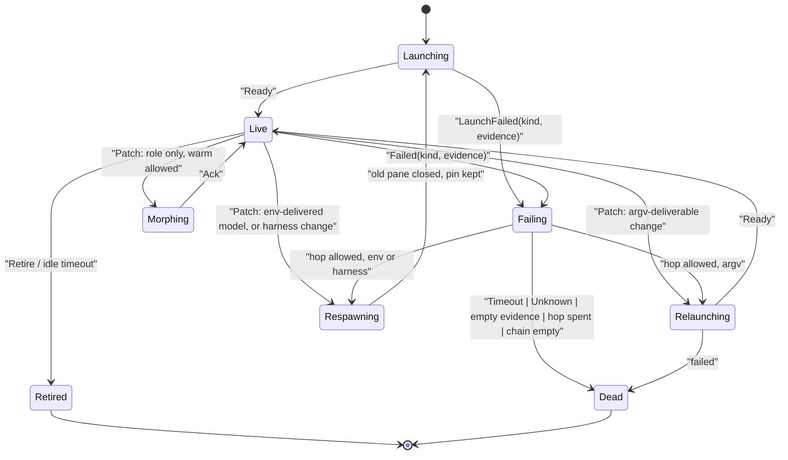

<!-- governed-by: ADR-0007, ADR-0011, ADR-0013, ADR-0016, ADR-0018, ADR-0021, toron ADR-0010, toron ADR-0022, toron ADR-0026, toron ADR-0032, toron ADR-0045 -->
---
status: proposed  # 2026-11-17: implementation map in §8 (D1–D8, V1–V11, acceptance 1–7); not reviewed for acceptance
date: 2026-11-13
decision-makers: Captain (bangedorrunt)
consulted: |
  Code audit: harness_registry, models, profile, headless, hc, pane, agent_ref, briefing, steer_brief, jev_rank, crew_menu, cmd/spawn, cmd/model.
  Live `--help` of installed harnesses on the operator host (pi, opencode, grok, gemini, agy, fx), 2026-11-13.
informed: flywheel × toron × beads maintainers
amends: |
  flywheel ADR-0021 2026-11-12 draft §5.1 (slot cap N<=2, in-pane morph) and §5.3 Tier 1 (coarse modes) — see §7.
  ADR-0021 was revised in place on 2026-11-13 and now carries these corrections itself.
  flywheel ADR-0007 D1 (one global harness+model per slot).
  flywheel ADR-0013 (write-only SpawnEntry.model; env-pinned hops refused with no way forward).
builds-on: |
  toron ADR-0010 (model registry), toron ADR-0022 (harness phase mechanics — the "ADR-0022" cited in src/headless.rs),
  toron ADR-0026 (failure taxonomy + fallback chains), toron ADR-0032 (honesty: no rebind on timeout/empty evidence).
---

# flywheel ADR-0022: The Swarm Plan — One Contract From Intent to Running Crew

> **Numbering note.** `src/` cites toron ADR numbers without a prefix (`ADR-0022 L2` in
> `src/headless.rs` is **toron** ADR-0022, phase-native orchestration). This document is
> **flywheel ADR-0022**. Code that cites it must write `flywheel ADR-0022`.

| Field | Value |
|---|---|
| **Status** | Proposed (2026-11-13) |
| **Governs** | `flywheel-plan.v1`; field provenance and precedence; consent policy; standing preferences; harness adapters; step→seat binding; plan→swarm reconciler |
| **Companion** | [flywheel ADR-0021](0021-elastic-role-morphing-declarative-topologies-and-capability-contracts.md) decides *what* a step needs and hands back (stage contract, witness). This ADR decides *who* runs it. |
| **Vocabulary** | ADR-0021 D1: **mode** `open \| swarm`; **swarm** = this plan + its seats + its run; **slot** = model tier (`@cheap` / `@standard` / `@premium`, ADR-0007). This record first called the live object a "fleet" and the tiers "bands"; both words are retired. |
| **Does not amend** | `flywheel → toron-workflow → toron-core`; Tick Law; journal-before-provider; bead close ceremony |
| **Verification** | `flywheel workflow verify`, resolver property tests, `bash scripts/clean-proof.sh --tests` |

---

## 1. The captain's problem

A captain wants three things:

1. **Say the intent once.** Get the crew I asked for, with the harness, model, effort, and head-count I asked for.
2. **See what will run before it runs, and get that.** No silent substitution: not by a registry, not by Jev, not by a harness that ignores a flag.
3. **Change anything while it runs.** Swap a model, add a reviewer, retire an idle pane. No ceremony, no dead end.

Today the stack fails all three, and each failure comes from a quirk the captain cannot see:

| What the captain sees | The quirk behind it (verified) |
|---|---|
| `spawn --gemini --model X` shows X at the confirm gate, then the agent runs its own default | `headless::model_args` returns `vec![]` for every harness except `pi`, `opencode`, `grok`. `spawn_model_rows` still prints X. Same for `agy`, `fx`, `claude`, `codex`. |
| `--effort high` on grok does nothing | `effort_degraded` is true only for `opencode`, and grok's arm in `model_args` emits only `-m`. No warning. `grok --help` lists `--reasoning-effort`. |
| `add --pi` and `spawn --pi` start different models | `cmd_add_rex` resolves no slot. `bare_model_launch` resolves the `standard` slot. |
| `spawn --pi --model foo` works; a profile with `model = "foo"` refuses | Bare path calls lenient `ModelRegistry::resolve`; profile path calls `resolve_strict`. |
| `[harness.pa]` works on hc and fails on rex | hc retries through `try_recipe_launch`; `cmd_spawn_rex` calls `rex_env_command(&pane_env, &kind, ..)` directly. |
| Jev picked the harness and tier; I was never asked | `briefing` reorders `harness_menu` with Jev but asks only topology / crew / model slot (`apply_answers`). `steer_brief` gets Jev profile/tier/effort only when `briefing_enabled` (TTY, no `--json`, no `--yes`, no `--crew`). Agents on `--json` never see a suggestion. |
| I picked a model, then a harness, and the model no longer fits | `steer_brief::run_briefing` asks models in `[2/4]` and harnesses in `[3/4]`. The model menu was filtered for the old harness. Head-count is total N only (`[1/4]`), never per role. |
| `model set-default` made my scouts expensive | `[defaults]` overrides all three slot aliases at once. |
| A 429 on an opencode pane cannot fall back to another model | The model rides `OPENCODE_CONFIG_CONTENT`, fixed at split. `RerouteEnvPin::ModelChanged` refuses and says "Respawn instead", but nothing respawns. |
| `binding-rebind --model` always errors | `cmd_binding_rebind` bails: `SpawnEntry.model` is write-only. |
| I cannot retire a stale compiled-in model | `ModelCmd::Remove` ignores `--shadow` (`shadow: _`) and refuses compiled-in ids. |

These are not ten bugs. They are one missing concept: **there is no single object that is the plan.** Each entrypoint (`add`, `spawn`, `--profile`, `steer`, `briefing`, `workflow compose`, headless, `recover`, fallback) rebuilds its own partial plan, with its own strictness, its own defaults, and its own idea of who decides.

---

## 2. Decision

### D1. One plan object: `flywheel-plan.v1`

Every entrypoint compiles to the same pure value, and only that value is executed.

```yaml
schema: flywheel-plan.v1
objective: "harden the login flow"
mode: swarm                # open | swarm (ADR-0021 D1)
workflow: wave-swarm       # any catalog workflow; its shape is declared on the workflow
seats:
  - role: coder
    count: 2
    harness:  { value: pi,        from: user }
    model:    { value: zai/glm-5.3, from: preference, note: "project pref coder.model" }
    effort:   { value: high,      from: jev }
    mode:     { value: workspace-write, from: profile }
    context:  warm             # warm (reuse a live pane) | fresh (cold start)
    placement: pane            # pane | headless
    status:   honored          # honored | degraded{reason} | blocked{remedy}
  - role: reviewer
    count: 1
    harness:  { value: grok,      from: jev }
    model:    { value: grok/grok-4.5, from: coupled-default }
    effort:   { value: high,      from: slot }
    mode:     { value: read-only, from: profile }
    context:  fresh            # review never inherits the author's context
    placement: headless
    status:   honored
needs_consent: [reviewer.harness]
estimate: { panes: 2, headless: 1, usd_per_mtok_in: 1.8 }
```

Every field carries **provenance** (`from`). Every seat carries a **status** computed by the resolver (D3). `needs_consent` is computed by the consent policy (D5). `briefing --json`, `steer --json`, `spawn --dry-run --json`, and the TTY gate all print this same object.

**Where the plan lives (what was built).** The plan grows out of `crew::CrewPlan` (today role → count, `src/crew.rs:34`); it is not a second type beside it. The plan VALUE is minted an id once (`plan-…`, `state::record_plan`) and its of-record snapshot — the resolved plan, its base seats, and the ordered `patches` (the apply-event log) — lives in `agents/<project>.plan.json` (`state::plan_file`). Dispatch and retirement journal their plan EVENTS into the run journal (`retire_journals_the_plan_event`); the plan's identity is the record's id, not the run id, and a patch is appended to that record's patch log. The original draft of this section said the plan was journaled as the run's input with plan id = run id and never "a side file"; that is not what shipped, and the note below says why.

Honesty note (2026-11-17, bd-6setu.3): the shipped code keeps the plan in `agents/<project>.plan.json`, so the earlier claim was the intent, not what was built. `state::PlanRecord` stores the plan value, its base seats, and the ordered `patches` (the apply-event log) as one durable snapshot; the fold rebuilds the desired seats from those patches. The side file is a deliberate captain decision: the plan stays inspectable and patchable across workflow runs and restarts without being trapped in the workflow engine's run lifecycle. D1's single-contract claim is about every entrypoint compiling to one plan VALUE, not about which store holds that value.

### D2. One precedence rule, applied per field

```
user  >  standing preference  >  stage contract  >  profile  >  slot  >  Jev  >  harness default
```

- **user**: a flag, a TTY edit, or a patch the agent relayed from chat.
- **stage contract**: `mode`, `context`, and `effort` that the stage requires for its step (ADR-0021 D3). A review stage's `context: fresh` is not a profile taste; only the user overrides it.
- **standing preference**: a remembered user choice (D6).
- **Jev fills only fields nobody above set.** It never overwrites a user or preference value. This keeps `jev_rank`'s existing law (order only, below `CONFIDENCE_FLOOR` = shrug) and extends it from the harness menu to every seat field.

This rule replaces the six-rung `resolve_profile_route_full`, the `[defaults]`-collapses-all-slots behaviour, and the bare/profile strictness split.

### D3. Harness adapters: each harness says what it can honour

One declarative table replaces the six places harness knowledge lives today (`harness_registry::REGISTRY`, `hc::INTEGRATION_KINDS`, `profile::compiled_in_harnesses`, `headless::{model_args, effort_degraded, phase_launch_args, build_argv_roles}`, `harness_caps::TABLE`, `models::coupled_default_model`). Compiled-in rows, user rows in `harnesses.toml`, `[harness.<name>]` in `profiles.toml` still honoured.

Each row answers five questions: how to **launch** (pane, headless), how to deliver a **model**, an **effort**, a **mode**, a **phase**, and how to **list models**. Rows below are from live `--help` on 2026-11-13.

| harness | model | effort | mode: read-only | phase: plan | list models |
|---|---|---|---|---|---|
| `pi` | `--model p/id` | `--thinking L` | `--tools read,...` (allowlist) | — (prompt) | `pi --list-models` |
| `opencode` (pane) | env `OPENCODE_CONFIG_CONTENT` | — | `--agent plan` | `--agent plan` | `opencode models` |
| `opencode run` (headless) | `--model p/m#variant` | `#variant` | `--agent plan` | `--agent plan` | `opencode models` |
| `grok` | `-m id` | `--reasoning-effort L` | `--permission-mode plan` | `--permission-mode plan` | `grok models` |
| `gemini` | `-m id` | — | `--approval-mode default` | — | — |
| `agy` | `--model id` | `--effort L` | `--mode plan` | `--mode plan` | `agy models` |
| `fx` | — (`fx provider`, no flag) | — | — | — | `fx models` |

A "—" is a fact, not a gap to hide. The resolver turns every requested field into exactly one of:

- **honored**: the adapter emits it.
- **degraded{reason}**: the adapter cannot emit it and the field came from `stage`, `profile`, `slot`, `Jev`, or default. The seat runs; the plan says why.
- **blocked{remedy}**: the adapter cannot emit it and the field came from `user` or `preference`. The captain asked for it, so the seat does not silently run without it.

This is the whole fix for false-green previews. It also makes ADR-0021's coarse modes honest: `mode: read-only` on `gemini` maps to `--approval-mode default`, which still lets the user approve writes, so it shows as `degraded{reason: "approval-gated, not enforced"}`.

Launch goes through the adapter on **both** planes, so rex and hc launch `[harness.pa]` the same way. `antigravity` / `agy` / `ag` / `antigravity-cli` become one row with `bin = "agy"` and `hc_target = "antigravity_cli"`.

**What the one table became (2026-11-17, bd-6setu.1).** Three of the six tables were the same domain and are now merged into `harness_registry::REGISTRY`: the coupled-model set, the launch columns (model/effort/read-only/plan/implement argv, plus the pane env-pin rule), and the capability rows (`harness_caps::rows()` derives one per registry row from one const shape; aliases answer through `canonical`). Two are a **different** domain and are pinned by a relationship test rather than merged, because merging would widen what flywheel launches: `hc::INTEGRATION_KINDS` is the multiplexer's vocabulary and a superset, so every registry row that is an hc pane names an `hc_target` the list really has; `profile::compiled_in_harnesses` holds recipe spawn commands for harnesses the registry does not declare, so a recipe name must never also be a registry row. V8 is witnessed by `rex_and_hc_build_the_same_launch_for_one_seat`. The honest summary is three merged, two related, one witnessed — not six logos collapsing into one.

### D4. Models: resolve generously, refuse precisely

- **Bare names resolve when unambiguous.** `--model glm-5.3` resolves to `zai/glm-5.3` if exactly one registered key ends in that id. Ambiguity is `blocked` with the candidates listed.
- **An explicit `provider/model` always passes**, from any entrypoint, marked `registry: unregistered`. No `flywheel model add` ceremony before a captain can try a model. The bare/profile strictness split ends.
- **Retirement is data.** A model or harness row may carry `replaced_by = "<id>"` or `retired = true`. `model remove --shadow` writes `retired = true` for a compiled-in id. The resolver substitutes `replaced_by` **visibly**: the field shows `from: replacement, was: <old id>`. A retired id with no replacement is `blocked{remedy}`.
- **Slots stay, and get honest.** `@cheap` / `@standard` / `@premium` become ordered candidate lists of `(harness?, model, effort?)`. The resolver picks the first candidate that fits the seat's harness. If the seat's harness is fixed (by user or preference), the slot adapts to it instead of forcing a harness switch. `model set-default` gains `--slot`; without `--slot all` it touches only `@standard`.

### D5. Consent: ask only when it matters

The user wants to confirm Jev's choices. The captain wants no interruptions. Both are right, and one policy serves both:

```toml
[consent]
ask = "on-change"     # on-change (default) | always | never
budget_usd_per_mtok = 5.0
```

**No `signoff` knob.** An earlier draft of this section carried `signoff = "human" | "witness"`, where `witness` would replace the outer `request_approval` with a fact-derived gate (every bead closed, `flywheel ship check` legal, `wave-verify` witness passed; ADR-0021 D4). That gate is not built: nothing in the tree computes it, and the only live auto-pass is ADR-0011 D7's `signoff::observe` (REVIEW residual empty, OPEN DECISIONS empty), which is a different predicate. Config that parses and does nothing is worse than absent config — it changes ADR-0008's captain-only outer signoff on paper only — so the field and its parsing were deleted (bd-6setu.4, 2026-11-17). ADR-0008's captain-only outer signoff stands. When the fact gate ships, `signoff` comes back with the gate in the same change.

With `on-change`, a field enters `needs_consent` when **any** of these holds:

1. It came from **Jev**. (Jev fills only fields nobody above it set, so every Jev value is a choice no profile, slot, or preference made. An earlier draft said "differs from what the profile would have chosen", which D2 makes impossible.)
2. Its status is **blocked**.
3. The plan's estimate crosses `budget_usd_per_mtok`, or head-count exceeds `crew_max` (`DEFAULT_CREW_MAX` = 5).

Empty `needs_consent` dispatches without a prompt. `--yes` and `ask = "never"` dispatch regardless, except for `blocked` seats, which never launch.

The same object drives two surfaces:

- **TTY.** Ask in this order: head-count per role (`coder:2, reviewer:1`), then harness per role, then model and effort re-filtered for that harness, then go. Jev and preference values are pre-filled and labelled. Enter accepts.
- **Agent.** `--json` returns the plan with `needs_consent`. The agent asks the user in chat (or with a multiple-choice tool), then submits a **patch**:
  `flywheel swarm apply <project> --patch reviewer.harness=pi --count coder=3`
  The patch re-resolves; only then does dispatch happen.

### D6. Standing preferences: ask once, remember

When a user overrides a Jev or default value, the gate offers: *remember this for (role | project | always)?* Accepted answers persist as preferences:

```bash
flywheel prefer reviewer.harness=grok --project flywheel
flywheel prefer coder.model=zai/glm-5.3
flywheel prefer --list
flywheel prefer --forget reviewer.harness
```

Preferences sit above Jev in D2, so the same question is not asked twice. Over a few sessions the plan converges on the captain's taste, and `needs_consent` empties. Storage is a plain TOML overlay in the config home; it is also recorded as a Chie lesson (`cmd::memory::record_lesson`) so briefing can explain *why* a value was chosen.

### D7. Running swarms: reconcile the plan, do not script it

A live change is a patch to the plan, not a new verb. The **reconciler** diffs desired seats against live seats and picks the cheapest effect the adapter allows:

| Change on a live seat | Effect |
|---|---|
| none | keep |
| model or effort, adapter delivers it by argv | relaunch in the same pane |
| model, adapter delivers it by env (opencode TUI) | **respawn**: new pane with the new env, same pin, same mail identity, same bead reservations, handoff note; old pane closed. The plan marks `context: fresh`. |
| harness | respawn (as above) |
| role only, same harness, `context: warm` allowed | inject a role prompt into the live pane |
| count +k / −k | spawn k / retire k idle seats (idle first) |
| placement pane → headless | retire pane after its current turn; future turns headless |

Every effect is journaled before it runs (`agent_ref::commit_rebind`, `EffectJournalMode::Enforced`). Failure-driven hops (toron ADR-0026 kinds) are patches the stack writes itself; toron ADR-0032 still holds: no hop on `Timeout`, `Unknown`, or empty evidence, one hop per failure class.

This turns three dead ends into one mechanism: `RerouteEnvPin::ModelChanged` becomes a respawn, `binding-rebind --model` becomes `flywheel swarm apply --patch '<pin>.model=…'`, and `cmd_recover`'s respawn re-resolves the full seat instead of only its kind.

**Pane economy is a reconciler policy, not an architectural cap** (amends the ADR-0021 draft §5.1). `crew.max` (`DEFAULT_CREW_MAX` = 5) stays the one head-count cap; an earlier draft added `max_live_panes` beside it, which would have been two knobs for one limit. The only new knob is retirement:

```toml
[swarm]
idle_retire_after = "10m"   # retire a seat idle this long, keep its pin and reservations
```

### D8. Binding a step to a seat

A workflow step dispatches to `@role`; nothing today says which live seat serves it. The binder is the pure fold that answers this, and it is where the ADR-0021 draft's "morph" and "rebind" live, as outcomes rather than architecture.

Input: the step's needs, from its stage contract with step overrides (ADR-0021 D3): `{role, mode, context, effort}`; and the live seats. Output, first match wins:

| Situation | Binding |
|---|---|
| A live idle seat of that role, same harness, and `context: warm` | reuse it; send the stage as the next turn |
| `context: fresh`, and the harness supports a new session in the same pane | same seat, new session (`ContextMode::Fresh`) |
| `context: fresh` otherwise, or a review/verify stage whose author was this seat | another seat of the role; if none is idle, a headless one-shot when `placement` allows, else spawn within `crew.max` |
| The step needs a different harness, model, or mode than every live seat of the role | a patch (D7): relaunch or respawn |
| No seat can be had within `crew.max` and budget | the step waits (bounded by `no_claim_timeout`); it never borrows another role's seat |

The binder never gives a review or verify step to the seat that authored the work under review (ADR-0021 D3.5). Each binding is journaled with the step's effect key, so a replayed run binds the same way.

---

## 3. State machines

Three small machines, not one large one. They run at different time scales and fail for different reasons, so they verify separately.

### 3.1 PlanMachine — intent to confirmed plan



Jev runs inside `Resolve` with a deadline. A Jev timeout, 429, missing key, or shrug leaves its fields unset; `Resolve` still completes.

### 3.2 SeatMachine — one seat from launch to retirement



### 3.3 Reconciler — desired plan vs live swarm

A pure fold: `(DesiredPlan, LiveSwarm) -> Vec<SeatPatch>`. The D8 binder is a second pure fold over the same inputs plus one step's needs. Each `SeatPatch` is an event into one SeatMachine. Tick Law holds: the fold does no I/O.

### 3.4 What is checked, and how

| # | Property | Checked by |
|---|---|---|
| V1 | Every state reachable; every state can reach a final state; every cycle bounded (PlanMachine, SeatMachine) | `flywheel workflow verify` with the real graph checks of ADR-0021 D5.2 (today's checks are weaker; ADR-0021 §0) |
| V2 | Jev failure never blocks `Resolve` | PlanMachine test: inject Jev timeout, assert `Resolved` |
| V3 | A `blocked` seat never reaches `Launching` | PlanMachine guard + test |
| V4 | No false green: for every adapter row × requested field, the field is in argv/env **iff** status is `honored` | Resolver property test over the full adapter table |
| V5 | An env-delivered model change never takes `Relaunching` | SeatMachine guard + property test |
| V6 | No hop on `Timeout` / `Unknown` / empty evidence; at most one hop per failure class | SeatMachine test (carries toron ADR-0032) |
| V7 | Precedence: a `user` or `preference` field is never changed by stage, profile, slot, Jev, or default | Resolver property test |
| V8 | Rex and hc produce the same launch command for the same seat | Adapter test over both planes |
| V9 | Reconciler is idempotent: reconciling a swarm that already matches yields no patches | Reconciler property test |
| V10 | The binder never gives a review or verify step to the seat that authored the work | Binder property test |
| V11 | At most one live pane per pin, and a respawn keeps the pin's reservations | Hand TLA+ model run by TLC (ADR-0021 D5.4), shown failing on a variant that closes the old pane after the new one claims |

Honesty note: `flywheel workflow verify --export-tla` writes TLA+ text; no model checker runs on that text today (`src/cmd/workflow.rs` invokes none), so V1 is a graph check, not a TLC proof. The hand-written protocol models are different: `scripts/verify-formal.sh` does run TLC 1.8.0 over `.agents/skills/verify-protocol-tla/models/`, positive and negative fixtures alike, and V11 rides it. Running TLC on the *workflow* export in CI remains a later, separate decision.

---

## 4. What this removes

| Removed | Replaced by |
|---|---|
| `add` vs `spawn` vs `--profile` vs headless resolution paths | one resolver producing `flywheel-plan.v1` |
| lenient vs strict registry split | D4: generous resolve, precise refusal |
| `[defaults]` overriding all slots | per-slot default + preferences |
| `briefing` questions vs `steer_brief` prompts | one consent gate, two surfaces |
| silent `vec![]` for unknown harness flags | `degraded` / `blocked` status |
| `RerouteEnvPin` refusal, `binding-rebind --model` refusal | reconciler respawn |
| six harness tables | one adapter table |
| `--shadow` no-op | `retired = true` |

The net count of user-facing concepts goes **down**: plan, patch, preference. Slot and swarm are existing words. Everything else is internal.

---

## 5. Rollout

Each phase ships alone and changes no default behaviour until its last step.

1. **See the truth.** `spawn --dry-run --json` and `briefing --json` print `flywheel-plan.v1` with provenance and status, computed from today's code paths. No launch changes. Captains immediately see every degraded field.
2. **Adapters.** One adapter table. Wire grok effort/plan, gemini, agy, opencode `#variant` headless. Rex honours `[harness.*]`. Statuses become real; `blocked` starts refusing.
3. **One resolver + consent.** D2 precedence, D4 resolution, D5 policy, `swarm apply --patch`. `briefing` and `steer_brief` become two renderers of one gate. PlanMachine verified.
4. **Preferences.** D6.
5. **Reconciler and binder.** D7 + D8, SeatMachine verified. `binding-rebind --model` and env-pin hops start working. `[swarm] idle_retire_after` replaces the ADR-0021 draft's slot cap. The SeatMachine runs inside the doorbell/supervisor fold, the one live model that already receives job results, presence, and failures; that fold emits the seat patches.
6. **Verbs.** `flywheel swarm plan | apply | status` front the plan, patch, and live view; `briefing --json` and `spawn --dry-run --json` keep printing the same object.

## 6. Acceptance

1. `flywheel spawn proj --kind gemini=1 --model gemini-2.5-pro --dry-run --json` shows `model.status = honored` and a gemini pane's interactive launch plan carries `-m gemini-2.5-pro`. The same call with `--kind fx=1` shows `blocked`. (This acceptance was first written with `--gemini` / `--harness fx`; those spellings were replaced by `--kind <harness>=<n>`. The behavior is unchanged — only the command text moved.)
2. `flywheel briefing "<goal>" --json` lists every Jev-filled field with its provenance (`from: jev`) and a non-empty `needs_consent` when Jev changed a profile choice. It does **not** carry a per-field confidence: that number is Jev's own ranking input (`CONFIDENCE_FLOOR` in `src/jev_rank.rs`), consumed inside the ranker and never carried outward, and a plan field with no reader is exactly what D5's `signoff` mistake taught us to refuse.
3. A patch `reviewer.harness=pi` re-filters the reviewer's model and clears that consent entry.
4. A remembered preference suppresses the same question in the next session.
5. A 429 on an opencode seat with a `model_fallback` respawns the seat with the new model, keeps the pin and its bead reservations, and journals one `RebindIntent`.
6. A `beads-lifecycle` audit step (ADR-0021 D7) binds to a seat other than the planner that polished the beads, and to a different model family when one is registered.
7. V1–V11 pass. `bash scripts/verify-clippy.sh` and `bash scripts/clean-proof.sh --tests` pass.

---

## 7. Corrections to the flywheel ADR-0021 draft (2026-11-12)

ADR-0021 was revised in place on 2026-11-13 and absorbs these; they are kept here as the record of why.

1. **Slot cap.** `N <= 2` live panes is replaced by `crew.max` plus `[swarm] idle_retire_after`. A hard cap blocks fan-out, which the draft itself shipped as `scatter-gather`, and duplicates `DEFAULT_CREW_MAX`.
2. **In-pane morph.** Allowed only for role changes where `context: warm` is legal (plan → execute). Review and verify seats are `context: fresh` by rule. A reviewer that inherits the author's context is not an independent review, and `ModelRegistry::verifier_for` already requires a different model family for exactly that reason.
3. **"<10ms morph".** A morph injects a prompt into a running harness; it cannot replace that harness's system prompt. Latency is one prompt turn, not 10 ms. The claim is withdrawn.
4. **Coarse modes.** "Zero per-tool config" holds for the captain, not for the stack: each mode must map to a per-harness flag (D3 table). Where no flag enforces it, the seat shows `degraded`, never a silent pass.
5. **Idle-pane cost.** An idle interactive harness spends no tokens. The real cost is RAM and screen space; the real benefit is a warm context. Pane economy is therefore a policy (D7), not a correctness concern.
6. **Example ids.** ADR-0021's profile examples use `model = "claude-3-7-sonnet"` with no provider and `harness = "hermes"`, which is not in `harness_registry::REGISTRY`. Under today's `resolve_strict` those profiles fail to spawn. Under D4 the bare id resolves only if one registered key matches; otherwise the plan says `blocked` with the candidates.

---

## 8. Implementation map (2026-11-17)

Every row below was checked by grepping the named test and mutation at `3af56271`-onward, not from memory. A mutation id in the `mutation` column is the spec that must go RED; `scripts/mutations/adr0022-gates.spec.sh` carries the decision gates (bd-6setu.5), the `plan-*` specs carry D1.

### Decisions

| # | Witness test | Mutation | Status |
|---|---|---|---|
| D1 plan is a durable object | `plan_record_mints_once_and_keeps_the_patch_log`, `retire_journals_the_plan_event`, `the_fold_rebuilds_the_desired_seats_from_the_journal`, `the_plan_of_record_counts_the_journal_not_the_fleet`, `a_legacy_base_excludes_gone_rows`, `a_lost_seat_is_a_planned_spawn` | `plan-record P1`, `plan-retire T1`, `plan-fold F1`, `plan-of-record R1`, `plan-spawn-consent S1` | closed by bd-6setu.3 |
| D2 one precedence rule | `prefer_spawn_user_model_wins` | `D2` | closed |
| D3 adapters say what they honour | `every_row_answers_the_launch_columns`, `capability_rows_are_the_registry`, `the_coupled_resolver_follows_the_registry_rows`, `every_hc_pane_row_names_a_real_integration`, `compiled_in_recipe_harnesses_are_not_registry_rows`, `harness_default_plan_says_honored_and_the_launch_injects_nothing`, `dry_run_ambiguous_from_profile_is_degraded` | `harness-registry-launch-columns L1`, `caps-rows-follow-registry R1`, `harness-registry-coupled C1`, `registry-relationship-tests H1`, `H2` | closed by bd-6setu.1: three tables merged, two pinned by relationship (see D3's note) |
| D4 bare ids resolve or refuse | `resolve_ask_retired_without_replacement_is_retired` | `D4` | closed |
| D5 consent asks only on change | `needs_consent_lists_jev_field`, `needs_consent_over_budget_lists_estimate`, `consent_policy_serializes_in_plan`, `plan_gate_names_items_and_hint`; `signoff` deleted (bd-6setu.4) | `D5A` (Jev never asked), `D5B` (over-budget never asked) — both in `adr0022-gates` | closed by bd-6setu.20: the rule's own witnesses now carry mutants; the blocked-seat mutant is V3's |
| D6 standing preferences | `prefer_spawn_model_from_preference` | `D6` | closed |
| D7 reconciler, not a script | `seat_reconcile_precedence_harness_model_one_respawn`, `seat_reconcile_env_model_gives_respawn_fresh`, `seat_reconcile_no_change_gives_keep` | `V5`, `V9` | closed |
| D8 binder picks the seat | `seat_binder_reviewer_never_author` | `V10` | closed; the dispatch-time binding rows are bd-6setu.2 (`scripts/mutations/dispatch-binding.spec.sh`) |

### Properties

| # | Witness test | Mutation | Status |
|---|---|---|---|
| V1 reachable / can-finish / bounded | `flywheel workflow verify` (catalog + hand charts) | `S1`, `C1`, `R1`, `W1`, `L1`, `F1` in `adr0021-gates.spec.sh` | closed as a GRAPH check; no TLC proof runs (honesty note above) |
| V2 Jev failure never blocks Resolve | `plan_machine_jev_timeout_reaches_resolved_then_awaiting`, `plan_machine_jev_rate_limited_reaches_resolved`, `plan_machine_jev_missing_key_reaches_resolved`, `plan_machine_jev_shrug_reaches_resolved` | `adr0022-gates V2` | closed (bd-6setu.7) |
| V3 a blocked seat never launches | `plan_gate_blocked_with_yes_asks_and_names_remedy`, `plan_gate_blocked_names_every_blocked_seat_field` | `V3` (was labelled `D5`; it witnesses this row, not the consent rule) | closed |
| V4 no false green (adapter × field) | `harness_default_plan_says_honored_and_the_launch_injects_nothing`, `every_harness_field_is_honored_iff_the_launch_emits_it` (the property over the whole table), `the_plan_and_the_leaf_agree_on_every_field` (the JOIN: pane delivery == leaf delivery, or a declared degradation) | `v4-adapter-property V4`, `v4-composition C1` | closed by bd-6setu.8 + bd-6setu.17 — the two halves only close it TOGETHER, and bd-6setu.17 found pi/grok dropping effort in the leaf while the plan reported it honored |
| V4 extension — headless step-phase resolution | `headless_step_fields_match_the_leaf_argv` (what the step resolves IS the leaf argv) | `headless-phase-argv H4` | closed by bd-6setu.14 |
| V5 env-delivered model never relaunches | `seat_reconcile_env_model_gives_respawn_fresh` | `V5` | closed |
| V6 no hop on Timeout/Unknown/empty evidence | `timeout_alone_never_allows_rebind`, `billing_with_evidence_allows_profile_hop` | `adr0022-gates V6` | closed (bd-6setu.7) |
| V7 precedence is never inverted | `the_precedence_ladder_never_lets_a_lower_rung_win` (every ordered pair of `swarm_plan::Provenance`, and `field_status` blocked iff the ask outranks the stage contract), `prefer_spawn_user_model_wins`, `seat_reconcile_precedence_harness_model_one_respawn` | `V7` (ladder inverted), `D2` (user > preference) | closed by bd-6setu.20: the ladder is `Provenance::rank/beats`, stated once and property-tested |
| V8 rex and hc produce the same launch command | `rex_and_hc_build_the_same_launch_for_one_seat` (argv token-for-token behind the env prefix, and the env-delivered half) | `launch-parity V8` | closed by bd-6setu.1 |
| V9 reconciler idempotent | `seat_reconcile_no_change_gives_keep` | `V9` | closed |
| V10 binder never gives a review to its author | `seat_binder_reviewer_never_author` | `V10` | closed |
| V11 one live pane per pin, reservations survive | `Respawn.tla` (`.agents/skills/verify-protocol-tla/models/`): positive config `Respawn` holds `OneLiveHolder` and `ReservationsKept`; `Respawn.broken-claim-before-free` is refuted on `OneLiveHolder` and `Respawn.broken-drop-reservations` on `ReservationsKept` | `scripts/verify-formal.sh` (bd-6setu.9) | closed: TLC 1.8.0, `verify-formal.sh` 35 passed / 0 failed |

### Acceptance

| # | Claim | Witness | Status |
|---|---|---|---|
| 1 | `spawn --kind gemini=1 --model gemini-2.5-pro` shows honored and the interactive launch plan carries `-m gemini-2.5-pro`; `--kind fx=1` shows blocked (originally written `--gemini` / `--harness fx`) | `acceptance1_gemini_honored_fx_blocked` (both halves, one test) | closed, `acceptance1-harness-pair A1` |
| 2 | `briefing --json` lists Jev-filled fields with provenance and non-empty consent | `a_briefing_plan_carries_its_consent_items` (the plan a briefing attaches carries its consent set) + `needs_consent_lists_jev_field` | closed by narrowing (bd-6setu.11): no confidence field, because no consumer reads one; mutant `A2` added by bd-6setu.20 |
| 3 | a harness patch re-filters the model and clears the entry | `plan_patch_harness_refilters_model_and_clears_consent` | closed, mutation `A3` |
| 4 | a remembered preference suppresses the question | `prefer_spawn_model_from_preference` | closed, mutation `D6` |
| 5 | a 429 on an env-pinned seat respawns, keeps pin and reservations, journals one `RebindIntent` | `acceptance5_429_respawn_journals_one_rebind_intent_and_keeps_the_pin` (end to end), `billing_with_evidence_allows_profile_hop`, `is_rate_limited_detects_429` | closed, `acceptance5-429-hop A5` |
| 6 | a `beads-lifecycle` audit step binds to another seat, and a different model family when one is registered | `acceptance6_lifecycle_audit_binds_a_non_author_and_another_family` (the step, the seat, the family), `seat_binder_reviewer_never_author` | closed, `acceptance6-audit-binding A6` |
| 7 | V1–V11 pass; `verify-clippy.sh` and `clean-proof.sh --tests` pass | this table | witnesses above all closed (14/14 `adr0022-gates` mutants RED, `verify-clippy.sh` green); the full `clean-proof.sh --tests` receipt is the captain's gate, per the bd-6setu.20 brief |

What this map does not claim: a green row means a witness exists and a named mutation was seen RED; it does not mean the behaviour is right. The `open`/`partial` rows are the places a reviewer should look first, and no row is closed by prose — each names the spec-qualified mutant that must go RED.

