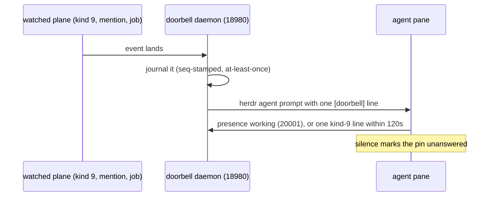

Nothing pushes into an agent's head; agents are woken. Wake is plane D, owned by a dedicated daemon, not by spawn: `doorbell-core` is a pure tick reducer, `doorbell-rt` wires brain, sensors, and sinks, and the `doorbell` daemon listens on a UDS plus `127.0.0.1:18980`. Spawn records a subscription row and defers to a healthy daemon, starting one when `[doorbell]` is configured and none is running (`FLYWHEEL_NO_DOORBELL_ENSURE=1` opts out); only then does an embedded degraded mode run locally, with a WARNING naming the remediation. `flywheel kill` never touches the daemon.



## Honesty rules

- Wake stamps (`last_wake`) come only from real observations: herdr status or delivered prompt pins. Planned injects never forge them.
- One live workspace model per workspace; sends are doorbell-with-inbox; waiters park on `WaitCorr` until a receipt drains them (on ndjson and sweep).
- Budgets 5/30/3 are dispatcher-enforced.
- After `[doorbell]`, publish presence `working` or post one kind-9 line within 120 seconds, or the pin is `unanswered`.
- Journals (v2, rotated, seq-stamped) and subscriptions persist, so pending wakes survive crashes at-least-once.
- `flywheel doorbell why <project> <pin> --seq <n> --corr <id>` folds the tick from default and explains a named wake.

## Hosting (how a subscription becomes a wake)

Subscriptions alone wake nothing — a hosted loop does. The daemon hosts a
Brain loop per `(project, workspace)` from two sources: boot `--host p/w`
pairs (baked into the launchd/systemd unit, so reboots keep them) and
auto-host: every 60s the daemon hosts every subscribed pair it can name
(lease-fenced — it never steals a live writer) and reaps spawn-scoped rows
silent for 7 days. `standby` with zero subscriptions is the only quiet
state; `standby_with_known_workspaces` is degraded and names the arming
verb. `flywheel kill` drops its spawn's rows (lifecycle symmetry);
operator rows outlive swarms. After `doorbell install`, reload the unit
definition (`bootout` + `bootstrap`) or the reboot runs the old hosts.

**A subscription buys you the sweep and an address — not a route.** The
hosted loop unions subscribed identities into the pin set it sweeps and
addresses, so a subscribed pin that was never spawned in the project (the
operator pin is the live case) has its inbox fetched and its mail
classified and journaled like anyone else's.

What a subscription row cannot create is a **pane**: rows carry identity,
scope, filter, sink, and budget — no target. Routing is registry-driven, and
deliberately so: inventing a target for a pane-less pin would fabricate a
delivery the sink cannot perform.

So the index marks such a pin **unroutable**, and its wakes are
**digest-bound**: they never enter the per-pin prompt queue (that queue only
drains on a `working → injectable` status transition, which a pin with no
pane can never produce — a queued wake there would be a RAM-only entry that
dies with the daemon and never reaches you). Instead the wake lands in the
digest batch, and the journal row says why:

```json
{"actions":[{"Digest":{"pin":"QuietHeron","why":"no_route"}}]}
```

Read it with `flywheel doorbell digest <project> --identity <pin>` — the verb
prints the wake line for a `Digest` row, which is the only place it is
rendered (the wake is otherwise readable only by grepping the journal).

`flywheel doorbell why <project> <pin>` does **not** yet replay these rows:
`why` rebuilds each entry by folding the embedded `workspace::tick`, and the
daemon journals its inbox wakes as `InboxFetched`, which has no `workspace::Msg`
counterpart — so the fold skips the row and `why` reports that nothing mentions
the pin. That blindness predates this change and covers the daemon's whole
inbox path, not just pane-less pins; it is filed separately.

To get an actual **prompt** for such a pin you need a real pane to route to
(bind a subscription to a spawned pin) — or the non-herdr sinks (webhook/DM)
that Phase 2 specifies. Until then, digest is the delivery.

So when `why` says nothing about a pin, ask in this order: is the daemon
hosting (`/health`), can it exec its CLIs (`/health.binaries`), is the pin
in the sweep set (`since_by_pin` in `doorbell-wake-<ws>.json`), and is it
subscribed? The journal is the only surface that answers all four.

## What the daemon execs (CLI resolution)

The daemon shells out to `toron` (bus watch + inbox fetch) and `herdr`
(prompt sink). It is normally started by launchd/systemd, whose `PATH` is
`/usr/bin:/bin:/usr/sbin:/sbin` — neither tool is there, and a bare-name
spawn fails as an ordinary child death: the watcher respawns on the retry
gate forever and every inbox fetch audits `toron spawn/timeout failed`,
while `/health` still says `mode: hosted`.

So the daemon resolves both to an absolute path at startup, first hit wins:

1. `PATH`
2. `~/.cargo/bin`
3. `~/.local/bin`
4. beside its own binary (dev checkouts, co-install)
5. `~/.local/share/mise/shims` **last**

Shims go last on purpose: a mise shim is a dispatcher that must infer a
tool version from env and cwd, so under launchd it dies with
`mise ERROR No version is set for shim: toron` — a resolved-looking path
that cannot run. Set `DOORBELL_TORON_BIN` / `DOORBELL_HERDR_BIN` to pin an
explicit binary; an override is used verbatim. `doorbell serve` logs the
resolved pair on startup and `/health.binaries` reports it:

```json
"binaries": { "toron": "/Users/me/.cargo/bin/toron",
              "herdr": "/Users/me/.local/bin/herdr",
              "resolved": { "toron": true, "herdr": true } }
```

### Reading `/health.degraded`

The list is the answer to "why didn't I get woken?", read back from the
plane's own files rather than tracked in RAM, so it survives a restart:

| Value | Means |
|---|---|
| `cli_unresolved` | `toron`/`herdr` not found anywhere above — wakes will not be delivered |
| `inbox_fetch_failing` | an `inbox_error` audit row inside the last 120s: the sweep is failing |
| `watch_restart_loop` | more than ~2× the healthy watcher restart rate in 300s. A **quiet** watcher restarts by design (90s idle-exit + retry gate ≈ every 109s); a handful in five minutes is healthy, dozens is a loop |
| `journal_torn_tail` | the journal has a torn tail; folds stop at the gap |
| `standby_with_known_workspaces` | the daemon is hosting nothing while workspaces that expect rings exist — re-arm it |

## Commands

Verbs live in two places: `flywheel doorbell …` (the operator surface —
status/start/stop/re-inject/afk/digest/why/inject/subscribe) and the
`doorbell` binary itself (the daemon: start/stop/restart/status/install/
serve/migrate/ping).

| Need | Command |
|---|---|
| Lifecycle | `flywheel doorbell status\|start\|stop\|re-inject\|afk` |
| Why | `flywheel doorbell why <project> <pin> --seq <n> --corr <id>` |
| History | `flywheel doorbell digest` |
| Direct ring | `flywheel doorbell inject <project> <pin> "<line>"` (ratcheted, budgeted, digest-visible) |
| Subscriptions | `flywheel doorbell subscribe\|subscriptions\|unsubscribe` (`--project` names the auto-host pair; omitted = never auto-hosted) |
| Cross-workspace | `flywheel doorbell subscribe --workspace wA --pin P --extra wB` (scope printed, never implicit) |
| Always-on | `flywheel daemon start` (flywheel + doorbell daemons in one command); `doorbell install` persists across reboots (launchd/systemd, idempotent); `curl 127.0.0.1:18980/health` shows `mode`, `hosted`, `binaries`, `degraded` |

Cross-project wake is a captain hold: `br hold --kind captain --corr external:<proj>:<bead> <your-bead>` rings once when the foreign bead closes; you still resolve the hold.

A foreign owner on port 18980 fails `doorbell start` loud ("answered by foreign owner, not child <pid>"). That is a port conflict, not corruption: stop the foreign holder or relocate the daemon.
